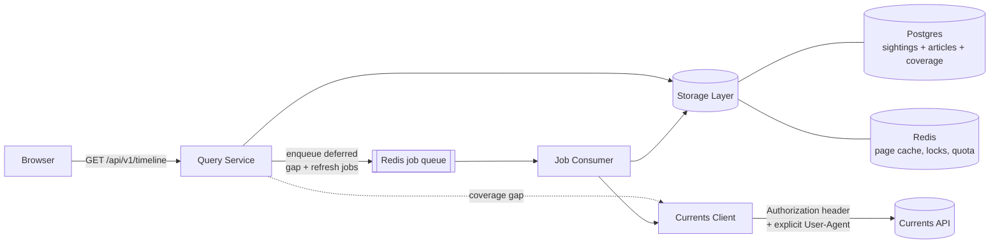

# Zammy — Architectural Proposal

**Status:** Phases 0–5f and 7a built (§13); **deployment moved to Vercel + Supabase + Upstash** ([ADR-0015](adr/0015-all-in-on-vercel-hobby-shaped.md)) · **Scope:** the design; decisions live in ADRs

A news aggregator that takes keywords from a user and returns a time-ordered timeline of headlines
and topic summaries, backed by [Currents API](https://currentsapi.services/en/docs/).

Read alongside: [CONTEXT.md](../CONTEXT.md) for the domain vocabulary — **sighting**, **article**
and **group** are distinct things here, and the differences are load-bearing —
[PROBE-FINDINGS.md](./PROBE-FINDINGS.md) for what the upstream actually does, and [docs/adr/](./adr/)
for decisions and the alternatives they beat.

---

## 1. Goals and non-goals

**Goals**

- Keyword search returning articles newest-first, paged, with stable ordering.
- Cache results: the first searcher of a topic populates it, everyone after reads from storage.
- Accumulate articles over time so a topic's timeline deepens beyond one upstream call — driven by
  actual use, not a scheduled watchlist (§9).
- **A landing-page wordcloud of the storylines the last 24 hours updated** (§10): each word a
  storyline's label, sized by unique articles gained inside the window, coloured by recency,
  clickable to open the storyline it names. The window rolls continuously. Vocabulary: a
  **storyline** is one arc of one event and its **label** names it; a **topic** is a saved canonical
  query. They meet when a search — typed into the box the cloud sits above — turns one into the
  other.
- A clean, fast front end; keywords in, timeline out.

**Non-goals for v1**

- User accounts, saved feeds, notifications.
- A coverage-gap map. `meta.ingest.state` already says whether more may arrive; a per-range gap map
  is a second range structure on the wire for something nobody has asked for. A deliberate no,
  recorded so it is not mistaken for an oversight.
- ~~Multiple upstream news providers~~ — **done** (GNews, 2026-08-17). The seam held: a new adapter
  and a composite, with no change to §6–§8. See §5.6 and ADR-0012.
- LLM-generated topic summaries. The schema reserves a place (§7.2); generation is a later phase.

---

## 2. The upstream constraints that shape everything

All values **empirically verified** against a live Free-tier key (45 calls, 2026-08-04); evidence
and method in [PROBE-FINDINGS.md](./PROBE-FINDINGS.md). Several contradict the OpenAPI spec.

| Property | Verified value |
| --- | --- |
| Base URL | `https://api.currentsapi.services/v1` |
| Auth | `Authorization: <api_key>` header (`?apiKey=` also works) |
| Daily quota | **1000 requests**, resets midnight UTC |
| Burst quota | **60 requests / 60s** |
| `page_size` | supported, **max 20** (Free tier) |
| `page_number` | supported, **1-indexed**; past-end → `200` + empty array |
| **Max retrievable results** | **100 per query** (5 pages) |
| **Max lookback** | **30 days**, and the edge MOVES (see below) |
| **Max date range per call** | **7 days** (drift: observed 2026-08-11; the 2026-08-04 probe's single 30-day call now 400s — `date_range: Max range is 7 days`) |
| **`start_date`/`end_date` bounds** | **both INCLUSIVE** — a closed `[start, end]` interval, honoured to the second (PROBE §6e) |
| Default sort | `published` DESC (undocumented, but consistent and page-stable) |
| `domain` | supported |
| `offset`, `sort_by` | silently ignored — no sort control exists |
| Unknown params | silently ignored |

**The lookback edge cannot be sat on.** 30 days back from *now*, and `now` is theirs, not ours.
A request whose `start_date` is exactly the boundary is rejected — observed in production
2026-08-26 (`dpl_GJ9xwKPDw9J7ZQDNpwqpmyMpeHfv`), on the oldest segment of a cold search, as
`400 date_range: Max lookback is 30 days`. Three things push a boundary value out of the window
after we compute it, all in the same direction: the wire format is second-precision so encoding
FLOORS the timestamp by up to 999ms; the request itself takes up to 24.6s across retries, all
re-sending a start date computed before the first attempt; and any clock skew narrows their window
against ours. So nothing aims at the edge: `LOOKBACK_PLAN_SLACK_MS` (15 min) holds the planner off
it, and `LOOKBACK_CLAMP_MARGIN_MS` (60s) holds the pre-flight clamp off it. The cost is the oldest
fifteen minutes of a 30-day window, never fetched; it ages out before any later read could plan it.

**Slack alone is not enough, and a bigger constant would be worse than the 400.** No fixed number
bounds the delay between planning a segment and fetching it: `DRAIN_MIN_AGE_MS` equals the message
TTL exactly, so the drain route only ever touches entries that have already consumed the whole
slack, and `onTruncated` re-enqueues remainders under a fresh TTL that keep the original lower edge.
Left there, the clamp in `clampSearchParams` would silently narrow the request and `fillSegment`
would record coverage for the span it *asked* for — days marked fetched that nobody fetched, with
no error anywhere, which is the failure the per-call range ceiling refuses to permit by throwing.
So `processSegmentJob` re-clamps against the live horizon at FETCH time and fills the clamped span;
a job that sank entirely below the edge records nothing at all. The slack is a latency
optimization; the fetch-time clamp is the correctness mechanism.

**Rate-limit headers are present on every response** — `x-ratelimit-limit`, `-remaining`,
`-burst-limit`, `-burst-remaining`, `-reset-time` — so quota can be *observed* rather than guessed
(§5.4).

Five consequences drive the whole design:

1. **Deduplication is load-bearing, not cosmetic.** Upstream re-ingests frequently-updated pages as
   new articles — same URL and title, distinct UUIDs, minutes apart. Measured: **100 articles, 100
   unique ids, only 42 unique URLs**, one link-roundup post appearing **50 times**. Untreated, over
   half the timeline is one repeated post. This reshapes §7 and §8.
2. **Effective depth is ~40 unique articles per query, not 100** — the 100-result cap combined with
   ~58% duplication.
3. **Window slicing is essential** — not for ordering (paging exists) but to get *past the
   100-result cap*: the only way to retrieve more than ~40 unique articles is to subdivide the time
   window and query each sub-window (§6.3).
4. **Relevance cannot be reproduced locally.** Matching runs against full body text the response
   never includes (only 7 of 20 `climate` results contained the word in `title`/`description`), so
   a local full-text index would return a *different* set and can never substitute for an upstream
   call (§7.2).
5. **Quota is genuinely tight.** At 1000/day, one topic's 30-day backfill (~150 calls) is 15% of the
   budget. Backfill must be lazy, prioritized and explicitly budgeted (§9).

Data-shape hazards the client must absorb — all confirmed live:

- `published` is `"2026-08-04 20:45:56 +0000"` — **not** ISO-8601; `new Date()` is unreliable on it.
- `image` is often the literal string `"None"` (5 of 40 sampled).
- `keywords` must be **space-joined**; comma-joining returns **0 results**.
- Responses include `source_category`, absent from the spec.
- `401` and `400` bodies do **not** match the spec's `ApiResponse` shape (§5.3).
- Reference endpoints return name→code *maps*, not arrays, with typos in five of the 102 names
  (`"Vietnamise"`, `"United State"`, `"German"`, `"Gahana"`, `"Indonedia"`) — use the values, never
  derive codes from names, and draw a picker's names through `repairedRegions` /
  `repairedLanguages` (PROBE-FINDINGS 6a). Categories include junk values (`crap`, `notsure`,
  `redundant`) to filter from any user-facing picker.
- The spec names the link field `urls` while responses use `url`; tolerate both. `id` is a UUID
  string despite the spec's `integer`.
- **Cloudflare returns `403` (`error code: 1010`) to default library User-Agents.** Every call must
  send an explicit `User-Agent`, and a `403` must never be reported as an auth failure (§5.3).

---

## 3. System context



The four components the brief asks for map to: **Currents Client** (§5), **Query Service** (§6),
**Storage Layer** (§7), **Front End** (§8). The **Job Consumer** (§9) has no schedule — every arrow
into it originates from a user request, so upstream spend tracks real demand.

---

## 4. Stack and repo layout

TypeScript end-to-end, pnpm workspaces: one language, one toolchain, and the article/query contract
is a shared type rather than a document that drifts.

```
zammy/
├── packages/
│   ├── shared/            # wire contract ONLY — what ships to the browser (ADR-0004)
│   ├── config/            # server-only env validation; holds the API key
│   ├── currents-client/   # Component 1 — upstream SDK, zero app knowledge
│   └── storage/           # Component 3 — schema, migrations, the collapse (§7.4),
│                          #   keyset timeline reads (§7.3)
├── apps/
│   ├── api/               # Component 2 — Fastify. HTTP surface, query planning,
│   │                      #   in-process job consumer (§9.1), the cloud's read (§10)
│   ├── worker/            # Component 5 — only if ingestion load justifies splitting it out
│   └── web/               # Component 4 — React + Vite, timeline + wordcloud
├── fixtures/              # real captured upstream payloads — regression basis (§12)
├── docs/ARCHITECTURE.md
└── docker-compose.yml     # postgres + redis for local dev
```

Runtime choices: **Fastify** (schema-first, fast JSON), **Zod** (one schema validates the HTTP
request *and* generates the TS type), **Kysely** for typed SQL — deliberately not an ORM, because
§7.3's keyset pagination and the `tstzrange` coverage query are hand-written SQL
([ADR-0003](adr/0003-kysely-and-hand-written-sql-instead-of-an-orm.md)). Migrations use Kysely's
`Migrator` and run as a discrete deploy step, never on boot.

### 4.1 Deployment target — Vercel + Supabase (ADR-0015); local development on Docker Compose

**Decided 2026-08-22 (ADR-0015):** the target is Vercel + Supabase + Upstash, Hobby-shaped —
Plan A of RESEARCH-VERCEL-SUPABASE, scoped and priced in
[VERCEL-ALL-IN-SCOPE.md](VERCEL-ALL-IN-SCOPE.md), whose §1 topology table is the deployment map.
Vercel + Supabase + Upstash is now the only deployment target; the earlier AWS and Oracle Cloud
plans are superseded. Moving between targets has always been an infrastructure rewrite, not an
application rewrite.

Docker Compose is the **local development
environment**, not a deployment target — the same source and the same environment-variable-driven
config run in both, differing only by the values. **The api's container image itself does not**:
`apps/api/Dockerfile` exists for Compose, but Vercel builds straight from source (`vercel.json`'s
`buildCommand` is plain `pnpm build`) and never touches it — a container-image rehearsal was a
property of the earlier AWS/OCI persistent-host plans, not of Vercel. No code path may branch on
environment; the moment one does, local development stops predicting production.

The two places local and production genuinely differ, needing explicit configuration:

- **`web`'s API origin** — the browser fetches `/api/v1/*` relative (api.ts), served by a Vite
  dev-server proxy locally and by the single Vercel project's own origin in production. Same-origin
  is deliberate — no CORS preflight, no build-time base URL — and is what the single-project layout
  (VERCEL-ALL-IN-SCOPE §1.1) exists to protect.
- **CORS** — pinned per environment (§12), never a permissive default.

**The scale-to-zero question resolved the other way.** Vercel Functions suspend between requests,
so the **in-process consumer (§9.1) is not viable in production**: it moves behind the same
`IngestQueue` surface to a Vercel Queues push consumer (VERCEL-ALL-IN-SCOPE §3.2), and `buildApp`
splits so a request instance never starts a consumer. In-process remains exactly right for Compose
— and would be again on any persistent host, which is why the seam is a constructor option, not a
fork.

**Production requirements that Compose usefully exercises early:**

- **At-least-once queue delivery** (BullMQ here; a hosted topic's own contract on Vercel). Instances
  are recycled on every deploy and scaling event; a naive `LPOP` loses whatever the dying one held.
  `docker compose down` and laptop sleep reproduce exactly that — and this is the deployment where
  the semantics are still *asserted* rather than trusted, which is why the driver stays (§9.1).
- **Graceful SIGTERM handling** — `docker compose down` sends SIGTERM, so the drain path is
  exercised constantly in development.
- **Redis-backed coordination** — quota governance (§5.4), single-flight locks (§6.3), the
  breadth-sample lock (§10.1). No-ops at one replica, essential at two or more Fargate tasks.
  Building them in from the start costs almost nothing; retrofitting concurrency control does not.

**Local development specifics:**

- **Fixture-backed offline mode.** `CURRENTS_MODE=fixture` serves recorded payloads from
  [`fixtures/`](../fixtures), so most development and the entire test suite cost zero quota — at
  1000/day, closer to a requirement than a convenience.
- **The API key lives in a gitignored `.env`**, read through the same Zod config validation as every
  other setting (§12). It must never reach the `web` bundle; the browser only talks to our API.
- **Intermittent uptime is fine.** A laptop off for a week leaves coverage gaps the next reader
  repairs (§6.4), bounded by the 30-day lookback. Nothing needs to run continuously — a direct
  benefit of demand-driven ingestion (§9.2).
- Modest memory limits on the Postgres and Redis containers; the dataset is a few hundred MB at
  90-day retention.

**What the Vercel move requires** is scoped and phased in VERCEL-ALL-IN-SCOPE §3 and §9: the
`buildApp` split, the queue reimplementation, the chores route, the Redis quota governor and
rate-limit store, config, and a CI migration step (ADR-0003's discrete `Migrator` step survives as
CI, since Vercel has no post-deploy hook). If Hobby's ceilings are outgrown, ADR-0015 names Vercel
Pro as the next tier, not a re-architecture.

---

## 5. Component 1 — Currents API client (`packages/currents-client`)

A thin, testable SDK. It knows HTTP and the Currents contract; nothing about our cache, database, or
front end. The only place in the system where the upstream's quirks exist.

### 5.1 Surface

```ts
interface CurrentsClient {
  search(params: SearchParams, opts?: CallOpts): Promise<SearchResult>;
  latestNews(language?: string): Promise<SearchResult>;
  availableLanguages(): Promise<Record<string, string>>;
  availableRegions(): Promise<Record<string, string>>;
  availableCategories(): Promise<string[]>;
}

type SearchParams = {
  keywords?: string; language?: string; country?: string; category?: string;
  domain?: string; startDate?: Date; endDate?: Date;
  pageNumber?: number;              // 1-indexed
  pageSize?: number;                // clamped to MAX_PAGE_SIZE (20 on Free)
};

type SearchResult = {
  sightings: Sighting[];
  requestedAt: Date;
  isLastPage: boolean;              // articles.length < pageSize
  quota: QuotaSnapshot;             // parsed from x-ratelimit-* headers
};
```

`keywords` is space-joined by the client regardless of how callers supply terms — comma-joining
returns zero results (§2), exactly the kind of upstream trap that belongs here and nowhere else.

### 5.2 Normalization — the client's most important job

Every article is normalized once, at the boundary, so nothing downstream sees an upstream quirk:

- **`published` → `Date`.** Explicit parse of `YYYY-MM-DD HH:MM:SS ±ZZZZ`, not `new Date()`.
  Unparseable timestamps are the one case we **drop with a warning metric** rather than default to
  "now" — a wrong timestamp silently corrupts the timeline, the product's core promise.
- **`image`** → `string | null`; literal `"None"`, empty string, and unparseable values become
  `null`. Protocol-relative URLs get `https:`.
- **`url`/`urls`** → single canonical `url`; also derive `sourceDomain` (registrable domain) — the
  front end's source chip and a cheap grouping key.
- **`category`** → always `string[]`, lowercased.
- Whitespace-collapse `title`/`description`; drop articles with no `title` or no `url`.

### 5.3 Reliability

- **Mandatory `User-Agent`** (§2). Set explicitly, always.
- **Timeouts:** per-request deadline (default 8s) via `AbortSignal`. Observed p50 ~700ms.
- **Retries:** max 2, exponential backoff with full jitter, on `429`, `5xx`, and network errors
  only. Never retry other `4xx` — those are our bug, and each retry costs quota.
- **Typed errors**, each mapping to a distinct degradation behaviour (§11):

  | Error | Trigger |
  | --- | --- |
  | `CurrentsAuthError` | `401` `{"status":"401","msg":"Invalid token"}` |
  | `CurrentsBlockedError` | `403` with non-JSON body (Cloudflare `1010`) — **not** an auth failure |
  | `CurrentsInvalidQueryError` | `400`; carries the parsed `details.errors` field→message map |
  | `CurrentsQuotaError` | `429`, or local pre-flight refusal |
  | `CurrentsUpstreamError` / `TimeoutError` / `SchemaError` | `5xx` · deadline · unparseable body |

  `400` bodies name the exact violated limit (e.g. `{"page_size": "Max page_size for Free tier is
  20"}`); surfacing that verbatim in logs turns tier-limit mistakes into one-line diagnoses.
- **Circuit breaker:** after N consecutive failures, open for a cooldown and fail fast; the Query
  Service serves stale data rather than waiting on a doomed call.
- **Response validation:** parse `{status, news[]}` with Zod, tolerating unknown fields.
  `status: "error"` under HTTP 200 is a failure.

### 5.4 Quota governance

Every call is **pre-flight checked** against a per-provider budget and refused locally when
exhausted — cheaper than earning a real `429`, which spends a request to learn something already
known. Where the budget's numbers come from differs per provider:

- **Observed.** Currents returns `x-ratelimit-*` on every response, so its budget is read rather
  than guessed — and accounts for spend by *any* client sharing the key.
- **Counted.** GNews returns no rate-limit headers and reports an exhausted day as a `403`. Its
  budget is counted locally, corrected only when that `403` arrives (ADR-0012).

An absent observation means "no new information", never "no limit".

> **Status: the burst half is built, the daily half is deferred.** `RedisQuotaGovernor`
> (`apps/api/src/quota-redis.ts`, VERCEL-ALL-IN-SCOPE §3.4) holds two keys per provider:
> `quota:<provider>:burst`, a sorted set of call timestamps that gives every instance ONE sliding
> window instead of one each, and `quota:<provider>:observed`, the last `{ limit, remaining,
> burstLimit, burstRemaining, resetTime, observedAt }` reading, written where a cold instance can
> read it. Both degrade to `InProcessQuotaGovernor` when Redis is unreachable — a cache outage
> costs the shared ceiling, never the call.
>
> **The day-rolling ledger is not built**, deliberately: its only real customer is a provider that
> reports no headers, and Currents self-corrects its daily count from headers one call after each
> cold start. So the daily budget and the interactive reserve are still counted in-process, and
> **enabling GNews requires building the ledger first** — that deferral and the `GNEWS_ENABLED=false`
> default are one decision. See §13, "Designed but unbuilt".

Two governors per provider, because the limits have different shapes:

- **Burst:** a short-window counter. The window differs — 60/60s on Currents, 1/s on GNews Free —
  so its length is configured per provider, not just its size.
- **Daily** (midnight UTC): the strategic budget, split into an **interactive reserve** and a
  **worker allowance**. The worker may only draw while `remaining > INTERACTIVE_RESERVE`, so
  backfill can never starve a live search. Sized per provider, proportionally: 250 of Currents
  Free's 1000, 25 of GNews Free's 100 — one shared number would silently make the smaller provider
  interactive-only.

Limits are read from a provider where reported, but always *bounded* by config: a plan upgrade is a
config change and a missing header never means "unlimited".

### 5.5 Secrets

`CURRENTS_API_KEY` and `GNEWS_API_KEY` are server-side only, injected by env; the front end talks
exclusively to our own API. Each is redacted from all logs, error messages, and `redactConfig` — a
provider added without adding its key to that list leaks it into the first startup log line.

### 5.6 A second provider

`search()` returning `Sighting[]` was the seam for a second provider. GNews went in behind it on
2026-08-17 and the prediction held: a new adapter, a `provider` column, nothing in §6–§8 changed.
The component is now four packages:

| Package | Knows |
| --- | --- |
| `@zammy/news-client` | No provider. The `Sighting` shape, the error taxonomy, URL canonicalization and the dedup key, quota governance, the breaker, pre-flight clamping, the retrying HTTP transport, the pager. |
| `@zammy/currents-client` | Currents only. `{status, news[]}`, `"2026-08-04 20:45:56 +0000"`, `"None"` images, `url`/`urls`, `x-ratelimit-*`, the Cloudflare 403, two API versions, the v2 taxonomy. |
| `@zammy/gnews-client` | GNews only. `X-Api-Key`, `{totalArticles, articles[]}`, ISO-8601, no rate-limit headers, a 403 that means *quota*, no article categories. |
| `@zammy/news-providers` | How many providers there are. The composite, and the factory `apps/api` calls. |

**The taxonomy is shared; the mapping is not.** The same status code means different things per
provider (403: Cloudflare ban vs spent budget), so each adapter owns its `mapErrorResponse`, and
nothing downstream may branch on a status code. Same for quota: Currents *observed*, GNews *counted*.

**The two providers are not equals**, and the asymmetry is load-bearing. `topic_coverage` is written
when `isLastPage` comes back true (§6.3); a combined end-of-results signal would let a supplement
that ran out of budget mid-window contribute to coverage over days nobody fetched — permanent and
silent, no error, no retry. Therefore:

- **Currents is coverage-bearing.** `isLastPage` is its answer alone; its failures propagate. Every
  §6–§8 invariant holds exactly as before GNews existed.
- **GNews is best-effort breadth.** Its articles merge in when they arrive; its errors, sit-outs and
  exhaustion never fail a call and never end a walk. Each is reported in `adjustments`, a warn log,
  and `/readyz.upstream.providers`.

Accepted cost: GNews coverage is opportunistic, so a GNews-only article inside an already-covered
span may never be fetched. Per-provider coverage is the eventual fix. Reasoning: ADR-0012; code:
`packages/news-providers/src/composite.ts`.

Two consequences worth knowing before a third provider:

- **Limits narrow to the strictest.** Every provider is asked the same `pageNumber`/`pageSize`, so
  the composite intersects limits. Enabling GNews Free drops the shared page size from 20 to 10 —
  Currents pays twice the calls for the same window. Deliberate: per-provider page sizes silently
  under-cover, because page 2 then means different items to each provider.
- **A provider that cannot express a query sits it out.** GNews `/search` has no category or domain
  filter, so a category-scoped topic is refused locally rather than answered unfiltered.

---

## 6. Component 2 — Query Service (`apps/api`)

Accepts front-end requests and turns them into the right upstream query — or, ideally, none.

### 6.1 Public HTTP surface

| Endpoint | Purpose |
| --- | --- |
| `GET /api/v1/timeline` | The main read. Keywords + filters → time-ordered page of articles. |
| `GET /api/v1/reference` | Cached `/available/*` values, for front-end filter controls. |
| `GET /api/v1/topics/:fingerprint` | Topic metadata: coverage window, article count, freshness, summary. |
| `POST /api/v1/storylines/:id/refresh` | Fire-and-forget: queue one background top-up of what this arc's coverage says (§9.1, ADR-0017). A UUID is the whole request — the keywords and the language are derived from the arc, never sent. 202 with `{ queued }`; nothing on the page reads it. |
| `GET /healthz` · `GET /readyz` | Liveness, and dependency checks for Postgres/Redis/upstream. |

`GET /api/v1/timeline` request:

```
q          string   required   raw keyword input, ≤200 chars
language   string   optional   defaults to DEFAULT_LANGUAGE (en); validated against
                              cached /available/languages. Omitting it upstream returns
                              every language mixed together, so "all" is an explicit
                              choice, never the accident of leaving a field unset.
country    string   optional   validated against /available/regions
category   string   optional   validated against /available/categories
from, to   ISO-8601 optional   timeline window
cursor     opaque   optional   keyset cursor from a previous response
limit      int      optional   default 25, max 100 — a CEILING, not a promise (§6.5)
storyline  uuid     optional   the STORYLINE VIEW (ADR-0011): the timeline filtered to
                              one storyline, alias-resolving. Carries no keywords —
                              `q` is optional only for this — because the view's
                              search box is empty by definition, and typing exits it.
                              NOT part of the fingerprint; it has no topic at all.
```

Response:

```jsonc
{
  "topic":  { "fingerprint": "…", "keywords": ["…"], "coverage": { "from": "…", "to": "…" } },
  "items":  [ /* Article, published DESC */ ],
  "page":   { "nextCursor": "…|null", "hasMore": true },
  "meta":   {
    "servedFrom": "cache|store|upstream",
    "asOf": "…", "stale": false, "degraded": null,
    "ingest": { "state": "complete|in_progress", "pendingJobs": 4 }
  }
}
```

`meta` is part of the contract, not a debug extra: the front end uses `stale` and `degraded` to
render honest freshness state (§8.3).

`meta.ingest` and `page.hasMore` answer **different** questions and both are required:

- `hasMore` — more rows exist *past your cursor in our store*.
- `ingest.state` — more rows may still *arrive from upstream* for this window.

"You've reached the end" requires `hasMore === false` **and** `ingest.state === "complete"`.
Conflating them would tell users "that's everything" while a job is still running — the exact bug
progressive delivery invites.

### 6.2 Request → canonical query → fingerprint

Every request is reduced to a **canonical form** first, so trivially different requests reuse the
same cache entry and the same accumulated topic:

1. **Validate** with Zod; reject unknown/oversized input with `400` and a field-level message.
2. **Normalize keywords:** trim, collapse whitespace, casefold, NFKC-normalize, de-duplicate, sort
   deterministically, cap term count. `"  Climate   POLICY "` and `"policy climate"` converge.
3. **Validate filter values** against the cached reference lists — catching a bad `language` locally
   instead of spending a quota token upstream.
4. **Snap the window.** `from`/`to` round outward to a 15-minute grid. Unsnapped `to = now` would
   make every request a unique cache key and defeat caching entirely.
5. **Fingerprint** = `sha256(canonical JSON of {keywords, language, country, category})`. The window
   is *excluded* — a topic is a durable entity; the window is a view onto it. This is what lets an
   older and a newer request contribute to one accumulating timeline.

The canonicalizer is a pure function — the single easiest and highest-value unit-test target in the
system.

### 6.3 Query planning — how a page gets filled

The component's real work. Paging exists but caps at **100 results per query**, only ~40 unique
(§2); slicing the time window is how we get past that ceiling.

```
1. Redis: page cache hit for (fingerprint, window, cursor, limit)?   → serve, done. No upstream call.
2. Postgres: is the requested window fully inside this topic's recorded coverage (§7.3)
   and recent enough per §6.4?                                       → serve from store, done.
3. Otherwise compute the coverage GAP = requested window − covered ranges,
   clamped to the last 30 days (beyond that upstream 400s — never spend a call to learn this),
   and SLICED to CURRENTS_MAX_RANGE_DAYS (7) per segment, newest first — upstream now rejects
   wider single calls (§2 drift, 2026-08-11), so every planned segment must be individually
   fetchable. The client refuses over-range requests locally as a backstop; it never clamps
   them, because coverage is recorded for the span that was ASKED, and a silently narrowed
   fetch would become coverage over days nobody fetched.
4. Plan a bounded set of upstream calls per gap segment:
     - page through the segment (page_number 1..5, page_size 20) until a page returns
       fewer than page_size rows, which is the clean end-of-results signal;
     - if a segment yields a FULL 5 pages, it is truncated by the 100-cap — but those
       pages are not wasted: record coverage from the OLDEST SIGHTING SEEN (plus 1ms,
       excluding the frontier instant in case of ties beyond the cap) to the segment
       end, and enqueue only the remainder. Every 5 calls advance the frontier ~100
       articles with nothing refetched. Halve-and-enqueue survives only as the
       fallback for a frontier that cannot advance (a timestamp pileup),
       depth-limited at the 1h floor.
5. Execute only as much of the plan as fits a WALL-CLOCK DEADLINE (default 1200ms),
   with a floor of 1 call and a ceiling of 5. Everything unfinished is enqueued (§9).
6. Dispatch through the client (quota-governed, single-flighted). Upsert results and
   collapse them into articles (§7.4), extend recorded coverage, then answer from Postgres
   — never from the raw upstream response, which is neither deduplicated nor guaranteed
   ordered across our own sliced calls.
```

**The synchronous budget is a deadline, not a call count.** Bounding calls bounds a proxy for what
users feel; bounding wall-clock time bounds the thing itself. At ~700ms per observed call, the
default admits one call reliably, a second when upstream is fast, then defers — a cold search paints
in well under a second instead of ~3.5s.

**Window bounds are half-open everywhere we own; upstream's are not.** Every window we own —
requested, segment, recorded coverage — is **half-open `[from, to)`**: `>= from`, `< to`. One
convention, stated once, so segment seams cannot be reasoned about two ways. `tstzrange` defaults to
`[)` (§7.2), so Postgres agrees for free.

Upstream's `start_date`/`end_date` are both *inclusive* (§2, PROBE §6e), so asking for `[A, B)`
returns the article published exactly at `B`. That surplus row is deliberately left alone — the
mismatch resolves in the safe direction:

- The seam instant is **fetched twice** across adjacent segments, and `ON CONFLICT (id) DO NOTHING`
  (§7.4) makes the second sighting a no-op.
- Coverage is recorded as `[A, B)`, so `B` is never marked covered by the segment that merely
  overlapped it — a later request touching `B` re-fetches rather than trusting coverage it does not
  have.

The inverse pairing would have bitten: exclusive upstream bounds under inclusive recorded coverage
would leave the seam article unfetchable while coverage claimed the instant — a silent hole, real
data loss reporting no error. The probe ruled it out; the convention keeps it ruled out. **Do not
"fix" the duplicate by recording closed coverage** — that trades a free no-op for that hole.

Two further subtleties, both from probe data:

- **A full page-5 means "truncated", not "finished".** Treating it as complete would silently and
  permanently hide history behind the 100-cap.
- **Adaptive subdivision must be depth-limited** (minimum 1h segment), or a pathologically dense
  keyword recurses until it consumes the whole daily quota.

**Single-flight** is essential: N concurrent users searching a trending keyword must produce **one**
upstream call. A Redis lock `lock:refresh:<fingerprint>:<segment>` with a short TTL elects one
fetcher; losers wait briefly or serve stale immediately. With a 60/60s burst limit this is a hard
requirement, not an optimization.

### 6.4 Staleness tiers and refresh-on-read

A recent-news window needs re-checking far more often than last month's:

| Requested window ends | Considered fresh for |
| --- | --- |
| within last 1h | 60s |
| within last 24h | 10m |
| older than 24h | 24h (historical data does not change) |

Serve-stale-while-revalidate throughout: a stale hit returns immediately with `meta.stale = true`
and **enqueues an incremental top-up** — a single call for the window since `max(coverage.upper)`.

Refresh-on-read applies to slivers up to the per-call range ceiling (§2 drift). A wider trailing gap
is missing *history*, not staleness — the reader gets a synchronous fill of the newest slice, and
the remaining slices queue as usual.

This mechanism replaces scheduled polling (§9): freshness is repaired **by the next reader**, not by
a clock. Cost scales with readership rather than watchlist size, which is what fits a 1000/day
budget.

### 6.5 Progressive delivery — paint page 1, fill the rest behind it

A cold search returns as soon as the first upstream call lands and is persisted; pages 2..5 and any
subdivisions arrive via the queue. Four consequences that have to be designed, not discovered:

**1. `limit` becomes a ceiling.** One upstream call is 20 raw sightings, which after collapsing may
be as few as **6** (measured — probe page 4 collapsed 20 → 6). A `limit=25` request can legitimately
return 6 items. The response must not pad, must not block to fill, and must signal
`ingest.state: "in_progress"` so a short list reads as "still arriving" rather than "that's all".

**2. Reads never block on the ingestion lock.** User B arriving mid-ingestion gets whatever is in
Postgres plus `ingest.state: "in_progress"`. The single-flight lock (§6.3) deduplicates *upstream
calls*, not *readers* — a naive implementation would make B wait on A's lock and turn a shared cache
into a queue.

**3. Late arrivals append downward — where the reader is going.** Deferred pages 2..5 contain
*older* articles than page 1, so the reader scrolling toward older content meets them head-on, and
keyset pagination (§7.3) picks them up with no duplicates or skips. Refresh-on-read (§6.4) is the
opposite case — articles *newer* than displayed — and those must **never** be silently spliced in
above a reading user: they surface as an explicit "N new articles" affordance, applied on click. One
gap in that absolute, recorded rather than closed (§8.1): the gate holds back whole SLOTS, so an
article a poll adds to a slot already on screen still reaches the rail, where it can draw a card of
its own in a part of the day above the reader, or take the headline of a card already there.

**4. Delivery is polling, not streaming.** While `ingest.state === "in_progress"` the client
re-requests the first page (~1.5s interval) and stops on `complete`. In TanStack Query that is a
conditional `refetchInterval`. SSE would be smoother but adds long-lived connections, proxy
buffering, and reconnect logic for a window typically 2–4 seconds long; the contract (`meta.ingest`)
doesn't change, so SSE stays a contained upgrade. Bounded: the client gives up after
`INGEST_POLL_MAX` attempts (default 8) and simply stops polling — no error, no manual retry
affordance; the last page just stays at `ingest.state: "in_progress"`.

---

## 7. Component 3 — Storage layer (`packages/storage`)

Two tiers with distinct jobs: Redis makes repeat reads free; Postgres makes the timeline *exist*.

### 7.1 Redis (ephemeral)

| Key | Contents | TTL |
| --- | --- | --- |
| `page:v<shape>:<fingerprint>:<windowHash>:<cursor>:<limit>` | serialized response page | per §6.4 tier |
| `ref:languages` \| `ref:regions` \| `ref:categories` | reference lists | 24h |
| `lock:refresh:<fingerprint>:<segment>` | single-flight election | 10s |
| `<queue>:lock:sample:<language>` | breadth-sample enqueuer election (§10.1) | `SAMPLE_REFRESH_MINUTES` |
| `budget:topic:<fingerprint>:<utcDay>` | per-topic daily call cap (§9.4) | 48h |
| `quota:<provider>:burst` | shared sliding burst window, a sorted set of call timestamps (§5.4) | one burst window |
| `quota:<provider>:observed` | last `x-ratelimit-*` reading, `<observedAtMs>\|<json>` (§5.4) | 24h |
| `ratelimit:<ip>` | per-IP request counter (§9.4) | `timeWindow` |
| `ingest:pending:<queue>:<pendingId>` | the ledger `meta.ingest` reads (§6.1) | pruned at `STALE_PENDING_MS` |

Redis is **pure cache**: a total flush costs latency and quota, never correctness. Nothing lives
only in Redis. **That still holds for the two rows that look like exceptions.** The burst window and
the rate-limit counter are the only shared *enforcement* state here, and both fail OPEN — losing
them costs the deployment-wide ceiling and degrades to per-instance counting, never a refused call
(§11). The circuit breaker is in-process, in `@zammy/news-client`, and has never had a key here.

### 7.2 Postgres (durable)

Table names are the vocabulary: a **sighting** is one upstream emission, an **article** is the real
story ([CONTEXT.md](../CONTEXT.md),
[ADR-0002](adr/0002-articles-are-deduplicated-stories-sightings-are-emissions.md)).

```sql
-- One row per upstream emission. The faithful record of what we were sent.
-- Upstream re-emits the same story under fresh UUIDs — one link-roundup page
-- arrived 50 times in 100 results — so a row here is an observation, not a story.
CREATE TABLE sightings (
  id            uuid PRIMARY KEY,              -- upstream id; unique per emission
  article_id    bigint NOT NULL REFERENCES articles(id) ON DELETE CASCADE,
  dedup_key     bytea NOT NULL,                -- sha256(canonical url); NOT unique here
  published     timestamptz NOT NULL,
  first_seen_at timestamptz NOT NULL DEFAULT now(),
  raw           jsonb NOT NULL                 -- original payload; re-normalize without refetching
);
CREATE INDEX sightings_article_idx ON sightings (article_id);
CREATE INDEX sightings_dedup_idx   ON sightings (dedup_key);

-- One row per real-world story. This is what the timeline pages over and what
-- anything countable counts. Display fields are denormalized from the earliest
-- sighting so a timeline read needs no join back to sightings.
CREATE TABLE articles (
  id              bigint GENERATED ALWAYS AS IDENTITY PRIMARY KEY,
  dedup_key       bytea NOT NULL,              -- sha256(canonical url); the PRIMARY identity
  -- Fallback identity: sha256(source_domain, folded title, UTC day), consulted
  -- only when dedup_key matches nothing (ADR-0018). NULL = identified by URL
  -- alone, which is what every row was before it existed.
  alt_key         bytea,
  url             text NOT NULL,
  title           text NOT NULL,
  description     text,
  author          text,
  image_url       text,
  language        text,
  categories      text[] NOT NULL DEFAULT '{}',
  source_category text[] NOT NULL DEFAULT '{}',-- undocumented upstream field, kept verbatim
  source_domain   text,
  published       timestamptz NOT NULL,        -- EARLIEST sighting; this article's place in time
  latest_seen     timestamptz NOT NULL,        -- most recent sighting
  sighting_count  int NOT NULL DEFAULT 1,
  -- Grouping (§14.3). group_id is the SEED article's id — self for a group of
  -- one, supplied by a BEFORE INSERT trigger so no writer can omit it. No FK:
  -- a dangling seed must degrade a group to loose members, never block a delete.
  group_id        bigint NOT NULL,
  group_published timestamptz NOT NULL,        -- MIN(published) over the group; the timeline axis
  title_tokens    text[] NOT NULL DEFAULT '{}' -- headline tokens; what candidates match on
);
CREATE UNIQUE INDEX articles_dedup_key_idx     ON articles (dedup_key);
CREATE UNIQUE INDEX articles_alt_key_idx       ON articles (alt_key) WHERE alt_key IS NOT NULL;
CREATE INDEX        articles_timeline_idx      ON articles (published DESC, id DESC);
CREATE INDEX        articles_group_timeline_idx ON articles (group_published DESC, group_id DESC);
CREATE INDEX        articles_group_idx         ON articles (group_id);
CREATE INDEX        articles_title_tokens_idx  ON articles USING gin (title_tokens);

CREATE TABLE topics (
  fingerprint   bytea PRIMARY KEY,
  keywords      text[] NOT NULL,
  language      text, country text, category text,
  summary       text,                          -- reserved: topic summary, later phase
  summary_at    timestamptz,
  created_at    timestamptz NOT NULL DEFAULT now(),
  last_hit_at   timestamptz NOT NULL DEFAULT now(),  -- drives worker prioritization + retention
  hit_count     bigint NOT NULL DEFAULT 0
);

-- Topic membership is recorded per ARTICLE, so a topic's timeline cannot be
-- flooded by one repeatedly-re-emitted post.
CREATE TABLE topic_articles (
  fingerprint bytea  REFERENCES topics   ON DELETE CASCADE,
  article_id  bigint REFERENCES articles ON DELETE CASCADE,
  PRIMARY KEY (fingerprint, article_id)
);

-- Which time windows have actually been fetched for a topic, by which provider.
-- This is what makes "do I need an upstream call?" an exact question instead of
-- a guess. `provider` defaults to 'currents' because until migration 0021 that
-- was the only thing that had ever written here (ADR-0012).
CREATE TABLE topic_coverage (
  fingerprint bytea REFERENCES topics ON DELETE CASCADE,
  provider    text NOT NULL DEFAULT 'currents',
  span        tstzrange NOT NULL,
  fetched_at  timestamptz NOT NULL DEFAULT now()
);
CREATE INDEX topic_coverage_gist ON topic_coverage USING gist (fingerprint, span);

-- The same question about a different subject: what a provider has fetched for
-- one persistent arc (ADR-0011). The deepening plane's unit of coverage is a
-- storyline, not a search, and it writes HERE and nowhere else — which is what
-- makes it structurally unable to manufacture topic coverage (ADR-0012).
CREATE TABLE storyline_coverage (
  storyline_id uuid REFERENCES storylines ON DELETE CASCADE,
  provider     text NOT NULL,
  span         tstzrange NOT NULL,
  fetched_at   timestamptz NOT NULL DEFAULT now()
);
CREATE INDEX storyline_coverage_gist ON storyline_coverage USING gist (storyline_id, span);

CREATE TABLE fetch_log (                       -- quota accounting + observability
  id bigserial PRIMARY KEY, fingerprint bytea, params jsonb,
  requested_at timestamptz NOT NULL, duration_ms int,
  http_status int, sighting_count int, error_kind text
);
```

`topic_coverage` is the load-bearing idea. Coverage gaps are a range-difference query; adjacent
spans merge on write so the table stays small. Without it we could not distinguish "no articles
exist in this window" from "we never asked" — and would either re-fetch constantly or show false
gaps.

`span` is always written **half-open, `[from, to)`** — `tstzrange`'s default, and §6.3's convention
for requested and segment windows. Write it explicitly (`tstzrange(from, to, '[)')`): upstream's
date bounds are *closed* (§2), and §6.3 explains why the mismatch is the safe direction and must not
be "fixed" here.

**Every table here has row-level security ON and no policies** (migration 0019), and **a migration
that creates a table enables RLS on it in the same `up`**. Nothing in this project reads Postgres
through PostgREST — there is no `supabase-js` dependency and no anon key in `Config` — but on
Supabase `public` is the schema the Data API exposes and a project's default grants reach `anon`, so
a table with RLS off is a table the internet can read, and write, with a key that ships publicly.
Zero policies is the end state, not a stub: there are no users and no per-tenant rows, so there is
no visibility rule to express. It costs the app nothing because RLS never applies to a table's owner
— which is the role both `DATABASE_URL` and `DATABASE_SESSION_URL` connect as — and for that same
reason **moving the app to a least-privilege non-owner role is a breaking change**: every query
starts returning zero rows until that role has policies. `migrator.test.ts` fails if any table
reaches the current schema with RLS off.

### 7.3 Timeline reads — keyset pagination over storyline-days

```sql
-- Step 1: the page of STORYLINE-DAYS (ADR-0011). A storyline is unbounded in
-- time; the paginated unit is not — each day a storyline has coverage it takes
-- one slot, so no slot spans days and the keyset survives unchanged in shape.
SELECT DISTINCT sd.storyline_id, sd.day_key, sd.day_slot_published
FROM articles a
JOIN storyline_groups sg ON sg.group_id = a.group_id
JOIN storyline_days sd ON sd.storyline_id = sg.storyline_id
                      AND sd.day_key = to_char(a.published AT TIME ZONE $tz, 'YYYY-MM-DD')
JOIN topic_articles ta ON ta.article_id = a.id AND ta.fingerprint = $1
WHERE a.published >= $2 AND a.published < $3
  AND (sd.day_slot_published, sd.storyline_id) < ($4, $5)  -- cursor; omitted on first page
ORDER BY sd.day_slot_published DESC, sd.storyline_id DESC
LIMIT $6;

-- Step 2: their members, per (storyline, day), for THIS topic only —
-- storylines are global, membership is not, and the representative is chosen
-- from what actually matched (§14.3). Each member carries its group_id, which
-- is what splits the slot's disclosure into "same story" and "more coverage".
SELECT a.*, sg.storyline_id || '|' || to_char(...) AS slot_key
FROM articles a
JOIN storyline_groups sg ON sg.group_id = a.group_id
JOIN topic_articles ta ON ta.article_id = a.id AND ta.fingerprint = $1
WHERE (sg.storyline_id, day_key) IN ($7)
ORDER BY a.published DESC, a.id DESC;
```

The first real join in the hot read path, superseding the LETTER of ADR-0002's "one index scan with
no join". The spirit is preserved and is what mattered: position is precomputed at write time in
`storyline_days`, step one is a pure index scan over a keyset, and reads never re-sort. The join
buys membership, which the old model denormalized onto every article row and could only afford
because a storyline was day-bounded. Measured at 2–6ms per page over the dev archive.

Deduplication is a *property of the table*, not a filter applied afterwards — the whole reason
`articles` and `sightings` are separate. Post-filtering would make page size unpredictable and
`hasMore` unreliable (a page of 25 could collapse to 3). Grouping (§14.3) keeps that property: the
group is materialized at write time, so `LIMIT` still counts what the reader sees. An ungrouped
article is a group of one whose position and identity are its own, so a store with no grouping pages
exactly as before the columns existed — cursor unchanged in shape. Storylines (ADR-0011) repeat the
move one layer up: the slot is one storyline's coverage on one day, materialized at write time as a
`storyline_days` row positioned at that day's earliest article. Every group is born a provisional
storyline of one, so a group that never links pages exactly as groups did before the layer existed —
the provisional storyline-of-one is the ordinary article slot, not a special case the read path must
know about.

Keyset, not `OFFSET`: constant cost regardless of depth, and rows cannot shift between pages and
cause duplicates or skips. The cursor is a base64 `(published, id)` tuple — the *group's* position
and identity — and `id` breaks ties, giving a total order upstream does not provide. The id half is
the surrogate key, deliberately not the URL hash: canonicalization is a rule we keep widening, and a
natural key would re-key live cursors every time it changed (ADR-0002).

### 7.4 Writes — idempotent upsert and the sighting→article collapse

The collapse belongs to the storage layer, not the client: it needs state across responses that a
single upstream page cannot have, so the client stays stateless and returns `Sighting[]`
([ADR-0004](adr/0004-shared-contains-only-what-ships-to-the-browser.md)).

Per fetched sighting, in one transaction:

1. Resolve the article — **`dedup_key`, then `alt_key`, then insert** (ADR-0018) — and fold:
   `published = LEAST(existing, incoming)`, `latest_seen = GREATEST(…)`, `sighting_count + 1`.
   Display fields come from the earliest sighting, so a later re-emission does not rewrite the
   headline. Both KEYS are exempt from that handover: they are minted once, by the sighting that
   created the row, so `dedup_key` may stop hashing `url` and that is intended.
2. `INSERT INTO sightings … ON CONFLICT (id) DO NOTHING`, linked to that `article_id`. The conflict
   clause makes a re-fetch idempotent: the same upstream UUID twice must not inflate
   `sighting_count`.
3. Upsert `topic_articles (fingerprint, article_id)`.

Every fetch is safely repeatable, which lets the worker and a user request race harmlessly.

Immediately after, outside the transaction, each article the call *created* is offered a group
(§14.3). Only new articles are grouped — regrouping on every re-sighting would let a group drift
with no bound — and the pass never throws, because a grouping failure must not fail the read that
triggered the ingest.

**Every** path that writes `articles` owes that call: the §10.1 breadth sample ingests here too, and
it is the most syndication-dense source we have. An article stored without headline tokens is not
merely ungrouped — it is invisible as a candidate to everything ingested after it, so one silent
path degrades grouping for all of them.

**`dedup_key` derivation** — `sha256` of the URL after lowercasing scheme/host, stripping the
fragment, removing tracking params (`utm_*`, `fbclid`, `gclid`), trimming the trailing slash.
Verified on probe data: neither over- nor under-collapsed (42 unique raw URLs → 42 normalized).
Unique on `articles`, deliberately **not** on `sightings`, where 58% of live rows would violate it.

**`alt_key` derivation** — `sha256(source_domain, folded title, UTC day)`, where the fold
lowercases, folds Latin diacritics, strips a trailing ` - Outlet` segment **only when it spells the
article's own `source_domain`**, and collapses non-alphanumerics. A `(title, source_domain)`
secondary key was disabled until ADR-0018 on the evidence available then — 41 unique title+domain
pairs against 42 unique URLs, one pair to merge. On the production archive it collapses 411 rows
(1.1%) that are one story filed under several URLs, and the fixture's one pair turns out to be a
genuine duplicate. It is a FALLBACK: titles drift and URLs do not, so it is consulted only when the
URL key matches nothing. No key is minted for a title the source itself truncated. Syndicated
stories across outlets do not collapse either, on purpose: the
wordcloud's breadth gate counts distinct sources and needs those rows (§10.3). They are **grouped**
instead (§14.3), keeping every row and every `source_domain` intact.

**Ordering across sliced calls.** Upstream sorts each response `published` DESC, but sliced window
queries return independently-sorted batches. Nothing downstream may assume fetch order is display
order; `ORDER BY` in §7.3 is the only source of truth.

### 7.5 Retention

A nightly job reports articles (and their sightings) older than `RETENTION_DAYS` (default 90)
belonging to no recently-hit topic, plus topics with `last_hit_at` older than 30 days. The same job
**deletes** `story_token_days` buckets past `STORYLINE_DF_WINDOW_DAYS + 1` — a derived table that
grows without bound. Deleting derived rows is not what ADR-0001 guards against: those buckets are
rebuildable from `articles` and worthless outside the linker's rarity window. (It used to prune
`term_snapshots` too; that table went with the term cloud, ADR-0013.)

**It reports and does not delete.** Point-in-time recovery protects against accidents, not against
this job doing exactly what it was told — a legitimate prune noticed three months later is outside
any recovery window. Enabling deletion is a later, deliberate decision
([ADR-0001](adr/0001-postgres-is-the-archive-beyond-the-upstream-lookback.md)).

Because upstream caps lookback at **30 days**, anything older in our store is **unreachable upstream
and unrecoverable if deleted**. Retention beyond 30 days is our own accumulated archive; the window
should only ever be widened without a deliberate decision, never narrowed.

### 7.6 No local search path

The original draft carried a `search_vec` tsvector. The probe removed it: upstream matches against
body text we never receive (§2), so a local index would answer a *different* question and quietly
return wrong result sets. Keyword resolution is upstream-only. A local index may return later purely
for **filtering within an already-fetched topic** — an honestly different feature.

The storyline view (ADR-0011) does not breach this: it resolves no keywords and finds no articles.
The caller names one storyline by UUID and gets its day slots — not "which articles match these
words", only "does this article, already in hand, carry all of them", the narrower claim
`topic_articles` can afford to record.

---

## 8. Component 4 — Front end (`apps/web`)

React + Vite + TypeScript, TanStack Query for server state, Tailwind. Simple, clean, modern;
keywords in, timeline out.

### 8.1 Views (v1)

- **Search bar** — the primary input. Debounced (~400ms), submits on Enter. Collapsible filter row
  for language / country / category from `/api/v1/reference` (junk categories filtered — §2).
  Multi-term keywords *narrow* results upstream, so the UI hints "all terms must match" rather than
  letting a 1-result response read as a bug. The date picker caps at **30 days back** — a disabled
  control beats a 400.
- **Timeline** — a single reverse-chronological column with day dividers ("Today", "Yesterday", dates), each
  day subdivided into the **parts of the reader's own day** it has coverage in: Night (00:00–06:00), Morning,
  Afternoon, Evening (18:00–24:00). Non-wrapping, so a segment never spans midnight and the rail's nesting
  stays exact — inside a day the column runs newest-first, and a "night" reaching back past midnight would
  render as two blocks of the same name. Four rather than three because a 12-hour Morning held 254 of 325
  slots on the dev archive against Afternoon's 12: the block that most needed chunking was the one being
  chunked least. The zone is the READER's, from `Intl.DateTimeFormat().resolvedOptions().timeZone` — not the
  country chip (that answers "whose news"), and not `APP_TIMEZONE`, which bounds group drift on the write path
  (§7.4, ADR-0005) and has never been the reader's. A slot is CUT by these dividers rather than placed between
  them: a storyline's coverage of one day lands hours apart, so each part of the day the slot reaches gets its
  own card — the slot's own position keeps the service's representative, and elsewhere the earliest article
  that part holds heads it, with the rest of that part's coverage behind its own disclosure. That is the rule
  a storyline day already follows (its earliest as the hero) applied one level down, and the wire carries no
  group structure below the slot to apply a better one; it is safe on §14.3's count because a slot's members
  are already scoped to the topic that asked, so a promoted row is never a headline the reader's keywords did
  not find. What gets placed is a HEADLINE, not an article: `moreCoverage` arrives as every non-lead group's
  members flattened, so one piece that four outlets ran arrives as four articles hours apart, and placing each
  on its own would draw the same headline twice — once per part of the day a copy landed in. So copies fold
  first, told apart by an identical headline (the fold `collapseCopies` already uses), a headline goes where
  its EARLIEST copy ran with the rest of them beside it as "same story", and a copy of the representative's
  own story goes to the lead card however far from it the wire put it. Exact title is weaker than the group
  ids it stands in for — a title reducing to fewer than two content tokens ("The Latest") never groups at all,
  so two different pieces can share one — but two cards under one headline are indistinguishable to a reader
  whatever produced them. Same-story copies never move: syndication is near-simultaneous, so cutting a copy
  off its headline would scatter one story down the rail to say nothing. Coverage is filed by its own DAY as
  well as its own part of the day, and that half earns its keep the most: a storyline's day is bounded in
  `APP_TIMEZONE` — UTC in every environment — so for a reader west of it half a slot's coverage belongs to the
  next of THEIR days, and leaving it with the lead put morning rows inside a card filed under the previous
  evening. A card may therefore open a day the page holds no slot in, but never a day below the last: an
  article is never earlier than the slot it belongs to, so coverage only ever moves a card up the rail, never
  past the "load older" frontier. The LEAD's part of the day comes from the slot's position, which is that
  day's earliest across the whole storyline while its members are per-topic, so on a keyword search a lead
  card can sit in a part of the day where nothing the reader can see ran; that predates the cut and is §14.3's
  own trade, and correcting it would mean rendering the rail in a different order from the one the keyset
  paged by. A day whose coverage all landed in one segment shows no segment divider, since a divider that
  chunks nothing is noise; the cost is that loading older coverage can turn a bare day into a segmented one,
  inserting a heading — or, when the appended slot's coverage reached a later part of the day, or a later day,
  than the slot itself, a whole card — above cards the reader is already looking at. That one is the price of
  the reader's own explicit action, and it is the half with no bound. The other slips past the "N new
  articles" gate (§6.5, §8.2): that gate holds back SLOTS, so an article a poll adds to a slot already on
  screen can draw a card of its own inside its day, or take the headline of one already there. That half IS
  bounded to the ingest window, where the rail is visibly growing — nothing else refetches on its own — and
  closing it needs a record of the article ids already rendered, which the gate's single timestamp cannot
  carry. Both dividers collapse — the day is the outer switch and leaves its segments as the reader left them
  — and a segment's heading text is its own control, with no glyph on the spine: a marker box masks the rail
  and draws inside the hole it punches, so the spine runs unbroken past a segment. The rail's grammar is that
  the spine marks slots and days, and segments are typography. Each card: headline, source chip + relative
  time, description snippet, thumbnail when `image_url` is non-null; whole card links out, `target="_blank"
  rel="noopener"`. One card = one headline of one storyline in one part of one day — usually one article;
  where several outlets ran it, the headline article with the rest behind a "N related" disclosure (§14.3).
  The card is timestamped by the **slot's** earliest published — for a card cut out of a later part of the
  day, by its own headline — with an "updated <relative time>" stamp when later members exist. The stamp
  measures only what the CARD holds: one reaching rows drawn further up the rail would point at nothing the
  reader can open there, and a 3-hours-ago headline below rows from five hours ago reads as a bug. The stamp
  needs a real gap (an hour): syndication is near-simultaneous, and stamping "updated" on wire copies seconds
  apart claims a story developed when nothing did. Where `sighting_count > 1` (a continuously-updated post)
  the card shows the same quiet treatment from `latest_seen`. This is the user-visible half of §7.4; without
  it, over half of a typical timeline is one post repeated.
- **Storyline label** — every slot of a labelled storyline hangs its label in the gutter on the far
  side of the rail; clicking opens the **storyline view**: the timeline filtered to that UUID, the
  label as a dismissible chip, the search box empty, typing exits (ADR-0011). The label's words are
  never executed as a search — labels are non-unique, so only the UUID identifies the story — and
  the landing-page cloud is no exception (§10.5, ADR-0016): a cloud word opens its storyline the
  same way. When two same-label storylines are on screen together, a quiet date qualifier separates
  them at the coarsest precision that works: month, escalating to day. A provisional storyline-of-one
  carries no label and renders as the plain article slot. Left of the spine on purpose: the
  right-hand column is the reader's present, and the label is a way out of it.
- **Surfaced storylines** — a search never narrows to a storyline; it surfaces the ones whose own
  vocabulary contains every keyword, as pills inside the sticky command bar under the `asOf`
  stamp, each a size-bucket glyph plus the label. In the chrome rather than the results, because
  search and storylines are separate axes and a strip among the results reads as part of the result
  set. The bar's bottom edge hides the row; the collapsed state persists.
  **A storyline speaks in two vocabularies and a keyword may be found in either** (ADR-0011,
  amended): its `profile_tokens`, and its LABEL — the majority rule drops a word only a minority of
  member groups use, even when that word is the one the model chose to name the event by, and the
  label is a name the reader was just shown in the cloud or the gutter. Containment is per keyword
  across the two together, so "fausto pacific" may take one word from each. The label side reads
  `label_words`, written beside the label by `setStorylineLabel` and folded by `normalizeLabel` —
  the corpus fold's own two steps, so both columns hold one spelling of a word and one folded
  keyword answers both with `@>`; `storylines_label_words_idx` (migration 0016) keeps it an index
  scan. Deriving the words in SQL instead would be a second definition of them in another language
  (ADR-0011, amended).
- **Freshness banner** — renders `meta.asOf` / `meta.stale` / `meta.degraded` honestly.
- **States** — skeleton cards on first load, distinct empty states ("no articles yet for X" vs "no
  more history"), and an error state with retry.

### 8.2 Behaviour

- Infinite scroll via `IntersectionObserver` on `nextCursor`, with an explicit "Load older" fallback.
- Query state mirrored into the URL (`/?q=climate+policy&lang=en`) so searches are shareable and
  back/forward works.
- `staleTime` aligned to §6.4 tiers, so client and server agree on "fresh".
- **Progressive fill (§6.5):** paint whatever the first response carries — often 6–15 cards — then
  poll every ~1.5s while `meta.ingest.state === "in_progress"`, stopping on `complete` or after
  `INGEST_POLL_MAX`. Two or three shimmer rows sit below the real cards so a short first paint reads
  as "more coming". No full-page spinner once any content exists, and no spinner *replacing* content
  on refetch — content only grows downward.
- **"N new articles" pill** when refresh-on-read surfaces items newer than the top of the view;
  prepends only on click, so the reading position never jumps.
- The "no more history" terminal state renders only when `hasMore === false && ingest.state ===
  "complete"` (§6.1).

### 8.3 Design notes

Restrained and legible: system font stack, generous line-height, one accent colour, max content
width ~720px. Dark and light via `prefers-color-scheme`. Images lazy-loaded with fixed aspect boxes.
Accessibility is not deferred: real landmarks, visible focus rings, `aria-live` on result-count
changes, full keyboard reachability, AA contrast in both themes.

---

## 9. Component 5 — Background job consumer (`apps/worker`)

**There is no scheduled poller.** Ingestion is entirely demand-driven: every upstream call traces
back to a real user search. The worker is a queue consumer with no clock of its own. This reverses
the first draft's hot-topic watchlist — the arithmetic killed it (§9.2), and the fingerprint-keyed
topic model (§6.2) makes a poller redundant anyway.

### 9.1 How work arrives

All triggers originate from a user request:

| Trigger | Timing | Cost |
| --- | --- | --- |
| **Fill visible page** — coverage gap for the requested window | synchronous, in-request | deadline-bounded, ~1 call (§6.3) |
| **Complete the plan** — pages 2..5 the deadline cut off | queued, background | ≤ 4 calls |
| **Breadth sample** — first landing-page visit after the last `/latest-news` snapshot staled (§10.1) | queued, background | `SAMPLE_PAGES` calls/sample (default 2), ≤48/day per language |
| **Deferred backfill** — gap segments and subdivisions §6.3 didn't have budget for | queued, background | metered |
| **Refresh-on-read** — stale coverage noticed while serving (§6.4) | queued, background | ~1 call |
| **Storyline opened** — a label clicked anywhere: the cloud, the gutter, a pill (ADR-0017) | queued, background | 0 or 1 call, freshness-gated; ~38 distinct arcs is a day's background budget (ADR-0017) |

The worker also handles coverage-span merging and a daily `/available/*` refresh (3 calls).

**The nightly chores are not in this process.** Retention (§7.5) and the storyline lifecycle pass
(ADR-0011) are one-shot runs on the platform's scheduler, reached two ways that share everything
below the entrypoint (`chore-runner.ts`): `pnpm chores <pass>` locally, and `POST
/api/chores?pass=<name>` on the deployment — 202 + `waitUntil`, so pg_net's own timeout is a question
about the request rather than about the night. **All eight passes are individually addressable**, the
two composites and the six steps of the storyline pass, so an on-demand re-run is a curl rather than
an SSH. Every run — from either entrypoint — writes a durable `chore_runs` record (migration 0018),
because a route that always answers 202 plus 1-hour Hobby log retention cannot otherwise answer "did
last night's chores run?"; the row is opened before the pass and closed after it, so a function
killed at `maxDuration` leaves `finished_at IS NULL` rather than leaving nothing. The Supabase
free-tier pause guard is a separate route on a separate schedule (`/api/keepalive`), deliberately
sharing no failure mode with the most complex nightly job. **Nothing is scheduled yet**:
`deploy/vercel/supabase-cron.sql` is written and has not been run. (Deployment moved to
Vercel + Supabase + Upstash, ADR-0015; earlier AWS/Oracle Cloud scheduler plans are superseded.)
The requirement is the pass, not the mechanism.

The chores were once a BullMQ job scheduler registered at boot, which bought exactly-once across N
instances from Redis-shared state; the runner buys it from a Postgres advisory lock — **two domains,
not one key per pass**, because `storylines` contains `labels` and a per-pass key would let an
on-demand label re-run spend the night's Gemini budget twice. `graph` takes none: it is a read, and
locking it would make the percolation alarm unreadable during the pass you would want to read it
during.

#### The late-candidate sweep's two modes, and what the narrow one stops promising

`runLateCandidateChore` offers old groups to the linker again (ADR-0011: "a Wednesday storyline may
pull in Monday's group"). Its bound has always been the trailing DF window — every group in the
fortnight, every night — and `--changed-only` /
`STORYLINE_LATE_CANDIDATE_CHANGED_ONLY` narrows that to the groups whose answer could have moved,
starting from the arcs marked in `storylines.link_dirty_at` (migration 0017). **Both the marker and
the narrow mode ship off**, and the honest reasons are below rather than in a commit message.

**The marker's home was a decision.** Not `storyline_groups.attached_at`, which deliberately
preserves the loser's timestamp when a merge re-points membership, so a merge WINNER — whose profile
was just re-derived over both memberships — never appears in `attached_at > $lastRun`. And not a
`chore_runs` row: a single global "when did the pass last run" timestamp is the wrong shape — it is not crash-safe (a
run that dies half way marks the whole night done), it cannot survive a missed night without a
lookback window somebody keeps in step with a scheduler this process cannot see, and the schedule is
explicitly outside the app. A per-row marker cleared by the pass that consumed it has none of those
problems: rows the pass did not reach are still marked, so a crashed or skipped run costs latency and
nothing else. The clear is compare-and-clear (`link_dirty_at <= $read`), so a write landing *during*
the pass is not swallowed by it — which is why the marker is a timestamp and not a boolean.

**What the narrow mode stops guaranteeing.** It reaches an arc whose profile widened or whose
coverage moved, a candidate crossing 1→2 groups (which un-blocks a coherence refusal, and which can
leave `profile_tokens` byte-identical — so the predicate is membership, never a profile diff), a
group an article joined, and a group merge enlarging a winner. It does **not** reach:

1. **Trailing-corpus drift under a fixed group.** `pruneStoryDf` deletes buckets past
   `windowDays + 1`, so a group's window shrinks as it ages inside the sweep window: same group, same
   arc, neither side changed, different verdict — driven by last night's retention chore. No storyline
   is anywhere in the causal chain, so no marker exists. Only an unscoped pass finds these.
2. **Groups in no storyline at all.** A crash between the group's insert and its birth storyline
   leaves a group with no timeline slot and no marker to carry it (measured once: 7 groups from
   2026-07-24..31 sat unlinked with the cursor three weeks past them).
3. **Bridges and alias re-points lost between qualification and insert**, which a free re-offer
   repairs because `recordBridge` is idempotent.
4. **Anything the marker's own write path dropped** — a crashed tail, a rolled-back deploy, a
   disabled flag.

A **withheld formation** is the interesting near-miss and it IS covered, deliberately: a withhold
writes nothing at all, so nothing marks anything, and the pass re-marks the group's own arc from the
in-memory outcome. Without that the pair would drop out of the changed set for good, which is the one
thing `runLateCandidateChore`'s own comment says it may not do.

**Two things the queue needs that the unfiltered pass gets for free.** The narrow pass reads a keyset
forward through a queue *it is appending to* — every attach and merge stamps its arc with `now()`,
which lands ahead of the cursor — so one pass will follow the whole cascade to convergence unless it
is bounded to the queue as it stood when it began (measured: without the bound, a filtered pass over
the dev archive was still finding ~2,400 dirty arcs after twenty minutes). And the markers are
per-arc while the offers are the union over a batch, so when `maxGroups` cuts a batch short there is
no way to say which arc an un-offered group came from: the pass leaves that whole batch marked rather
than retiring questions it never asked. Both are the same discipline — a marker may only be cleared
by a pass that actually asked its question.

**And the narrowing is much weaker than it was designed to be, which is why it is off.** MEASURED on
a `pg_restore` clone of the dev archive (31,308 articles, 12,558 window groups):

- The inverse retrieval cannot filter on the anchor or the mass floor. Both are functions of `N` and
  `df`, and both are functions of *which fortnight the reader is standing in* — the arc's, or each
  candidate group's. One real missed pair: the group's window held 1,074 articles so its ceiling
  floored out at 10 and its shared tokens had df 6, mass 31.8, qualifying comfortably; the arc's
  window held 13,489, ceiling 27, and the same tokens had df 32–171, none anchor-eligible. Over 400
  sampled groups that form reached **38.9%** of the pairs the real forward decision qualified.
- The sound form — overlap, window, and the shared-token count the mass floor implies at any window —
  reaches **87.4%**, and every remaining miss is the 200-row safety valve rather than the predicate.
  But it names **105.6 groups per arc** on average (p50 95, p90 200), not the 2.05 the design was
  priced at. A realistic night of 250 changed arcs names **3,698 window groups, 29.4% of the
  window**, in 5.6s of retrieval. A 3.4× narrowing, not the ~24× the pricing assumed.

- And it does not make the sweep **safer**, which was the better case for it. Measured head to head
  over four passes from one restore, the filtered arm reaches a **32% larger runaway arc** than the
  unfiltered pass it replaces (1,782 groups against 1,347), and is larger at every pass along the
  way. The arcs that change every pass are the arcs the percolation runs through — a merge is what
  marks an arc, and the runaway grows by merging — so the filter selects *for* the runaway. It is not
  reliably faster either: the first filtered pass after a productive one took 165s against the
  unfiltered 101s, because ~2,300 changed arcs at ~100ms of retrieval each is most of a pass on its
  own. docs/STORYLINE-LINKING.md has both trajectories.

So the changed-set filter is a modest saving bought with a real loss of guarantee, the ~12s figure it
was proposed against does not exist, and it reaches the sweep's answers sooner rather than better. It
is built, tested and off; what it leaves behind that is unambiguously useful is the marker itself — a
durable record of which arcs' linking inputs moved, which is the scoping instrument a threshold
re-measurement needs — and `--full` / `--changed-only`, which let an operator run a targeted
late-candidate pass instead of the whole fortnight.

Two consequences, neither of them visible in the api's logs. A schedule the app registers cannot be
forgotten, while an external one is absent until someone configures it — so if nothing schedules the
runner, every pass silently never runs and `/readyz` stays green throughout (the `chore_runs`
table's most recent row is the check — `pnpm chores status`; locally, `systemctl list-timers` was). And the labelling pacer no longer spans both: it is a window inside
one Gemini client, so two processes labelling at once is up to 2x `GEMINI_MAX_RPM` on the shared key
(STORYLINE-LABELS, "The pacer's scope"). What it buys is an api that need not be awake at 3am for
any of this to happen.

**User A pays, User B doesn't.** A's search populates `articles`, `sightings`, `topic_articles` and
`topic_coverage`; B's identical search canonicalizes to the same fingerprint, finds the window
covered, and is served from Postgres with zero upstream calls. Concurrent searches collapse into one
upstream call via the single-flight lock (§6.3).

The queue has **at-least-once delivery** on either transport — a plain `LPOP` is not sufficient on a
platform that recycles instances (§4.1) — and `INGEST_QUEUE_DRIVER` picks which:

- **`bullmq`** — jobs in Redis, drained by a worker in this process. Compose, local development, and
  the integration tests, which assert real dedup and real redelivery against a real Redis.
- **`vercel`** — a hosted Vercel Queues topic in push mode, published to by the request function and
  drained by `api/queues/ingest.ts`, a function with no public URL (VERCEL-ALL-IN-SCOPE §3.2). Dedup
  is the `idempotencyKey`, redelivery is the platform's, and both are trusted rather than tested.

**What does not vary is the pending set.** `meta.ingest.pendingJobs` (§6.1, §6.5) is a Redis sorted
set under both, keyed by the same content address the transport dedups on — so progressive delivery
is untouched by the swap, and what is owed survives in a ledger of our own whether or not anything
is draining it. Under `vercel` that ledger is best-effort: the message is already durable in the
hosted topic, so a Redis blip makes `meta.ingest` under-report rather than failing the read.

The consumer runs **in-process in the API** under Compose and as its own deployable on Vercel — it
stays structured as a separable unit, and both routes through one `ingestDispatch`, over services
one `buildServices` assembles. Quota honesty: the shared quota snapshot (§5.4) that
would let N instances share the 60/60s burst ceiling is **designed and not built** (quota.ts, §13
"Designed but unbuilt"); today's governor is per-process. One process, one governor is safe; the
Vercel build carries the Redis burst window (VERCEL-ALL-IN-SCOPE §3.4) precisely because the
consumer and the request path scale independently there.

### 9.2 Why demand-driven wins here

The verified 1000 calls/day makes it concrete:

| Approach | Daily cost |
| --- | --- |
| Poll 50 topics @ 15-min | **4800 — 5× over budget** |
| Poll 20 topics @ 30-min | ~960 — over budget once user traffic counts |
| Poll 20 topics @ 60-min | ~480 — fits, but half the budget spent whether or not anyone visits |
| **Demand-driven** | **0 when idle**; ~1 call per stale topic read |

Polling spends on topics *predicted* to matter; demand-driven spends on topics that *demonstrably*
matter, and nothing overnight. On a fixed budget that is strictly better, and it removes the
watchlist, the scheduler lock, and interval tuning entirely.

### 9.3 What this costs, honestly

1. **The first searcher of a topic waits** — only for the first call, not the whole plan: the
   deadline-bounded fill (§6.3) plus progressive delivery (§6.5) paint in under a second and fill in
   behind the reader.
2. **A topic nobody reads stops deepening.** The claim becomes "history accumulates for topics
   people actually use". The 30-day lookback bounds any gap, so a long-silent topic needs a bounded
   catch-up.
3. **Cold start.** A first-ever visitor to an empty database sees nothing until they type.
   Mitigation: the landing-page wordcloud (§10), whose sample is triggered by the first visitor
   after the previous snapshot staled — the one place where non-search-driven fetching earns its
   cost.
4. **A STORYLINE nobody searched into stopped deepening**, which is a sharper version of (2) and
   was live for as long as ADR-0016 stood alone: a cloud click opens an arc by UUID and mints no
   topic, so the most-clicked storylines in the app had no mechanism for staying current. Opening
   one now queues a background top-up of the topic its own coverage names (ADR-0017) — at most one
   job, freshness-gated, no call on the request path. Every trigger still originates from a user
   request; a click is one.

### 9.4 Budget guards that demand-driven ingestion requires

Making spend user-triggered means users can drive spend:

- **Per-topic daily cap** (default 20 calls — 2% of the pool). One curious user deep-backfilling an
  obscure keyword cannot drain the pool; the topic stops deepening that day and resumes tomorrow.
  Safe to keep this tight because truncation records a coverage frontier (§6.3): every capped call
  is durable progress — a dense keyword banks ~400 articles of history per day and resumes exactly
  where it stopped. (Briefly 50 while halve-and-refetch truncation wasted budget re-buying pages;
  with the frontier there is no waste left for a bigger cap to pay for.)
- **Per-IP rate limit** on `/api/v1/*` (§11), so novel-fingerprint spam can't mint unbounded topics.
  The counters are **Redis-held**, because on an elastic-instance platform an in-process counter's
  effective ceiling is `RATE_LIMIT_PER_MINUTE ×` however many instances exist, and the guard
  protects the thing that actually runs out — the daily quota (VERCEL-ALL-IN-SCOPE §3.5).
- **Interactive reserve** (§5.4): queued jobs only run while `remaining > INTERACTIVE_RESERVE`.
- **Backfill is never automatic on first search.** A full 30-day backfill is ~150 calls (15% of the
  budget), so deep history is opt-in ("load older"), metered, lowest priority.

---

## 10. Landing page — storyline wordcloud

The storylines the last 24 hours **updated**, busiest and freshest first, each word that storyline's
label — "Fort Hood Crash", not "fort hood" — sized by articles gained inside the window, coloured by
recency, clicking a word opening that storyline by UUID (ADR-0016). It doubles as the cold-start
answer (§9.3): the landing page is never blank.

**The window rolls; it does not reset.** The cloud covers `TREND_WINDOW_HOURS` (default 24) back
from now ([ADR-0008](adr/0008-the-cloud-rolls-over-a-weighted-24-hour-window.md)), which retired the
fixed `APP_TIMEZONE` calendar-day design that froze when the day closed. `APP_TIMEZONE` survives
elsewhere: article grouping still bounds a group by the local calendar day (§7.4, ADR-0005).

**What is in the window is an event, not a word.** The cloud used to draw *terms* — proper nouns and
two-word phrases extracted from headlines, scored against a trailing baseline. It draws storylines
now ([ADR-0013](adr/0013-the-cloud-names-recently-updated-storylines.md)) — the same change of unit
the timeline already made (ADR-0011) — so the cloud stopped defending a phrase of its own and
started naming something the write path already maintains. The probe that shaped the term scorer is
still worth reading (§10.3): one finding survives as the only gate this cloud keeps.

### 10.1 Corpus — where the window's storylines come from

Demand-driven ingestion alone cannot feed this: a wordcloud must know what is prominent *before*
anyone searches. The corpus is a union of two sources:

1. **Everything already stored inside the window** — articles with `published` in
   `[now - TREND_WINDOW_HOURS, now)`, accumulated from user searches. Free, and it broadens with
   use.
2. **A breadth sample from `/v2/latest-news`** — upstream's editorially-mixed feed of the newest
   ~20 articles per page, `SAMPLE_PAGES` pages per sample (default 2, ~40 articles). Probed
   (PROBE-FINDINGS 6c): v2 accepts a **comma-separated multi-category filter** — one call carries
   the whole curated category list that the old design spent 12 `/search` calls on — against a
   **new fixed 16-value taxonomy**. The 20-item page is shared across categories, not multiplied.
   There is no page-size parameter, so a bigger sample means paging — and paging past 5 is
   unverified territory that may share `/search`'s 100-result cap, which is why the knob refuses
   values above it. Depth is deliberately modest: consecutive snapshots overlap, so this hour's
   page 5 is roughly next hour's page 3.

**Articles are not yet a cloud, and what closes the gap is grouping.** Every write path into
`articles` owes grouping a call (§14.3), grouping births and links storylines (ADR-0011), and the
linker turns "forty articles arrived" into "this arc gained two groups". The sampler's job is corpus
and nothing else — it computes nothing the cloud reads — and an article ingested without tokens can
never join a group, so it can never reach a storyline the cloud can name.

**Nor can a storyline with no name.** The cloud query requires a label (§10.3), and the labeller
runs on a tail the linker starts and drops, because on the timeline's sync-fill path a ~8s model
call cannot sit inside the §6.3 deadline. The sample job is the exception that must hold that tail:
nothing is waiting on it, and returning before the names exist publishes a cloud missing everything
the sample just grew — then caches it, because a finished sample job reads as `state: "complete"`.
Measured on the dev archive at a 60-minute cadence, that was the whole hour's landing page: sixteen
of nineteen qualifying storylines were named in the ~3 minutes after the job cleared the cache, and
the visitor whose arrival triggered the sample was the one guaranteed to miss them.

A single snapshot buys ~40 articles where the old category-sliced `/search` sample bought a few
hundred for 12–24 calls, so the freed budget goes into **cadence** rather than depth: a sample is
fresh for `SAMPLE_REFRESH_MINUTES` (default 60), and the first visitor after it staled triggers the
next one. A fully-visited day costs **≤ `SAMPLE_PAGES` × 24 calls per language** — ≤48 (~5% of
quota) — spread across the day, repairing the old design's morning-only sampling; the corpus
accumulates to the same few hundred articles. Overlap between samples is free: re-ingested articles
collapse into existing rows (§7.4), only genuinely new ones extend the corpus. A day with no
visitors costs nothing, so this stays consistent with §9 rather than smuggling a scheduler back in —
stored storylines are served instantly while a refresh runs behind them, reusing §6.5's
stale-while-revalidate and `meta.ingest` machinery.

Two trade-offs, both measured (PROBE-FINDINGS 6c). **The filter filters; it does not balance.** A
probed two-category call came back 19:1 — newest-matching-any wins, so one busy category can crowd a
multi-category sample. Category steering is *exclusion*, not *allocation*; paging deeper or
splitting the curated list across 2–3 grouped calls are the levers if skew shows up. And **v2 is a
second taxonomy living alongside v1**: its 16 values are disjoint from `/v1/available/categories`
(which must not validate them), and since v1 and v2 serve the same articles relabeled (20/20 id
overlap), ingesting from both mixes taxonomies in `articles.categories` — harmless for the cloud,
worth remembering for any future category-based feature. The client pins the API version in
`CURRENTS_BASE_URL` (default `…/v1`), so adopting v2 is a client change. Feed turnover between
hourly samples remains the one unmeasured input; the cadence knob absorbs it.

"First visitor" needs a **Redis lock** (`lock:sample:<language>`, TTL = the freshness window) — a
no-op in single-replica dev, but without it concurrent requests across Fargate tasks would each
enqueue a sample, and the 60/60s burst budget says one election, not N. The key carries no day:
cadence is governed by the TTL alone (the frozen-day design had to key the lock per day so a
rollover did not leave the new day's first visitor waiting out last night's TTL).

**There is no midnight.** The window ends at `now` on every read, so the cloud is never emptier at
5pm than at 9am and nothing has to be true of the local calendar. This *retires* the old design's
timezone problem rather than solving it: under a UTC day, a Vancouver afternoon was already tomorrow
and the landing page went near-empty after ~5pm local — why `APP_TIMEZONE` existed here at all.

**And there is nothing to recompute.** The window's contents *are* the answer: a late-arriving
article counts the moment it lands and ages out of its own accord. Under the term design this needed
a per-window recompute and an immutable hourly history for the baseline; both are gone with the
baseline (§10.4).

One caveat, sharper now: `/latest-news` is a snapshot of *this moment's* news, with no way to ask
about earlier. The window's corpus is an **accumulation of hourly snapshots plus whatever user
searches stored** — a rolling record of what was prominent while people were looking, not a census
of the last 24 hours. Hours with no visitors are simply absent.

### 10.2 What a word is — a storyline's label

A word in the cloud is a **storyline label**: two to five words naming an event, generated by the
model when a storyline is promoted, regenerated on merge and drift (ADR-0011, "Labels"), with a
deterministic bigram fallback when the model is unavailable or refuses.

This retires §10.2's old contents — term extraction over `title` + `description`, stopped at two
words by [ADR-0007](adr/0007-the-cloud-stops-at-two-word-phrases.md). None of that machinery is
deleted; it moved one layer down and kept its readers. `headline-tokens.ts` (formerly
`term-scoring.ts`) still owns the tokenizer that survives identifiers — the probe's regex shredded
`CVE-2026-1234` into a `cve-` token that ranked #1 — because **article grouping compares headlines
through it** and would otherwise re-acquire that bug. It still owns the propriety gate (case
evidence in running text) and the verb lexicon
([ADR-0006](adr/0006-a-curated-verb-lexicon-keeps-predicates-out-of-the-cloud.md)), because the
bigram label reads both: a label that states rather than names is a headline with its middle
removed. What is gone is the *scorer* — `scoreTerms`, the per-domain cap, the baseline division, the
bigram-subsumption rule — which ranked extracted phrases against each other, and there are no longer
extracted phrases to rank.

Two label properties shape the read below, both from ADR-0011:

- **A label is presentation, never identity.** It regenerates as a storyline drifts; nothing may key
  off it — the cloud keys on the UUID and draws the label.
- **Labels are deliberately non-unique.** The dev archive holds three "Trump Administration". A pill
  has room for a date qualifier; a cloud cannot draw one word twice at two sizes with one click
  behind both, so the API keeps **one word per label** — the most recently updated claimant.

### 10.3 Selection — what enters the cloud, and what the two channels say

A storyline enters when **at least one member article was published inside the window**, in the
requested language. "Updated" means exactly that: the arc gained coverage, measured on the articles
themselves, not on when we happened to see them.

Four exclusions, three of which the surfaced pills already made (§7.3):

- **Aliases** (`merged_into is not null`) — a pointer with no coverage of its own.
- **Provisional** storylines — a storyline-of-one is the ordinary timeline slot, not a story
  (ADR-0011); offering one says a single group is an event.
- **Unlabelled** storylines — fine in a timeline (slots simply carry no gutter label), but in a
  cloud the label *is* the word. `findSurfacedStorylines` learned this by shipping without the rule:
  eight pills reading "unlabelled storyline" while the backfill's label pass was still running.
- **Fewer than two distinct source domains inside the window** — the one mechanism that survives
  the term scorer intact, because the probe proved it necessary.

**The breadth gate, and why the probe still matters.** Naive document-frequency over a live
80-article sample returned `cve-, earlier, jenkins, plugin, attackers, permission, credentials, how,
not, just, found, read` — three failure classes: single-source bursts captured the cloud, generic
vocabulary survived stopwording, and a tokenization artifact ranked first. The storyline unit
answers the second and third by construction (a storyline cannot be "earlier", and the label is
written by a model reading real headlines), but **not the first**: eight advisories from one
newsroom are eight groups, and eight groups can link into a real arc that is nonetheless not what
several newsrooms are covering. So a storyline needs `>= 2` distinct source domains to appear.

Measured over the **window** ([ADR-0014](adr/0014-the-cloud-ranks-by-volume-and-searches-what-the-coverage-says.md)),
where ADR-0013 measured it over the whole arc. Asked about the arc, the gate answers a question about
the *story* — have several newsrooms ever covered this — on a page that is asking about *now*, and it
admitted exactly what the live board filled up with: 18 of 32 qualifying storylines had one article
from one outlet inside the window, qualifying on breadth earned weeks earlier. The arc's own breadth
survives as `sourceCount`, reported and no longer gating; the window's gate subsumes it, since a
window's articles are a subset of the arc's. Applied after the language filter, so a storyline is
held to "several newsrooms are covering this" once per cloud it appears in.

**Two channels, one question each — and a ranking that is neither.** The term cloud folded recency,
volume and breadth into one score and gave *size* the result, so a reader could not tell a busy old
story from a quiet new one. Here the two channels answer one question each, and the thing that
decides which words are on the board at all is a third quantity that gets no channel:

```
rank   = count(articles inside the window) * 0.5 ^ (age / TREND_HALF_LIFE_HOURS)   -- what leads
size   ∝ sqrt(count of the arc's articles inside the window)                       -- "how much"
colour = rank of max(published) among the words on the board                        -- "how recently"
```

- **Volume decayed by age is the ordering**, so `limit` slices the storylines that matter most and
  the accessible `<ol>` leads with them. ADR-0013 ordered by recency alone and left nothing deciding
  prominence: position and colour, a cloud's two loudest signals, both pointed at "whatever landed
  last", and `sqrt` put every single-article word at the font floor together where size separated
  nothing. The decay's shape and half-life are ADR-0008's, unchanged, and it is a decay rather than
  "volume, then recency" because the tiebreak version cannot let go — yesterday afternoon's
  eight-article story would hold the top of the board until it aged out.
- **Size is the window's article count, not the arc's** — a storyline running since March would
  otherwise be the biggest word on the board every day for a month.
- **Colour is ranked in the browser, not read off the response order** (§10.5). Under ADR-0013 array
  position *was* the recency rank; now that it is the ranking, keying colour to it would make size
  and colour answer the same question and put the cloud back inside one conflated score.
- **The arc's total size gets no channel**, appearing in the `title` and the accessible `<ol>`
  instead. It is the one fact separating a three-week story from a three-hour one, and no visual
  channel is legible as a number. The window's **outlet count** joins it there, because it is the
  gate: "6 articles from 2 outlets in the last 24 hours" says why the word qualified.
- **The 24-hour edge is still a plain cliff**, and honest: a storyline that has not gained an
  article in a day is not, on this page, happening.

**The cloud is only as good as the labels.** A bad label is now a bad word on the landing page,
where before the worst it could do was mis-name one timeline gutter. That raises the stakes on
ADR-0011's labeler, its fallback, and the nightly label pass (§9.1).

**A cold deployment stays empty longer than the term cloud did.** Forty unrelated articles yield
terms; they yield forty *provisional storylines of one*, which this cloud refuses. It fills once the
linker has seen enough coverage for second groups to attach, and the empty state says so.

### 10.4 Storage and API

**No tables.** The cloud is a query over `storylines`, `storyline_groups` and `articles` — rows the
linker, labeler and ingest path already maintain — so nothing is stored, nothing replaced wholesale,
nothing stale relative to what it describes. Migration 0014 drops the term cloud's three tables and
says what that cost:

```sql
DROP TABLE trending_terms;   -- the computed cloud, one row set per language
DROP TABLE term_snapshots;   -- hourly RAW per-term counts, the baseline's only input
DROP TABLE term_baseline;    -- the trailing per-term mean; the suppressor for perennial vocabulary

-- Added in their place: every cloud read is language-scoped, and the aggregate now runs
-- on the request path rather than in the sampler, so the language goes in front of the range.
CREATE INDEX articles_language_window_idx ON articles (language, published DESC);
```

All three were derived from `articles`, so no ADR-0001 exemption is needed — but the baseline's
accumulated history took a week of real traffic and cannot be rebuilt, which is why the migration's
`down` restores the schema **empty** and records that plainly. With `term_snapshots` goes §7.5's one
deleting prune; the nightly chore now prunes only the linker's trailing corpus, and carries the
`REINDEX TABLE CONCURRENTLY` sweep — a storage chore, not a latency one: index bloat was 22% of the
database at 15 corpus-days, and returning it moves the 500 MB tripwire from 1,214 articles/day to
1,485 (VERCEL-PHASE-0-FINDINGS §5).

The read is one aggregate: a windowed join for recency and window count, a lateral for the arc's
size and breadth, exclusions in `where`, the breadth gate in a `having`, ordered by the decayed
volume score, limited (`packages/storage/src/trending-storylines.ts`). It also carries the
storyline's `profile_tokens` out, which is what the service turns into each word's `query`
(`apps/api/src/cloud-query.ts`).

`GET /api/v1/trending?language=&limit=50` → `{ windowStart, windowEnd, language, storylines: [{ id,
label, query, windowArticles, windowSources, size, sourceCount, lastUpdated }], meta }`, with the
same `meta.ingest` block as §6.1 so the front end can show a warming cloud with existing machinery.
Redis-cached under `<queue>:trending:<language>` for ~15 minutes — scoped to the ingest queue as its
pending keys are, so a test run and a dev server sharing one Redis cannot write each other's cloud or
sample lock. The contract changed wholesale with the unit: `term`, `isBigram`, `uniqueArticles` and
`score` are gone, and `query`/`windowSources` arrived with ADR-0014. No compatibility shim either
time — front end and API ship together.

**What is cached is the whole list; `limit` slices it on the way out.** The key names a language and
nothing else, so caching one caller's slice would let a `?limit=4` request serve a four-word cloud
to everyone for fifteen minutes — observed, not hypothetical. A single total ordering (score, then
recency, then id) makes every limit a prefix of one list, so readers asking for different amounts
never disagree about what leads.

**No `day` parameter, no archive read.** The old contract could serve a closed day; a rolling window
has no addressable periods (ADR-0008). A stale `?day=` is stripped rather than rejected, so an old
bookmark lands on the live cloud. The cache TTL is the only thing making two readers a few minutes
apart see the same cloud.

### 10.5 Rendering

`d3-cloud` for spiral layout and collision handling; hand-rolling that is a poor use of effort.

- Font size from **`sqrt(windowArticles)`**, ramped into `[12px, 56px]` relative to the board's own
  extremes — linear scaling makes the busiest storyline absurd and the tail illegible, and a board
  where every storyline gained the same count draws every word mid-range rather than at either end.
- **Clamped again by LENGTH**: d3-cloud silently drops a word too wide for the board. Under the term
  cloud this guard was untrippable; a label is two to five WORDS, so it is now routinely
  load-bearing. Measured: `artificial intelligence` (23 chars) never places at 56px on a 700px
  board.
- **Colour is the warm→cool ramp keyed to recency rank**: freshest burns red, the quiet end cools to
  blue. Ranked in `rankColors` from `lastUpdated` rather than read off array position, which is what
  the response order used to be (§10.3). Decorative — the cloud is `aria-hidden` — and colour never
  carries meaning alone.
- Each word is a real `<button>` navigating to `/?storyline=<uuid>`, opening the **storyline view**
  the same way the timeline gutter and surfaced pills do (ADR-0011). ADR-0013 had made the cloud the
  one place a label ran as a search instead; ADR-0016 retracted that — the cost (a keyword match over
  headlines, not the arc, landing on an empty timeline often enough to matter) outweighed what it
  bought the demand-driven loop.
- **`query` still exists on the wire but no longer drives the click.** It is the label's own words
  that the arc's coverage actually says, capped at two terms — "Jason Arday plagiarism controversy"
  grounds to `jason arday` (ADR-0014) — and now feeds `searchPlaceholder`'s ghost text: ADR-0014's
  reason for grounding rather than running the label verbatim (a 2–5 word label as that many
  conjunctive upstream terms, matched against body text the response never includes, PROBE-FINDINGS 3)
  still applies to that placeholder, which suggests something worth actually typing.
- **Accessibility is not optional.** A wordcloud is near-unusable for screen readers and keyboard
  users, so the same data renders as an ordered `<ol>` of labels with counts and update times —
  visually hidden by default, toggleable for everyone. Size and colour are decorative; the numbers
  and "updated 2h ago" are the accessible signal, and the arc's total is stated only there.
- Deterministic layout seed **per `language`**, so the cloud does not reshuffle on every poll.
  Seeding on anything derived from the window (`windowEnd`, `meta.asOf`) would reshuffle each poll:
  the layout must be a function of the words, not of when they were counted.

---

## 11. Failure modes

| Failure | Behaviour |
| --- | --- |
| Upstream `429` / local quota exhausted | Serve from store; `meta.degraded = "quota"`. Never a hard error if any local data exists. Expected on Free tier — a designed-for state, not an incident. |
| Upstream `401` | Fail loudly in logs, alert; serve store-only. Operator problem, not a user problem. |
| Upstream `403` non-JSON (Cloudflare `1010`) | Distinct alert: "client blocked, check User-Agent". Diagnosing this as auth cost the probe its first 11 calls. |
| Upstream `400` | A bug in *our* query construction. Log `details.errors` verbatim, alert, never retry. Pre-flight validation should make it unreachable. |
| Upstream 5xx / timeout | Retry per §5.3, then circuit-break; serve stale with `meta.degraded = "upstream"`. |
| Segment returns a full 5 pages | Truncated by the 100-cap, **not** complete: record the fetched frontier as covered, enqueue the remainder (§6.3). Metric on this — a rising rate means dense windows are walking, not sprinting. |
| First synchronous call fails on a cold topic | Nothing to show: normal error state with retry. The only case with no content to fall back on — why it gets the one guaranteed synchronous call. |
| Deferred ingest job fails or stalls | Coverage is not extended; the gap remains and the next reader retries it. Client stops polling after `INGEST_POLL_MAX` — never an indefinite spinner, but no explicit timeout signal either; `meta.ingest.state` just stays `"in_progress"`. |
| Ingest still running when user scrolls past loaded rows | `hasMore: false` with `ingest.state: "in_progress"` → "still gathering", **not** "end of results" (§6.1). |
| Redis down | Skip cache and single-flight; serve from Postgres. The shared burst window (§5.4) and the per-IP rate limit (§9.4) both fall open to in-process counting — the ceilings degrade from once-per-deployment to once-per-instance, and no call is refused for want of a cache. Degraded, not down. |
| Postgres down | `503` from `/readyz`; the API cannot honour its ordering guarantee without it. The one hard dependency. |
| Zero upstream results | Record coverage anyway, so we don't re-ask. Empty state distinguishes "nothing published" from "not yet fetched". |
| Malformed article | Drop it, increment a metric, keep the rest of the batch. |

---

## 12. Cross-cutting

- **Config** via env, validated with Zod at boot — refuse to start on bad config.
- **Observability:** structured JSON logs with a request id; the numbers that matter are cache hit
  ratio by tier, upstream calls per user request (the key efficiency number), quota headroom
  against observed `x-ratelimit-remaining`, p95 latency by `servedFrom`, normalization drop rate.
  **The `/metrics` Prometheus endpoint is deleted under the Vercel target (ADR-0015)** — per-process
  prom-client counters mean nothing across ephemeral instances and nothing scrapes them. Latency
  and invocation counts come from platform observability; the domain numbers above are carried as
  structured log fields, and quota spend lands in the nightly `chore_runs` record so it survives
  1-hour log retention. Two of the numbers exist
  because of probe findings: **unique-articles-per-upstream-call** (baseline ~8 of 20 — a fall means
  duplication is worsening) and **truncated-segment rate** (§11). A third,
  **articles-grouped rate** (grouped / created), exists because §14.3's similarity threshold ships
  unmeasured: near zero means grouping is doing nothing, a sharp rise means it is merging stories
  that are merely similar (ADR-0005).
- **Security:** API key server-side only; CORS pinned to the web origin; per-IP rate limit on
  `/api/v1/*`; parameterized SQL only; article text escaped by React, never rendered as HTML.
- **Testing:** unit tests on the canonicalizer, normalizer, and coverage-gap math (pure functions,
  highest defect density); contract tests for the client; integration tests over ephemeral
  Postgres/Redis; one Playwright happy path.

  Two cases earn explicit **integration** tests because they are races rather than logic: **User B
  reading mid-ingestion** must never block on User A's lock (§6.5), and `hasMore === false` while
  `ingest.state === "in_progress"` must not render as end-of-results (§6.1).

  **Test files are type-checked, by their own tsconfig.** Every package's `tsconfig.json` excludes
  `*.test.ts` and `test-support.ts` so `tsc -b` does not emit them into `dist/`, and `typecheck` read
  that same config — so for every package except `apps/web`, the test files were never checked at
  all. Each package therefore also carries a `tsconfig.test.json`: same strictness, same project
  references, `noEmit`, nothing excluded, and `typecheck` runs both passes (the build config is the
  only one with `declaration: true`, so it is the only one that surfaces declaration-emit errors).

  This is not hygiene. A stale test fixture does not fail — it passes, having tested something
  quieter than what it claims, and Vite's transform hides even a dead import because it only errors
  where a binding is USED. Turning the check on found: a config field a test omitted reaching SQL as
  `null` and ordering a whole result set by nothing; a `mergeGroups` call re-deriving day slots
  bucketed by no timezone; `label_source` left NULL by a misspelled key, which silently removed that
  storyline from the label-merge candidate set the test was about; a `NewsClient` fake missing
  `coverageProvider`; two imports of functions that no longer exist; two dead config keys
  (`storyline`, `storylinesV2`) that had been renamed out from under their tests. It also found a
  public option type that advertised `breaker.failureThreshold`, a key `CircuitBreaker` never reads —
  a latent trap for the first caller to trust it. Every one of these was invisible while green.

  **Recorded-payload regression tests.** Three behaviours were shown to fail under the obvious
  implementation, so each gets a test bound to real captured data in [`fixtures/`](../fixtures) —
  synthetic articles are exactly what would have hidden these:

  | Fixture | Guards | Assertions |
  | --- | --- | --- |
  | `search-climate-duplicates.json`<br/>100 sightings, 42 unique URLs, one URL ×50 | The collapse (§7.4) | 100 rows in `sightings` → **41** in `articles`; the ×50 article has `sighting_count = 50`; re-ingesting leaves both counts unchanged; a `limit=25` page returns ≤25 **slots**, never 25 sightings — 25 articles before grouping, 25 groups after (§14.3); `dedup_key` normalization neither over- nor under-collapses (42 → 42), and the 42→41 gap is `alt_key` folding one Times of India post filed under two section paths (ADR-0018) — both numbers asserted, so a regression says which key moved |
  | `search-keywordless-category-sample.json`<br/>80 articles incl. a single-source Jenkins CVE burst | The headline tokenizer and its gates (§10.2), which grouping and the bigram label read | `cve-`-style fragments and anything containing a digit never survive tokenization; generic vocabulary (`earlier`, `found`, `read`, `how`) absent via stopwords; wire-service furniture (`angeles ap`, `ap`, `ceo`, `daily`, `rep`) absent while named entities (`ai`, `los angeles`) and phrases (`donald trump`) survive; a name beside a verb (`kelowna advances`, `leaving kelowna`) refused while deverbal nouns (`kelowna funding`, `kelowna games`) kept. Written against `scoreTerms`, re-pointed when the cloud stopped drawing terms (ADR-0013): the classes are properties of headline text, not of the cloud |
  | `error-and-reference-bodies.json` | Client error taxonomy (§5.3) | each `400` maps to `CurrentsInvalidQueryError` with `details.errors` preserved; `401` → `CurrentsAuthError`; non-JSON `403` → `CurrentsBlockedError`, **not** auth; `{"status":"ok","news":[]}` → `isLastPage: true`, not an error; reference maps parse as name→code with values used verbatim |

  The tokenizer test asserts against *failure classes*, not an expected token list — the day's news
  is not reproducible, and pinning exact output would snapshot one afternoon rather than check the
  mechanisms.

---

## 13. Delivery phases

> **Two numbering schemes exist in this repo, and they are unrelated.** These are the *product*
> phases; the Vercel rollout has its own 0–5 in
> [VERCEL-ALL-IN-SCOPE §9](VERCEL-ALL-IN-SCOPE.md). "Phase 3" means the Query Service here and
> "the Redis quota governor" there. Say which you mean.
>
> Status column: ✅ built · 🔄 in progress · ⬜ not started · ⛔ blocked on something outside the
> phase.

| Phase | Deliverable | Status |
| --- | --- | --- |
| 0 | Monorepo scaffold, shared Zod schemas, config validation, multi-stage Dockerfiles, `docker-compose` local dev stack, `CURRENTS_MODE=fixture` offline mode (§4.1). | ✅ |
| 1 | `currents-client`: normalization, explicit UA, typed errors, header-driven quota, paging. Error taxonomy tested against `fixtures/error-and-reference-bodies.json`. | ✅ |
| 1b | Vocabulary reconciliation: `Sighting`/`Article` split, `Sighting` moved out of `@zammy/shared`, docs aligned to [CONTEXT.md](../CONTEXT.md). | ✅ |
| 2 | Postgres schema + migrations; the **sighting→article collapse** and keyset-read repositories. Dedup tested here against `fixtures/search-climate-duplicates.json`, not later. | ✅ |
| 3 | Query Service: canonicalization, coverage-gap planning with adaptive subdivision, single-flight, Redis page cache, **plus the in-process job queue and `meta.ingest` contract** — the deadline-bounded fill (§6.3) produces deferred work by construction, so the queue lands here. | ✅ |
| 4 | Front end: search → timeline → infinite scroll → freshness states → progressive fill (§6.5). | ✅ |
| 5 | Refresh-on-read, adaptive subdivision backfill, budget guards (§9.4), retention, metrics. | ✅ |
| 5b | **Wordcloud (§10):** breadth sample, term aggregation over a rolling recency-weighted 24h window with domain-breadth gating and a snapshot-fed baseline, `/api/v1/trending`, d3-cloud landing page with accessible list. Scorer tested against `fixtures/search-keywordless-category-sample.json`. **Terms since replaced by storyline labels** ([ADR-0013](adr/0013-the-cloud-names-recently-updated-storylines.md)): the sample, rolling window, breadth gate, API shape and accessible list survive; the scorer, baseline and their three tables do not. | ✅ |
| 5d | **Grouping maintenance:** `articles.tokens_version`, and `pnpm regroup [--days=N] [--tokens-only]` to re-derive stored tokens and re-run the grouping decision for groups of one after a rule change (ADR-0005). | ✅ |
| 5c | **Article grouping (§14.3):** `group_id` / `group_published` / `title_tokens` on `articles`, write-time grouping after the collapse, the keyset moved onto the group axis, per-topic representative from the source-authority list, the "related" disclosure. | ✅ |
| 5e | **Storylines:** day-clustered slots (ADR-0009), then the persistent arc that superseded them (ADR-0011) — `storylines` / `storyline_days`, the linker, bridges and auto-merge, the timeline paged over storyline-days. Migration 0012 dropped the day-bounded model and its flag. | ✅ |
| 5f | **Storyline labels (ADR-0011, "Labels"):** Gemini-generated names at promotion, merge and drift, bigram fallback when no key is set, plus `label_source` so a relabel campaign can resume. | ✅ |
| 6 | **Deploy** — Vercel, all in ([ADR-0015](adr/0015-all-in-on-vercel-hobby-shaped.md), phased in VERCEL-ALL-IN-SCOPE §9), superseding earlier AWS and Oracle Cloud plans. Vercel Phase 0 (the spikes) and **Phases 1–2 (the api as one Function; the queue on Vercel Queues) are done and verified on preview. Phase 3 (the Redis quota governor and rate-limit store) is deployed but only half verifiable**: its rate-limit half is confirmed across six instances, its burst half is unexercised because a fixture-mode preview never calls the governor at all. **Phase 4 (the chores route, `chore_runs`, the pause guard, the reindex sweep) is built and green locally and is scheduled nowhere** — `deploy/vercel/supabase-cron.sql` is written and unrun. VERCEL-ALL-IN-SCOPE §9 keeps both 🚧 for those reasons. Cutover is Phase 5. Operator's half: [deploy/vercel/](../deploy/vercel/). | 🚧 in progress — Phase 4 of 5 |
| 7a | **Second provider behind the client interface:** `@zammy/news-client` core + per-provider adapters + the composite, GNews added, `provider` column on `articles`/`sightings` (§5.6, ADR-0012). | ✅ |
| 7b | Topic summaries into `topics.summary`. The schema reserves the columns (§7.2); nothing generates them. | ⬜ not started |

Phases 1–4 were the walking skeleton; Phase 5 added depth and self-repairing freshness. The queue
ran in-process (§9.1) throughout, so no phase here introduced a second deployable — Vercel's Phase 2
was the first thing that did (2026-08-25, preview only), and it landed behind the same `IngestQueue`
interface, which now has two implementations chosen by `INGEST_QUEUE_DRIVER`.

Phase 2 was the highest-risk phase, not Phase 3, and that held up: deduplication is the difference
between a usable timeline and an unusable one, cheapest to get right at schema time — the recorded
probe payload was a ready-made regression fixture.

### Designed but unbuilt

Carried here because these are described elsewhere in the present tense, which reads as though they
exist. No phase in this table carries them (the quota governor's burst half was carried by the
Vercel plan's Phase 3 instead — see below).

- **The quota governor's day-rolling ledger (§5.4).** The burst half shipped with Vercel Phase 3
  (VERCEL-ALL-IN-SCOPE §3.4): `RedisQuotaGovernor` shares the sliding burst window and the observed
  snapshot across instances, fail-open. What is still in-process is the DAILY count and the
  interactive reserve, so a restart still forgets the day's spend. Currents self-corrects from
  `x-ratelimit-*` one call later and that is tolerable; GNews sends no headers, so its count would
  stay wrong until a 403 arrives — the exact outcome pre-flight refusal exists to prevent.
  **Enabling GNews requires building the ledger first.**
- **Per-provider coverage (ADR-0012).** Half paid. Migration 0021 gave `topic_coverage` its
  `provider` column and added `storyline_coverage` for the deepening plane's subject, so spans are
  now *recordable* per provider. The PLANNER half is outstanding: `readCoverage` and the gap
  arithmetic in `coverage-gaps.ts` are still provider-blind, which is exact only while Currents is
  the sole writer of topic coverage — `coverage.ts` names the four things that have to change
  together the day that stops being true. Until then the cost stands: a supplement-only article
  inside an already-covered span may never be fetched.

---

## 14. Open questions

Resolved by the probe (2026-08-04): paging params exist and are usable; plan limits are 1000/day and
60/60s; keyword terms narrow rather than OR. Resolved by a follow-up probe (2026-08-10, 8 calls):
`/v2/latest-news` takes a comma-separated multi-category filter over a fixed 16-value taxonomy,
shares its ~20-item page across categories, filters without balancing (19:1 skew), and serves the
same feed as v1 relabeled — `fixtures/latest-news-v2-sample.json`. Details in
[PROBE-FINDINGS.md](./PROBE-FINDINGS.md).

Resolved by design review, each with an ADR: the archive boundary and report-only retention
([0001](adr/0001-postgres-is-the-archive-beyond-the-upstream-lookback.md)); sightings versus
articles, the dedup boundaries in both directions, and surrogate article identity
([0002](adr/0002-articles-are-deduplicated-stories-sightings-are-emissions.md)); Kysely over an ORM
and migrations as a deploy step ([0003](adr/0003-kysely-and-hand-written-sql-instead-of-an-orm.md));
the package boundary keeping server concerns out of the browser bundle
([0004](adr/0004-shared-contains-only-what-ships-to-the-browser.md)); how grouping decides two
headlines are one story ([0005](adr/0005-headline-tokens-not-embeddings-decide-article-grouping.md));
the verb lexicon ([0006](adr/0006-a-curated-verb-lexicon-keeps-predicates-out-of-the-cloud.md)); the
cloud's n-gram ceiling ([0007](adr/0007-the-cloud-stops-at-two-word-phrases.md)). Settled without an
ADR, being cheap to reverse: `DEFAULT_LANGUAGE=en` (§6.1) and no coverage-gap map (§1). Two former
entries — `APP_TIMEZONE` for the cloud's day, and closed days freeze — were reversed and needed an
ADR after all ([0008](adr/0008-the-cloud-rolls-over-a-weighted-24-hour-window.md)). And the unit
those term ADRs were about was itself replaced by the storyline label
([0013](adr/0013-the-cloud-names-recently-updated-storylines.md)), which keeps 0006's and 0007's
findings as gates on the shared tokenizer and keeps 0008's roll as it stands. Two of 0013's own
choices were then reversed by what the live board looked like — the arc-wide breadth gate and the
pure-recency ordering — along with the click that ran a label verbatim and returned nothing
([0014](adr/0014-the-cloud-ranks-by-volume-and-searches-what-the-coverage-says.md)), which brings
0008's decay and its half-life back with it.

Resolved by decision, then reopened: the target moved from AWS to Oracle Cloud to
**Vercel + Supabase + Upstash** (ADR-0015, §4.1). What the original decision corrected still
stands — the earlier claim that the deployment choice would not affect the architecture. It does,
in two places: the job queue needs at-least-once delivery rather than a naive `LPOP`, and the
breadth-sample trigger needs a lock a single host would not need. Vercel Functions scale to zero,
which is why the consumer moved out of the api process to a Vercel Queues push consumer (§9.1) —
the opposite of what a persistent host would have needed.

Still open:

1. **Tier** — Free tier's 100-result cap, 20-row pages and 30-day lookback bound how deep any
   timeline can go. The 1000/day limit is no longer pressing now that ingestion is demand-driven
   (§9.2), so this is a question about *timeline depth*, and it can wait until real usage says
   whether ~40 unique articles per window is enough.
2. **Partial topic reuse** — "climate" and "climate policy" are distinct fingerprints; neither
   reuses the other's upstream calls. Forced rather than chosen: upstream relevance can't be
   reproduced locally (§7.6), so one topic's result set cannot be derived from another's. Revisit
   only if fingerprint proliferation shows up in metrics.
3. **Duplicate policy for syndicated stories** — the same story republished at *different* URLs
   across outlets does not collapse under URL-based dedup. Whether that is informative or noise was
   a product call; §7.4's secondary key was the lever on offer. Neither answer won.

   The answer was a **third option: grouping rather than collapsing** — keep every article row, add
   a group, show one member as the timeline entry with the rest as "related". ADR-0002 does not
   forbid this: its refusal of syndicate collapse is grounded in the `df_domains` breadth signal
   (§10.3), and grouping leaves every row and `source_domain` intact. **Built in Phase 5c**, behind
   `GROUPING_ENABLED`; below is the design as shipped, with what remains open at the end.

   - **Grouping is a day's coverage of a story, not an event.** The looser unit is what a reader
     scanning a timeline wants, and it lets the time bucket do the constraining a tight similarity
     threshold would otherwise have to. Naming matters: "grouped" invites the event reading, and
     the two want different thresholds.
   - **Materialised at write time.** ADR-0002 rejected read-time collapse because it makes page
     size unpredictable and `hasMore` unreliable — an objection about paging, which a rename does
     not escape. A `group_id` on `articles` with the timeline selecting representatives keeps the
     §7.3 keyset and page size intact.
   - **The ordering key is not the display choice.** Positioning a group by "its best member"
     re-sorts the timeline whenever a new article lands — the row-shifting keyset pagination exists
     to prevent. Groups are positioned by **earliest published** (already ADR-0002's rule for
     articles); the headline is chosen independently and may change in place without moving the
     group.
   - **The headline comes from a two-tier source-authority list**, not a score. Representative =
     any tier-1 member (AP, BBC, CBC and the like), tie-broken by earliest published then `id`;
     with no tier-1 member, earliest published wins. Two tiers rather than a ranking: a total
     ordering of outlets would mean adjudicating Reuters against AFP — unmaintainable and
     indefensible. The list is a checked-in constant, so it goes through review. It is an editorial
     stance in the codebase, and an Anglophone one — on a Spanish or Arabic timeline no member is
     tier 1 and it silently falls back to earliest published. Say so where the constant is defined.
   - **`sighting_count` must not be the ranking signal.** It measures upstream re-emission, not
     importance (PROBE-FINDINGS 4), so ranking by it would promote exactly what §7.4 neutralises.
   - **The displayed time is the group's, not the representative's.** Position by earliest
     published while showing a later article's own timestamp reads as a bug in a time-ordered
     timeline. Show first-reported time with an "updated" badge — the same pattern ADR-0002 uses
     for an article's earliest sighting.
   - **Groups are global; the representative is per-topic.** A global headline could surface an
     article that never matched the topic searched, hiding the matching one under "related".
   - **A cloud count is over ARTICLES, not groups.** It is the size input *and* the displayed
     number (§10.3); the cloud/timeline count mismatch is a labelling problem, fixable in the
     timeline header.
   - **Time buckets the similarity, and bounds the drift.** Candidates come from the same
     `APP_TIMEZONE` calendar day. A rolling window would chain — A–B twenty hours apart, B–C twenty
     hours apart, A and C in one group forty hours apart having never been compared — the unbounded
     drift the greedy rule in item 7 avoids. The cost is a midnight cliff: 23:50 and 00:10 never
     group. Accepted as bounded and explicable, where chaining is neither.

     **Amended after measurement (2026-08-11): candidates are ANY member of a group, not one fixed
     article.** The fixed member was the group's *seed*, and it cost real recall: the Mirror's
     "Dozens of police chiefs urge PM to prevent PC Harper killers' prison release" scored 0.375
     against its group's first arrival and missed, while duplicating a BBC article *inside that
     group* almost word for word. Replayed over 2,713 live articles, any-member grouping raised
     grouped articles 336 → 348 with no new single-outlet merges; lowering the threshold instead
     reached the same story only by also fusing distinct developments (at 0.40 the police-chiefs
     letter and the separate Burnham U-turn collapsed into one 15-article slot). Details in
     ADR-0005.

     Cost: the **calendar day is now the whole of the drift bound**. Chaining within a day is
     possible and accepted — a day is a hard ceiling, and the alternative was losing the
     syndication this feature exists to catch. The seed keeps its job as the group's identity; the
     group's *position* still follows its earliest member, so seed, position and headline are
     frequently three different articles.

   - **Plurals are folded before comparison, in grouping only.** `chiefs` and `chief` are the same
     word when asking whether two headlines describe one story; two different surface forms
     everywhere else. The stemmer sits over the shared tokenizer in grouping, and `contentTokens`
     still returns what was written; the label merge's grounding guard folds them again for its own
     question (§10.2). Plurals only: measured at +44 grouped articles with no new single-outlet
     merges, where `-ing`/`-ed` stripping bought less and risked more (ADR-0005).
   - **Headlines that quote contradictory figures are not the same story.** The tokenizer drops
     anything containing a digit (§10.2's fix for `cve-` fragments) — right for the cloud, wrong
     here: templated headlines differ ONLY in their numbers. Ten distinct marketbeat.com insider
     filings — "Buys 36,800 Shares", "Buys 43,500 Shares" — are token-identical and merged into one
     slot on live data. When both headlines quote figures and none agree, grouping refuses.
     One-sided figures prove nothing and do not block: an outlet that puts "2,000 acres" in its
     headline and one that does not are still covering the same fire.

   Unlike variant merging (item 7), the failure mode here is *soft*: a wrong grouping demotes an
   article behind a toggle rather than deleting it — a materially better risk profile, and the
   strongest case in this product for vectors at all. They are not what shipped (ADR-0005):
   similarity is **Jaccard over headline tokens**, at least two shared, inside the day — the
   wordcloud's tokenizer, so grouping and the cloud agree about what a word is. If vectors are ever
   wanted, `group_id` is durable state on `articles` and belongs in **Postgres** (RDS ships
   pgvector) — Redis could not filter the candidate window without keeping a second copy of
   `published` and `language` in sync.

   Three things stay open; none blocks the feature:

   - **The threshold is unmeasured.** 0.5, set against constructed examples rather than labelled
     pairs — exactly the gap that ended item 7. `GROUPING_SIMILARITY_THRESHOLD` is the knob and the
     articles-grouped rate (§12) the instrument; err high, since a false merge is worse than a
     visible duplicate.
   - **What shipped is tighter than the unit above describes.** Lexical overlap catches
     syndication, not a day's *loose* coverage of one story where two outlets share a subject and
     almost no vocabulary. That gap is the honest case for vectors — not for lowering the
     threshold, which would merely merge different stories that share words.

     **Resolved lexically, vectors still unbuilt, and the answer outgrew the question.** ADR-0009
     clustered a DAY's groups hub-and-spoke; ADR-0011 replaced that with a **storyline** — a
     persistent, unbounded arc of one event, identified by UUID, that groups attach to across days
     (§7.3). The relation is the same shape — a rare shared anchor plus rarity-weighted mass over
     title AND description tokens — with rarity measured against a rolling 14-day corpus rather
     than one day, because a storyline that outlives a day cannot ask a question whose answer
     depends on which day it is asked. The angle piece that names the story only in its description
     attaches there — the gap on live data.

     Every threshold was measured before pinning and the sweep stays in the repo as the instrument
     (`pnpm measure:storylines-v2`, recorded in docs/STORYLINE-LINKING.md). The percolation alarm
     ADR-0009's first cut tripped — one storyline swallowing 1,179 of a day's 1,190 groups — never
     rings again: across the whole threshold grid the largest storyline stays under 2.2% of the
     corpus, 0.18% at the pinned values.
   - **Grouping is forward-looking, and `pnpm regroup` is how you change that deliberately.** Every
     rule decides at write time, so articles stored before a rule existed keep the grouping — and
     the tokens — they were given. `title_tokens` is a materialized derivation of a rule that has
     changed twice, and a row written under an older tokenizer degrades every comparison it takes
     part in: measured live, a pair scoring 0.538 today scored 0.429 against stored tokens, on
     either side of the bar. `articles.tokens_version` makes the backlog countable, and the command
     re-derives in two passes — tokens first, then the grouping decision for groups of one.

     A command, not a chore, because the second pass moves rows under live cursors: an article
     folding into a group takes that group's position. `--tokens-only` is the half that cannot;
     `--days=N` bounds the rest. Bump `TOKENIZER_VERSION` whenever `headlineTokens` changes, or the
     backlog goes invisible again.
   - **An arrival adopts the groups of one it also matched.** Grouping still evaluates an article
     once, at creation, but best-match no longer decides who is left out: it decides which group
     the newcomer joins, and every *other* match still a group of one joins too. This fixes the
     one-shot gap — a Daily Mail piece sat beside a 6-article group it scored 0.538 against,
     because when it arrived the group did not exist and when the group's BBC article arrived it
     had a 0.750 match elsewhere. Measured over 8,240 live articles: +31 grouped, no new
     single-outlet merges.

     Only groups of **one** were adopted at first — merging two established groups looked like the
     transitive chaining the day window bounds, and ADR-0005 refused it. **Superseded (ADR-0009):**
     an arrival whose matches clear the full bar against members of TWO groups is direct evidence
     they are one story, and such groups now merge whole, arrival-time and backfill alike — what
     healed a story locked into "to leave" / "to step down" poles. The singleton rule survives in
     SQL for the ordinary join path — an article with members of its own never moves alone — and
     `mergeGroups` is the one sanctioned way a whole group moves.

     Cost: a slot a reader has seen can fold into another slot, and a group adopting an earlier
     article moves down the timeline. Both were already possible — a new member has always been
     able to drag `group_published` earlier (§7.3) — adoption makes them slightly more frequent,
     not new in kind.
4. **Summary scope** — per-topic rollup, or per-article abstractive summary? Only affects Phase 6.
5. **`type` parameter** — the one probe result that changed output without an obvious meaning
   (17/20 overlap with the control). Unexplored; not needed for v1.
6. **`/v2/latest-news` feed turnover** — how much of the ~20-item feed is new after an hour. Cheap
   to measure once the sampler runs (compare consecutive samples' ids in the logs);
   `SAMPLE_REFRESH_MINUTES` is the knob it informs.
7. **Term variants in the cloud** — ~~"China" and "Chinese" can both survive §10.3's gates and
   occupy two slots for one story~~. **Retired by ADR-0013**: the cloud draws storyline labels, so
   there are no unigrams to be variants of, and one word per label is enforced by the read (§10.2).
   Kept because the reasoning — *when orthography and embeddings may be trusted to mean "the same
   thing"* — is the question the label-agreement merge asks in its own form (ADR-0011), and it will
   recur. Designed and **not built**: cost out of proportion to benefit.

   The workable design: at read time, merge two unigrams when they share a 4-character prefix
   **and** their embeddings exceed a measured cosine threshold; the higher-ranked term survives,
   the other dropped with no transfer of counts, with over-fetch from `trending_terms` to refill
   the slot. Both conditions are load-bearing and cover each other's blind spot: orthography alone
   merges `iran`/`iraq` and `austria`/`australia`; embeddings alone merge `trump`/`biden` and
   `israel`/`palestine`, because they measure *relatedness*, not *sameness*. Neither is safe alone,
   which is why the cheap version does not exist. ADR-0002's principle governs — **a false merge is
   worse than a visible duplicate**.

   The costs that ended it: the first ML dependency in the codebase, model weights baked into an
   image whose runtime filesystem is deliberately read-only (§4.1), an English-only affordance in a
   language-selectable product, and a threshold whose validity was **unmeasured** — the design
   assumes `cos(china, chinese) > cos(iran, iraq)` with daylight between them, never confirmed. Any
   revival starts by measuring that on labelled pairs; if the classes do not separate, the feature
   is not buildable as designed.

   **A Redis vector index (`FT.*`) was evaluated and rejected**, twice over. At ~45 terms per cloud
   the vectors are ~70 KB and an all-pairs cosine is ~1,200 operations — nothing for an ANN index
   to accelerate. Nor does future article deduplication justify it: that would use the
   `(title, source_domain)` key in §7.4 rather than vectors, and item 3 plus ADR-0002 refuse the
   syndication case outright (collapsing syndicates would destroy the `df_domains` breadth signal
   §10.3 depends on; article *grouping* shipped on headline tokens, ADR-0005, so it does not change
   this either). Were article vectors ever wanted, they belong in Postgres beside the rows they
   describe (RDS ships pgvector; ElastiCache has no search engine at any version, so the Redis path
   means migrating to MemoryDB or Valkey).
