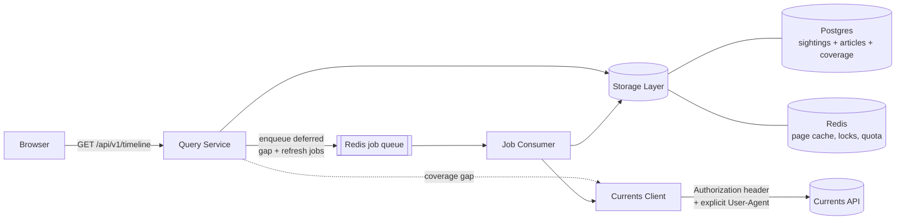

# Zammy — Architectural Proposal

**Status:** Phases 0–5c built · **Scope:** the design; decisions live in ADRs

A news aggregator that takes keywords from a user and returns a time-ordered timeline of
headlines and topic summaries, backed by [Currents API](https://currentsapi.services/en/docs/).

Read alongside:
[CONTEXT.md](../CONTEXT.md) for the domain vocabulary — **sighting**, **article** and **group** are
distinct things here, and the differences are load-bearing — [PROBE-FINDINGS.md](./PROBE-FINDINGS.md) for what
the upstream actually does, and [docs/adr/](./adr/) for decisions and the alternatives they beat.

---

## 1. Goals and non-goals

**Goals**

- Keyword search returning articles sorted newest-first, paged, with stable ordering.
- Cache results so a repeated query does not re-hit the upstream API: the first searcher of a topic
  populates it, everyone after reads from storage.
- Accumulate articles over time so a topic's timeline deepens beyond what one upstream call returns —
  driven by actual use, not by a scheduled watchlist (§9).
- **A landing page wordcloud of the day's most-referenced terms**, each word sized by how many
  *unique articles* reference it, and clickable to run that search (§10). Note the vocabulary: a
  **term** is a word extracted from headlines; a **topic** is a saved canonical query. They meet when
  a click turns one into the other.
- A clean, fast front end; keywords in, timeline out.

**Non-goals for v1**

- User accounts, saved feeds, notifications.
- A coverage-gap map. A topic can have holes — deferred backfill not yet run — and we *could* tell the
  reader which stretch is "nothing published" versus "not fetched yet". `meta.ingest.state` already
  says whether more may arrive, which covers the honest-freshness requirement; a per-range gap map
  means a second range structure on the wire for something nobody has asked for. A deliberate no,
  recorded so it is not mistaken for an oversight.
- Multiple upstream news providers (the client is abstracted so this stays cheap to add — see §5.6).
- LLM-generated topic summaries. The schema reserves a place for them (§7.2); generation is a later phase.

---

## 2. The upstream constraints that shape everything

All values below are **empirically verified** against a live Free-tier key (45 calls, 2026-08-04).
Full evidence and method in [PROBE-FINDINGS.md](./PROBE-FINDINGS.md). Several contradict the OpenAPI
spec, which is incomplete and in places wrong.

| Property | Verified value |
| --- | --- |
| Base URL | `https://api.currentsapi.services/v1` |
| Auth | `Authorization: <api_key>` header (`?apiKey=` also works) |
| Daily quota | **1000 requests**, resets midnight UTC |
| Burst quota | **60 requests / 60s** |
| `page_size` | supported, **max 20** (Free tier) |
| `page_number` | supported, **1-indexed**; past-end → `200` + empty array |
| **Max retrievable results** | **100 per query** (5 pages) |
| **Max lookback** | **30 days** |
| **Max date range per call** | **7 days** (drift: observed live 2026-08-11; the 2026-08-04 probe's single 30-day call now 400s — `date_range: Max range is 7 days`) |
| **`start_date`/`end_date` bounds** | **both INCLUSIVE** — a closed `[start, end]` interval, honoured to the second (2026-08-11, PROBE §6e) |
| Default sort | `published` DESC (undocumented, but consistent and page-stable) |
| `domain` | supported |
| `offset`, `sort_by` | silently ignored — no sort control exists |
| Unknown params | silently ignored |

**Rate-limit headers are present on every response** — `x-ratelimit-limit`, `-remaining`,
`-burst-limit`, `-burst-remaining`, `-reset-time`. Better than assumed: quota can be *observed*
rather than guessed (§5.4).

Five consequences drive the whole design:

1. **Deduplication is load-bearing, not cosmetic.** Upstream re-ingests frequently-updated pages as
   new articles — same URL and title, distinct UUIDs, minutes apart. Measured over the full
   retrievable depth of one query: **100 articles, 100 unique ids, but only 42 unique URLs**, with a
   single link-roundup post appearing **50 times**. Untreated, over half the timeline is one repeated
   post. This is the most consequential finding of the probe, and it reshapes §7 and §8.
2. **Effective depth is ~40 unique articles per query, not 100.** The 100-result cap combined with
   ~58% duplication sets the real ceiling.
3. **Window slicing is still essential** — but for a different reason than originally assumed. Paging
   exists, so slicing is not needed for *ordering*; it is needed to get *past the 100-result cap*. The
   only way to retrieve more than ~40 unique articles for a topic is to subdivide the time window and
   query each sub-window separately (§6.3).
4. **Relevance cannot be reproduced locally.** Matching runs against full article body text the
   response never includes: only 7 of 20 results for `climate` contained that word in `title` or
   `description`. A local full-text index would return a *different* set than upstream, so it can
   never substitute for an upstream call (§7.2).
5. **Quota is genuinely tight.** At 1000/day, one topic's 30-day backfill (~150 calls) costs 15% of
   the daily budget. Backfill must be lazy, prioritized and explicitly budgeted (§9).

Data-shape hazards the client must absorb — all confirmed live:

- `published` is `"2026-08-04 20:45:56 +0000"` — **not** ISO-8601; `new Date()` is unreliable on it.
- `image` is often the literal string `"None"` (5 of 40 sampled articles).
- `keywords` must be **space-joined**; comma-joining returns **0 results**.
- Responses include `source_category`, absent from the spec.
- `401` and `400` bodies do **not** match the spec's `ApiResponse` shape (§5.3).
- Reference endpoints return name→code *maps*, not arrays, and names contain typos (`"Vietnamise"`,
  `"United State"`) — always use the values, never derive codes from names. Categories include junk
  values (`crap`, `notsure`, `redundant`) to filter out of any user-facing picker.
- The spec names the link field `urls` while responses use `url`; tolerate both. `id` is a UUID string
  despite the spec declaring `integer`.
- **Cloudflare returns `403` (`error code: 1010`) to default library User-Agents.** Every call must
  send an explicit `User-Agent`, and a `403` must never be reported as an auth failure (§5.3).

---

## 3. System context



The four components the brief asks for map to: **Currents Client** (§5), **Query Service** (§6),
**Storage Layer** (§7), **Front End** (§8). The **Job Consumer** (§9) has no schedule — every arrow
into it originates from a user request, so upstream spend tracks real demand.

---

## 4. Stack and repo layout

TypeScript end-to-end, pnpm workspaces. One language, one toolchain, and the article/query contract
is a shared type rather than a document that drifts.

```
zammy/
├── packages/
│   ├── shared/            # wire contract ONLY — what ships to the browser (ADR-0004)
│   ├── config/            # server-only env validation; holds the API key
│   ├── currents-client/   # Component 1 — upstream SDK, zero app knowledge
│   └── storage/           # Component 3 — schema, migrations, the collapse (§7.4),
│                          #   keyset timeline reads (§7.3)
├── apps/
│   ├── api/               # Component 2 — Fastify. HTTP surface, query planning,
│   │                      #   in-process job consumer (§9.1), term aggregation (§10)
│   ├── worker/            # Component 5 — only if ingestion load justifies splitting it out
│   └── web/               # Component 4 — React + Vite, timeline + wordcloud
├── fixtures/              # real captured upstream payloads — regression basis (§12)
├── docs/ARCHITECTURE.md
└── docker-compose.yml     # postgres + redis for local dev
```

Runtime choices: **Fastify** (schema-first, fast JSON), **Zod** (one schema validates the HTTP
request *and* generates the TS type), and **Kysely** for typed SQL — deliberately not an ORM, because
§7.3's keyset pagination and the `tstzrange` coverage query are hand-written SQL
([ADR-0003](adr/0003-kysely-and-hand-written-sql-instead-of-an-orm.md)). Migrations use Kysely's own
`Migrator` and run as a discrete deploy step, never on application boot.

### 4.1 Deployment target — AWS; local development on Docker Compose

**Decided.** The deployment target is **AWS**. Docker Compose on a laptop is the **local development
environment**, not a deployment target — it exists so the whole system can be run and tested offline,
and it is deliberately built to be a faithful rehearsal of production rather than a different animal.

The **same images** run in both, differing only by environment variables. No code path may branch on
environment; the moment one does, local development stops predicting production behaviour.

| Unit | Local dev (Compose) | AWS (deploy target) |
| --- | --- | --- |
| `api` + in-process consumer | container | ECS **Fargate** service behind an ALB |
| `web` | Vite dev server | static build on S3 + CloudFront |
| Postgres | `postgres:17` container, named volume | **RDS** Postgres, automated backups, PITR |
| Redis | `redis:7` container | **ElastiCache** |
| Secrets | gitignored `.env` | **Secrets Manager / SSM**, injected into the task definition |
| Logs | stdout to the terminal | stdout → **CloudWatch** |

The two spots where local and production genuinely differ, and so need explicit configuration rather
than a default that silently works in one and not the other:

- **`web`'s API base URL** — a Vite dev-server proxy locally, an absolute origin behind CloudFront in
  AWS. Build-time configurable.
- **CORS** — pinned per environment (§12), never a permissive default that would ship to production.

**This resolves the scale-to-zero question.** Fargate keeps CPU allocated for the life of a task, so
the **in-process consumer (§9.1) is viable in production** and no separate `consumer` service is
needed initially. Splitting it out becomes necessary only if ingestion outgrows the API or a later
target suspends CPU between requests (Lambda, App Runner scale-to-zero); §9.1 keeps it separable so
that remains a deployment decision with no code change.

**Production requirements that Compose usefully exercises early:**

- **At-least-once queue delivery** (BullMQ, or `BLMOVE` + processing list + reaper). Required because
  Fargate recycles tasks on every deploy and scaling event, and a naive `LPOP` loses whatever the dying
  task held. `docker compose down` and laptop sleep reproduce exactly that, so the behaviour is
  testable locally instead of first appearing in production.
- **Graceful SIGTERM handling** — same reasoning: `docker compose down` sends SIGTERM, so the drain path
  gets exercised constantly in development rather than being theoretical until the first AWS deploy.
- **Redis-backed coordination** — quota governance (§5.4), single-flight locks (§6.3), the daily
  breadth-sample lock (§10.1). These are no-ops at the single replica of local dev and essential once
  Fargate runs two or more tasks. Building them in from the start costs almost nothing; retrofitting
  concurrency control does not.

**Local development specifics:**

- **Fixture-backed offline mode.** With a 1000/day quota, a developer hot-reloading against the live API
  will exhaust it before lunch. `CURRENTS_MODE=fixture` serves the recorded payloads in
  [`fixtures/`](../fixtures) instead of calling upstream, so most development and the entire test suite
  cost zero quota. Given the budget, this is closer to a requirement than a convenience — and it means
  the app can be developed with no network at all.
- **The API key lives in a gitignored `.env`**, read through the same Zod config validation as every
  other setting (§12). It must never reach the `web` bundle; the browser only ever talks to our API.
- **Intermittent uptime is fine.** A laptop off for a week leaves coverage gaps the next reader repairs
  (§6.4), bounded by the 30-day lookback. Nothing in the design needs to run continuously — a direct
  benefit of demand-driven ingestion (§9.2).
- Modest memory limits on the Postgres and Redis containers; the dataset is small, a few hundred MB at
  90-day retention.

**What the AWS move will actually require** — infrastructure, not application code: task definitions,
RDS and ElastiCache provisioning, secret wiring, an ALB using the existing `/healthz` and `/readyz`
probes (§6.1), and Kysely's `Migrator` run as a discrete deploy task rather than on boot. Images are
multi-stage with `pnpm deploy --filter` to prune workspace dependencies, so they are already
deploy-shaped. Worth writing the IaC (Terraform or CDK) at the point of the move rather than now,
since provisioning nothing yet costs nothing.

---

## 5. Component 1 — Currents API client (`packages/currents-client`)

A thin, testable SDK. It knows HTTP and the Currents contract; it knows nothing about our cache,
our database, or our front end. It is the only place in the system where the upstream's quirks exist.

### 5.1 Surface

```ts
interface CurrentsClient {
  search(params: SearchParams, opts?: CallOpts): Promise<SearchResult>;
  latestNews(language?: string): Promise<SearchResult>;
  availableLanguages(): Promise<Record<string, string>>;
  availableRegions(): Promise<Record<string, string>>;
  availableCategories(): Promise<string[]>;
}

type SearchParams = {
  keywords?: string; language?: string; country?: string; category?: string;
  domain?: string; startDate?: Date; endDate?: Date;
  pageNumber?: number;              // 1-indexed
  pageSize?: number;                // clamped to MAX_PAGE_SIZE (20 on Free)
};

type SearchResult = {
  sightings: Sighting[];
  requestedAt: Date;
  isLastPage: boolean;              // articles.length < pageSize
  quota: QuotaSnapshot;             // parsed from x-ratelimit-* headers
};
```

`keywords` is space-joined by the client regardless of how callers supply terms — comma-joining
returns zero results (§2), and that is exactly the kind of upstream trap that belongs here and
nowhere else.

### 5.2 Normalization — the client's most important job

Every article is normalized once, at the boundary, so nothing downstream ever sees an upstream quirk:

- **`published` → `Date`.** Explicit parse of `YYYY-MM-DD HH:MM:SS ±ZZZZ` rather than `new Date()`.
  Unparseable timestamps are the one case we **drop with a warning metric** rather than default to
  "now" — a wrong timestamp silently corrupts the timeline, which is the product's core promise.
- **`image`** → `string | null`; the literal `"None"`, empty string, and unparseable values all
  become `null`. Protocol-relative URLs get `https:` prefixed.
- **`url`/`urls`** → single canonical `url`. Also derive `sourceDomain` (registrable domain), which
  the front end shows as a source chip and which gives us a cheap grouping key later.
- **`category`** → always `string[]`, lowercased.
- Whitespace-collapse `title`/`description`; drop articles with no `title` or no `url`.

### 5.3 Reliability

- **Mandatory `User-Agent`.** Cloudflare `403`s default library UAs (§2). Set explicitly, always.
- **Timeouts:** per-request deadline (default 8s) via `AbortSignal`. Observed p50 was ~700ms.
- **Retries:** max 2, exponential backoff with full jitter, on `429`, `5xx`, and network errors only.
  Never retry other `4xx` — those are our bug, not a transient fault, and each one costs quota.
- **Typed errors**, each mapping to a distinct degradation behaviour (§11):

  | Error | Trigger |
  | --- | --- |
  | `CurrentsAuthError` | `401` `{"status":"401","msg":"Invalid token"}` |
  | `CurrentsBlockedError` | `403` with non-JSON body (Cloudflare `1010`) — **not** an auth failure |
  | `CurrentsInvalidQueryError` | `400`; carries the parsed `details.errors` field→message map |
  | `CurrentsQuotaError` | `429`, or local pre-flight refusal |
  | `CurrentsUpstreamError` / `TimeoutError` / `SchemaError` | `5xx` · deadline · unparseable body |

  `400` bodies name the exact violated limit (e.g. `{"page_size": "Max page_size for Free tier is
  20"}`). Surfacing that verbatim in logs turns tier-limit mistakes into one-line diagnoses.
- **Circuit breaker:** after N consecutive failures, open for a cooldown and fail fast. While open,
  the Query Service serves stale data rather than making users wait for a doomed call.
- **Response validation:** parse `{status, news[]}` with Zod, tolerating unknown fields (upstream
  already ships an undocumented `source_category`). `status: "error"` under HTTP 200 is a failure.

### 5.4 Quota governance — header-driven

The probe found `x-ratelimit-*` on every response, so we do not have to guess. Each response updates
a Redis-held snapshot shared by the API and worker:

```
quota:currents  →  { limit, remaining, burstLimit, burstRemaining, resetTime, observedAt }
```

Every call is **pre-flight checked** against the snapshot and refused locally when exhausted —
cheaper and kinder than earning a real `429`. A Redis `INCR` counter covers in-flight calls made
since the last observed header, so concurrent dispatch cannot overshoot between refreshes.

Two governors, because the limits have different shapes:

- **Burst (60/60s):** a short-window counter, since exceeding it stalls everything for up to a minute.
- **Daily (1000, midnight UTC):** the strategic budget, split into an **interactive reserve** and a
  **worker allowance**. The worker may only draw while `remaining > INTERACTIVE_RESERVE` (default
  250), so background backfill can never starve a live user search — the failure mode that would
  otherwise appear only on the busiest day.

Limits are read from headers but *bounded* by config, so a plan upgrade is a config change and a
missing header never means "unlimited".

### 5.5 Secrets

`CURRENTS_API_KEY` is server-side only, injected by env. It never reaches the browser — the front
end talks exclusively to our own API. The key is redacted from all logs and error messages.

### 5.6 Extensibility

`search()` returning `Sighting[]` is the seam for a future second provider. Adding one
means a new client satisfying the same interface plus a `provider` column on `articles`; nothing in
§6–§8 changes.

---

## 6. Component 2 — Query Service (`apps/api`)

Accepts front-end requests and turns them into the right upstream query — or, ideally, into no
upstream query at all.

### 6.1 Public HTTP surface

| Endpoint | Purpose |
| --- | --- |
| `GET /api/v1/timeline` | The main read. Keywords + filters → time-ordered page of articles. |
| `GET /api/v1/reference` | Cached `/available/*` values, for populating front-end filter controls. |
| `GET /api/v1/topics/:fingerprint` | Topic metadata: coverage window, article count, freshness, summary. |
| `GET /healthz` · `GET /readyz` | Liveness, and dependency checks for Postgres/Redis/upstream. |

`GET /api/v1/timeline` request:

```
q          string   required   raw keyword input, ≤200 chars
language   string   optional   defaults to DEFAULT_LANGUAGE (en); validated against
                              cached /available/languages. Omitting it upstream returns
                              every language mixed together, so "all" is an explicit
                              choice, never the accident of leaving a field unset.
country    string   optional   validated against /available/regions
category   string   optional   validated against /available/categories
from, to   ISO-8601 optional   timeline window
cursor     opaque   optional   keyset cursor from a previous response
limit      int      optional   default 25, max 100 — a CEILING, not a promise (§6.5)
```

Response:

```jsonc
{
  "topic":  { "fingerprint": "…", "keywords": ["…"], "coverage": { "from": "…", "to": "…" } },
  "items":  [ /* Article, published DESC */ ],
  "page":   { "nextCursor": "…|null", "hasMore": true },
  "meta":   {
    "servedFrom": "cache|store|upstream",
    "asOf": "…", "stale": false, "degraded": null,
    "ingest": { "state": "complete|in_progress", "pendingJobs": 4 }
  }
}
```

`meta` is deliberately part of the contract, not a debug extra: the front end uses `stale` and
`degraded` to render honest freshness state instead of silently presenting old data as current (§8.3).

`meta.ingest` and `page.hasMore` answer **different** questions and both are required:

- `hasMore` — more rows exist *past your cursor in our store*.
- `ingest.state` — more rows may still *arrive from upstream* for this window.

The "you've reached the end" state therefore requires `hasMore === false` **and**
`ingest.state === "complete"`. Conflating them would tell users "that's everything" while a job is
still running — a quiet lie, and the exact bug progressive delivery invites.

### 6.2 Request → canonical query → fingerprint

Every request is reduced to a **canonical form** before anything else, so that trivially different
requests reuse the same cache entry and the same accumulated topic:

1. **Validate** with Zod; reject unknown/oversized input with `400` and a field-level message.
2. **Normalize keywords:** trim, collapse whitespace, casefold, NFKC-normalize, de-duplicate terms,
   sort terms deterministically, cap term count. `"  Climate   POLICY "` and `"policy climate"`
   converge on the same canonical topic.
3. **Validate filter values** against the cached reference lists — this catches a bad `language`
   locally instead of spending a quota token to learn it upstream.
4. **Snap the window.** `from`/`to` are rounded outward to a 15-minute grid. Unsnapped
   `to = now` would make every request a unique cache key and defeat caching entirely.
5. **Fingerprint** = `sha256(canonical JSON of {keywords, language, country, category})`. Note the
   window is *excluded* — a topic is a durable entity; the window is a view onto it. This is what
   lets an older request and a newer one contribute to one accumulating timeline.

The canonicalizer is a pure function, which makes it the single easiest and highest-value unit-test
target in the system.

### 6.3 Query planning — how a page gets filled

This is the component's real work, and the probe reshaped it: paging exists, but caps at **100
results per query**, of which only ~40 are unique (§2). Slicing the time window is how we get past
that ceiling.

```
1. Redis: page cache hit for (fingerprint, window, cursor, limit)?   → serve, done. No upstream call.
2. Postgres: is the requested window fully inside this topic's recorded coverage (§7.3)
   and recent enough per §6.4?                                       → serve from store, done.
3. Otherwise compute the coverage GAP = requested window − covered ranges,
   clamped to the last 30 days (beyond that upstream 400s — never spend a call to learn this),
   and SLICED to CURRENTS_MAX_RANGE_DAYS (7) per segment, newest first — upstream now rejects
   wider single calls (§2 drift, 2026-08-11), so every planned segment must be individually
   fetchable. The client refuses over-range requests locally as a backstop; it never clamps
   them, because coverage is recorded for the span that was ASKED, and a silently narrowed
   fetch would become coverage over days nobody fetched.
4. Plan a bounded set of upstream calls per gap segment:
     - page through the segment (page_number 1..5, page_size 20) until a page returns
       fewer than page_size rows, which is the clean end-of-results signal;
     - if a segment yields a FULL 5 pages, it is truncated by the 100-cap — but those
       pages are not wasted: record coverage from the OLDEST SIGHTING SEEN (plus 1ms,
       excluding the frontier instant in case of ties beyond the cap) to the segment
       end, and enqueue only the remainder. Every 5 calls advance the frontier ~100
       articles with nothing refetched. Halve-and-enqueue survives only as the
       fallback for a frontier that cannot advance (a timestamp pileup),
       depth-limited at the 1h floor.
5. Execute only as much of the plan as fits a WALL-CLOCK DEADLINE (default 1200ms),
   with a floor of 1 call and a ceiling of 5. Everything unfinished is enqueued (§9).
6. Dispatch through the client (quota-governed, single-flighted). Upsert results and
   collapse them into articles (§7.4), extend recorded coverage, then answer from Postgres
   — never from the raw upstream response, which is neither deduplicated nor guaranteed
   ordered across our own sliced calls.
```

**The synchronous budget is a deadline, not a call count.** Bounding calls (the first draft's "max 5")
bounds a proxy for what users feel; bounding wall-clock time bounds the thing itself. At ~700ms per
observed call, the default admits one call reliably and a second when upstream is fast, then defers the
rest — so a cold search paints in well under a second instead of ~3.5s.

**Window bounds are half-open everywhere we own; upstream's are not.** Every window in this system —
requested, segment, recorded coverage — is **half-open `[from, to)`**: `>= from`, `< to`. One
convention, stated once, so segment seams cannot be reasoned about two ways. `tstzrange` already
defaults to `[)` (§7.2), so Postgres agrees with us for free.

Upstream does **not**: `start_date`/`end_date` are both *inclusive* (§2, PROBE §6e). So asking for
segment `[A, B)` returns the article published exactly at `B`. That surplus row is deliberately left
alone, because the mismatch resolves in the safe direction:

- The seam instant is **fetched twice** across adjacent segments `[A, B)` and `[B, C)`, and
  `ON CONFLICT (id) DO NOTHING` (§7.4) makes the second sighting a no-op.
- We record coverage as `[A, B)`, so `B` is never marked covered by the segment that merely
  overlapped it — a later request touching `B` re-fetches rather than trusting coverage it does not
  have.

The inverse pairing is the one that would have bitten: exclusive upstream bounds under inclusive
recorded coverage would leave the seam article unfetchable while coverage claimed the instant — a
silent hole, in the same class as the page-5 truncation bug below: real data loss that reports no
error. The probe ruled it out; the
convention is what keeps it ruled out. **Do not "fix" the duplicate by recording closed coverage** —
that trades a free no-op for that hole.

Two further subtleties worth naming, both direct consequences of probe data:

- **A full page-5 means "truncated", not "finished".** Treating it as complete would silently and
  permanently hide history behind the 100-cap — a data-loss bug that no error would ever report.
- **Adaptive subdivision must be depth-limited** (e.g. minimum 1h segment). A pathologically dense
  keyword would otherwise recurse until it consumed the whole daily quota.

**Single-flight** is essential: N concurrent users searching a trending keyword must produce **one**
upstream call. A Redis lock `lock:refresh:<fingerprint>:<segment>` with a short TTL elects one
fetcher; losers wait briefly on the result or serve stale immediately. With a 60/60s burst limit,
this is a hard requirement rather than an optimization.

### 6.4 Staleness tiers and refresh-on-read

A recent-news window needs re-checking far more often than a window from last month.

| Requested window ends | Considered fresh for |
| --- | --- |
| within last 1h | 60s |
| within last 24h | 10m |
| older than 24h | 24h (historical data does not change) |

Serve-stale-while-revalidate throughout: a stale hit returns immediately with `meta.stale = true` and
**enqueues an incremental top-up** — a single call for the window since `max(coverage.upper)`.

Refresh-on-read applies to slivers up to the per-call range ceiling (§2 drift). A trailing gap wider
than that is missing *history*, not staleness — the reader takes the synchronous fill of the newest
slice rather than a stale flag over week-old content, and the remaining slices queue as usual.

This is the mechanism that replaces scheduled polling (§9). Freshness is repaired **by the next
reader**, not by a clock. A reader arriving six hours after the last fetch gets the stored timeline
instantly and triggers one call to close the gap; the reader after them sees the fresher result. Cost
scales with readership rather than with the size of a watchlist, which is what makes it fit a
1000/day budget.

### 6.5 Progressive delivery — paint page 1, fill the rest behind it

A cold search returns as soon as the first upstream call lands and is persisted; pages 2..5 and any
subdivisions arrive via the queue. Four consequences that have to be designed, not discovered:

**1. `limit` becomes a ceiling.** One upstream call is 20 raw sightings, which after collapsing may be
as few as **6** (measured — probe page 4 collapsed 20 → 6). A request with `limit=25` can therefore
legitimately return 6 items. The response must not pad, must not block to fill, and must signal
`ingest.state: "in_progress"` so a short list reads as "still arriving" rather than "that's all".

**2. Reads never block on the ingestion lock.** User B arriving mid-ingestion gets whatever is already
in Postgres plus `ingest.state: "in_progress"` — the same progressive experience as User A. The
single-flight lock (§6.3) exists to deduplicate *upstream calls*, not to serialize *readers*. A naive
implementation would make B wait on A's lock and turn a shared cache into a queue.

**3. Late arrivals append downward, which is exactly where the reader is going.** Upstream returns
newest-first, so deferred pages 2..5 contain *older* articles than page 1. The reader scrolling toward
older content meets them head-on, and keyset pagination (§7.3) picks them up on the next cursor fetch
with no duplicates or skips. The ingest direction and the scroll direction agree — the one piece of
luck in this design.

Refresh-on-read (§6.4) is the opposite case: it adds articles *newer* than what is displayed. Those
must **never** be silently spliced in above a reading user. They surface as an explicit "N new
articles" affordance at the top, applied on click.

**4. Delivery mechanism: polling, not streaming.** While `ingest.state === "in_progress"` the client
re-requests the first page on a short interval (~1.5s) and stops when it flips to `complete`. In
TanStack Query that is a conditional `refetchInterval` and nothing more. SSE would give a smoother
feel but adds long-lived connections, proxy buffering concerns, and reconnect logic for a window that
is typically 2–4 seconds long. Polling is the right cost for v1; SSE is a contained upgrade later
because the contract (`meta.ingest`) does not change.

Bounded, so a stuck job can't poll forever: the client gives up after `INGEST_POLL_MAX` attempts
(default 8) and renders `degraded: "ingest_timeout"` with a manual retry.

---

## 7. Component 3 — Storage layer (`packages/storage`)

Two tiers with distinct jobs. Redis makes repeat reads free; Postgres makes the timeline *exist*.

### 7.1 Redis (ephemeral)

| Key | Contents | TTL |
| --- | --- | --- |
| `page:<fingerprint>:<windowHash>:<cursor>:<limit>` | serialized response page | per §6.4 tier |
| `ref:languages` \| `ref:regions` \| `ref:categories` | reference lists | 24h |
| `lock:refresh:<fingerprint>:<segment>` | single-flight election | 10s |
| `budget:currents:*` | quota counters | minute / day |
| `breaker:currents` | circuit state | cooldown |

Redis is treated as **pure cache**: a total flush costs latency and quota, never correctness. Nothing
lives only in Redis.

### 7.2 Postgres (durable)

Vocabulary matters here, because the table names are the vocabulary: a **sighting** is one
upstream emission, an **article** is the real story (see [CONTEXT.md](../CONTEXT.md) and
[ADR-0002](adr/0002-articles-are-deduplicated-stories-sightings-are-emissions.md)).

```sql
-- One row per upstream emission. The faithful record of what we were sent.
-- Upstream re-emits the same story under fresh UUIDs — one link-roundup page
-- arrived 50 times in 100 results — so a row here is an observation, not a story.
CREATE TABLE sightings (
  id            uuid PRIMARY KEY,              -- upstream id; unique per emission
  article_id    bigint NOT NULL REFERENCES articles(id) ON DELETE CASCADE,
  dedup_key     bytea NOT NULL,                -- sha256(canonical url); NOT unique here
  published     timestamptz NOT NULL,
  first_seen_at timestamptz NOT NULL DEFAULT now(),
  raw           jsonb NOT NULL                 -- original payload; re-normalize without refetching
);
CREATE INDEX sightings_article_idx ON sightings (article_id);
CREATE INDEX sightings_dedup_idx   ON sightings (dedup_key);

-- One row per real-world story. This is what the timeline pages over and what
-- anything countable counts. Display fields are denormalized from the earliest
-- sighting so a timeline read needs no join back to sightings.
CREATE TABLE articles (
  id              bigint GENERATED ALWAYS AS IDENTITY PRIMARY KEY,
  dedup_key       bytea NOT NULL,
  url             text NOT NULL,
  title           text NOT NULL,
  description     text,
  author          text,
  image_url       text,
  language        text,
  categories      text[] NOT NULL DEFAULT '{}',
  source_category text[] NOT NULL DEFAULT '{}',-- undocumented upstream field, kept verbatim
  source_domain   text,
  published       timestamptz NOT NULL,        -- EARLIEST sighting; this article's place in time
  latest_seen     timestamptz NOT NULL,        -- most recent sighting
  sighting_count  int NOT NULL DEFAULT 1,
  -- Grouping (§14.3). group_id is the SEED article's id — self for a group of
  -- one, supplied by a BEFORE INSERT trigger so no writer can omit it. No FK:
  -- a dangling seed must degrade a group to loose members, never block a delete.
  group_id        bigint NOT NULL,
  group_published timestamptz NOT NULL,        -- MIN(published) over the group; the timeline axis
  title_tokens    text[] NOT NULL DEFAULT '{}' -- headline tokens; what candidates match on
);
CREATE UNIQUE INDEX articles_dedup_key_idx     ON articles (dedup_key);
CREATE INDEX        articles_timeline_idx      ON articles (published DESC, id DESC);
CREATE INDEX        articles_group_timeline_idx ON articles (group_published DESC, group_id DESC);
CREATE INDEX        articles_group_idx         ON articles (group_id);
CREATE INDEX        articles_title_tokens_idx  ON articles USING gin (title_tokens);

CREATE TABLE topics (
  fingerprint   bytea PRIMARY KEY,
  keywords      text[] NOT NULL,
  language      text, country text, category text,
  summary       text,                          -- reserved: topic summary, later phase
  summary_at    timestamptz,
  created_at    timestamptz NOT NULL DEFAULT now(),
  last_hit_at   timestamptz NOT NULL DEFAULT now(),  -- drives worker prioritization + retention
  hit_count     bigint NOT NULL DEFAULT 0
);

-- Topic membership is recorded per ARTICLE, so a topic's timeline cannot be
-- flooded by one repeatedly-re-emitted post.
CREATE TABLE topic_articles (
  fingerprint bytea  REFERENCES topics   ON DELETE CASCADE,
  article_id  bigint REFERENCES articles ON DELETE CASCADE,
  PRIMARY KEY (fingerprint, article_id)
);

-- Which time windows have actually been fetched for a topic. This is what makes
-- "do I need an upstream call?" an exact question instead of a guess.
CREATE TABLE topic_coverage (
  fingerprint bytea REFERENCES topics ON DELETE CASCADE,
  span        tstzrange NOT NULL,
  fetched_at  timestamptz NOT NULL DEFAULT now()
);
CREATE INDEX topic_coverage_gist ON topic_coverage USING gist (fingerprint, span);

CREATE TABLE fetch_log (                       -- quota accounting + observability
  id bigserial PRIMARY KEY, fingerprint bytea, params jsonb,
  requested_at timestamptz NOT NULL, duration_ms int,
  http_status int, sighting_count int, error_kind text
);
```

`topic_coverage` is the load-bearing idea. Coverage gaps are a range-difference query; adjacent
spans are merged on write so the table stays small. Without it, we could not distinguish "no
articles exist in this window" from "we never asked about this window" — and would either re-fetch
constantly or show false gaps in the timeline.

`span` is always written **half-open, `[from, to)`** — `tstzrange`'s default bounds, and the same
convention §6.3 uses for requested and segment windows. Write it explicitly (`tstzrange(from, to,
'[)')`) rather than leaning on the default: upstream's date bounds are *closed* (§2), so a reader who
assumes the two agree will mis-reason about segment seams. §6.3 explains why the mismatch is the safe
direction and must not be "fixed" here.

### 7.3 Timeline reads — keyset pagination over article groups

```sql
-- Step 1: the page of GROUPS. Both columns are functions of the group, so
-- DISTINCT folds a group's members into the one row that represents it here.
SELECT DISTINCT a.group_id, a.group_published
FROM topic_articles ta
JOIN articles a ON a.id = ta.article_id
WHERE ta.fingerprint = $1
  AND a.group_published >= $2 AND a.group_published < $3
  AND (a.group_published, a.group_id) < ($4, $5)   -- cursor; omitted on first page
ORDER BY a.group_published DESC, a.group_id DESC
LIMIT $6;

-- Step 2: their members, for THIS topic only — groups are global, membership
-- is not, and the representative is chosen from what actually matched (§14.3).
SELECT a.*
FROM topic_articles ta
JOIN articles a ON a.id = ta.article_id
WHERE ta.fingerprint = $1 AND a.group_id = ANY($7)
ORDER BY a.published DESC, a.id DESC;
```

Deduplication is a *property of the table*, not a filter applied afterwards — which is the whole
reason `articles` and `sightings` are separate. Post-filtering would be wrong here: with one URL
occupying 50 of 100 upstream slots, a page of 25 could collapse to 3 rows, so page size would become
unpredictable and `hasMore` unreliable. Grouping (§14.3) keeps that property rather than trading it
away: the group is materialized at write time, so `LIMIT` still counts what the reader sees. An
ungrouped article is a group of one whose position and identity are its own, so a store with no
grouping pages exactly as it did before the columns existed — including the cursor, which is
unchanged in shape.

Keyset, not `OFFSET`: cost is constant regardless of depth, and — critically for a feed where new
articles arrive constantly — rows cannot shift between pages and cause duplicates or skips. The
cursor is a base64 `(published, id)` tuple — the *group's* position and identity — and `id` breaks
ties among the many groups sharing a timestamp, giving a total order that upstream does not provide.

The id half is the surrogate key, deliberately not the URL hash. Canonicalization is a rule we keep
widening, and a natural key would re-key live cursors every time it changed
([ADR-0002](adr/0002-articles-are-deduplicated-stories-sightings-are-emissions.md)).

### 7.4 Writes — idempotent upsert and the sighting→article collapse

The collapse belongs to the storage layer, not the client: it needs state across responses that a
single upstream page cannot have, so `@zammy/currents-client` stays stateless and returns
`Sighting[]` ([ADR-0004](adr/0004-shared-contains-only-what-ships-to-the-browser.md)).

Per fetched sighting, in one transaction:

1. Upsert `articles` on `dedup_key`: on conflict, `published = LEAST(existing, incoming)`,
   `latest_seen = GREATEST(…)`, and `sighting_count = sighting_count + 1`. Display fields are taken
   from the earliest sighting, so a later re-emission does not rewrite the headline.
2. `INSERT INTO sightings … ON CONFLICT (id) DO NOTHING`, linked to that `article_id`. The conflict
   clause is what makes a re-fetch idempotent: seeing the same upstream UUID twice must not inflate
   `sighting_count`.
3. Upsert `topic_articles (fingerprint, article_id)`.

Every fetch is safely repeatable, which is what lets the worker and a user request race harmlessly.

Immediately after, and outside the transaction, each article the call *created* is offered a group
(§14.3). The two halves are one write path: this one deduplicates by URL, that one groups what URLs
alone cannot. Only new articles are grouped — regrouping on every re-sighting would let a group drift
with no bound — and the pass never throws, because a grouping failure must not fail the read that
triggered the ingest.

**Every** path that writes `articles` owes that call, not just the timeline fill: the §10.1 breadth
sample ingests here too, and it is the most syndication-dense source we have. An article stored
without headline tokens is not merely ungrouped — it is invisible as a candidate to everything
ingested after it, so one silent path degrades grouping for all of them.

**`dedup_key` derivation** — `sha256` of the URL after lowercasing scheme/host, stripping the
fragment, removing tracking params (`utm_*`, `fbclid`, `gclid`), and trimming the trailing slash.
Verified on probe data: normalization neither over- nor under-collapsed (42 unique raw URLs → 42
unique normalized). It is unique on `articles` and deliberately **not** on `sightings`, where 58% of
live rows would violate it.

A `(title, source_domain)` secondary key stays disabled: probe data showed 41 unique title+domain
pairs against 42 unique URLs, so it would merge exactly one pair — no evidence, and a false merge is
worse than a visible duplicate. Syndicated stories across different outlets do not collapse either,
on purpose; the wordcloud's breadth gate counts distinct sources and needs those rows (§10.3). They
are **grouped** instead (§14.3), which keeps every row and every `source_domain` intact.

**Ordering across sliced calls.** Upstream sorts each response by `published` DESC, but our sliced
window queries return several independently-sorted batches. Nothing downstream may assume the fetch
order is the display order; `ORDER BY` in §7.3 is the only source of truth.

### 7.5 Retention

A nightly job reports articles (and their sightings) older than `RETENTION_DAYS` (default 90)
belonging to no recently-hit topic, plus topics with `last_hit_at` older than 30 days.

**It reports and does not delete.** Point-in-time recovery protects against accidents, not against
this job doing exactly what it was told — a legitimate prune noticed three months later is outside
any recovery window. Enabling deletion is a later, deliberate decision
([ADR-0001](adr/0001-postgres-is-the-archive-beyond-the-upstream-lookback.md)).

Worth stating plainly: because upstream caps lookback at **30 days**, anything older than that in our
store is **unreachable upstream and unrecoverable if deleted**. Retention beyond 30 days is therefore
our own accumulated archive, and the retention window should only ever be widened, never narrowed,
without a deliberate decision.

### 7.6 No local search path

The original draft carried a `search_vec` tsvector for local full-text search. The probe removed it:
upstream matches against article body text we never receive (only 7 of 20 `climate` results contained
that word in `title`/`description`), so a local index would answer a *different* question and quietly
return wrong result sets. Keyword resolution is upstream-only. A local index may return later purely
for **filtering within an already-fetched topic**, which is an honestly different feature.

---

## 8. Component 4 — Front end (`apps/web`)

React + Vite + TypeScript, TanStack Query for server state, Tailwind for styling. Simple, clean,
modern; keywords in, timeline out.

### 8.1 Views (v1)

- **Search bar** — the primary and initially only input. Debounced (~400ms), submits on Enter.
  Collapsible filter row for language / country / category, populated from `/api/v1/reference` (junk
  categories filtered — §2). Because multi-term keywords *narrow* results upstream, the UI should hint
  this ("all terms must match") rather than let users read a 1-result response as a bug.
  The date picker is capped at **30 days back**, since upstream rejects anything older — a disabled
  control is a far better answer than a 400.
- **Timeline** — a single reverse-chronological column with sticky day dividers ("Today",
  "Yesterday", then dates). Each card: headline, source chip + relative time, description snippet,
  thumbnail when `image_url` is non-null. Whole card links out, `target="_blank" rel="noopener"`.
  One card = one **group** — usually one article, and where several outlets ran the same story, the
  group's headline article with the others behind a "N related" disclosure (§14.3). The card is
  timestamped by the **group's** earliest published, not the headline article's, with an "updated
  <relative time>" stamp when later members exist: showing a 3-hours-ago headline in a slot sitting
  below rows from five hours ago reads as a bug. The stamp needs a real gap (an hour) to appear —
  syndication is near-simultaneous, and stamping "updated" on wire copies seconds apart claims a
  story developed when nothing did. Where `sighting_count > 1` — a continuously-updated
  post like a daily link roundup — the card shows the same quiet treatment from `latest_seen` rather
  than repeating the story. This is the user-visible half of §7.4; without it, over half of a typical
  timeline is one post repeated.
- **Freshness banner** — renders `meta.asOf` / `meta.stale` / `meta.degraded` honestly.
- **States** — skeleton cards on first load, distinct empty state ("no articles yet for X" vs. "no
  more history"), and an error state with retry.

### 8.2 Behaviour

- Infinite scroll via `IntersectionObserver` on `nextCursor`, with an explicit "Load older" fallback button.
- Query state is mirrored into the URL (`/?q=climate+policy&lang=en`) so searches are shareable and back/forward works.
- `staleTime` in TanStack Query aligned to §6.4 tiers, so client and server agree on what "fresh" means.
- **Progressive fill (§6.5):** paint whatever the first response carries — often 6–15 cards — then poll
  every ~1.5s while `meta.ingest.state === "in_progress"`, stopping on `complete` or after
  `INGEST_POLL_MAX`. Below the real cards sit two or three shimmer rows, so a short first paint reads as
  "more coming" rather than "that's all there is". No full-page spinner once any content exists, and no
  spinner *replacing* content on refetch — content only ever grows downward.
- **"N new articles" pill** appears when refresh-on-read surfaces items newer than the top of the
  current view; it prepends only on click, so the reading position never jumps beneath the user.
- The "no more history" terminal state renders only when `hasMore === false && ingest.state ===
  "complete"` (§6.1).

### 8.3 Design notes

Restrained and legible: system font stack, generous line-height, one accent colour, a max content
width around 720px so headlines stay scannable. Dark and light via `prefers-color-scheme`. Images
lazy-loaded with fixed aspect boxes to prevent layout shift. Accessibility is not deferred: real
landmarks, visible focus rings, `aria-live` on result-count changes, full keyboard reachability, AA
contrast in both themes.

---

## 9. Component 5 — Background job consumer (`apps/worker`)

**There is no scheduled poller.** Ingestion is entirely demand-driven: every upstream call traces back
to a real user search. The worker is a queue consumer with no clock of its own.

This is a deliberate reversal of the first draft, which proposed polling a hot-topic watchlist. The
arithmetic killed it — see §9.2 — and once the fingerprint-keyed topic model (§6.2) is in place, the
poller turns out to be redundant anyway.

### 9.1 How work arrives

Three trigger types, all originating from a user request:

| Trigger | Timing | Cost |
| --- | --- | --- |
| **Fill visible page** — coverage gap for the requested window | synchronous, in-request | deadline-bounded, ~1 call (§6.3) |
| **Complete the plan** — pages 2..5 the deadline cut off | queued, background | ≤ 4 calls |
| **Breadth sample** — first landing-page visit after the last `/latest-news` snapshot staled (§10.1) | queued, background | `SAMPLE_PAGES` calls/sample (default 2), ≤48/day per language |
| **Deferred backfill** — gap segments and subdivisions §6.3 didn't have budget for | queued, background | metered |
| **Refresh-on-read** — stale coverage noticed while serving (§6.4) | queued, background | ~1 call |

The worker also handles two non-upstream chores: coverage-span merging and retention (§7.5), plus a
daily `/available/*` refresh (3 calls).

**User A pays, User B doesn't** — exactly as intended. User A's search populates `articles`,
`sightings`, `articles`, `topic_articles` and `topic_coverage`. User B's identical search canonicalizes to
the same fingerprint (§6.2), finds the window already covered, and is served from Postgres with zero
upstream calls. If they search *concurrently*, the single-flight lock (§6.3) collapses them into one
upstream call rather than two.

The queue is Redis-backed with **at-least-once delivery** (BullMQ, or `BLMOVE` + processing list +
stale-entry reaper). A plain `LPOP` is not sufficient on a managed container platform, where instances
are recycled on every deploy and scaling event — see §4.1.

The consumer runs **in-process in the API**, which holds in production too: Fargate keeps CPU allocated
for the life of a task (§4.1). It stays structured as a separable unit so it can move into its own
service if ingestion outgrows the API or a later target scales to zero, but that is a deployment
decision with no code change. Either way it draws from the shared quota snapshot (§5.4), so adding
Fargate tasks cannot breach the 60/60s burst ceiling.

### 9.2 Why demand-driven wins here

The verified 1000 calls/day makes the comparison concrete:

| Approach | Daily cost |
| --- | --- |
| Poll 50 topics @ 15-min | **4800 — 5× over budget** |
| Poll 20 topics @ 30-min | ~960 — over budget once user traffic counts |
| Poll 20 topics @ 60-min | ~480 — fits, but half the budget spent whether or not anyone visits |
| **Demand-driven** | **0 when idle**; ~1 call per stale topic read |

Polling spends the budget on topics *predicted* to matter. Demand-driven spends it on topics that
*demonstrably* matter, and spends nothing at all overnight. On a fixed 1000/day budget that is
strictly better, and it removes the watchlist, the scheduler lock, and the interval tuning entirely.

### 9.3 What this costs, honestly

Three real trade-offs, each with a mitigation:

1. **The first searcher of a topic waits** — but only for the first call, not the whole plan. Resolved
   by the deadline-bounded synchronous fill (§6.3) plus progressive delivery (§6.5): a cold search
   paints in under a second and fills in behind the reader. Everyone after User A reads from storage.
2. **A topic nobody reads stops deepening.** The product claim becomes "history accumulates for topics
   people actually use" rather than "for everything". Since the 30-day lookback bounds any gap, a topic
   revisited after a long silence needs a bounded catch-up, not an unbounded one.
3. **Cold start.** A first-ever visitor to an empty database sees nothing until they type something.
   Mitigation: the landing-page wordcloud (§10), whose `/latest-news` sample is triggered by the first
   visitor after the previous snapshot staled. It fills the empty state *and* gives users something to
   click before they know what to search — the one place where a small amount of non-search-driven
   fetching earns its cost.

### 9.4 Budget guards that demand-driven ingestion requires

Making spend user-triggered means users can drive spend, so the budget needs explicit protection —
this is the main thing the model adds rather than removes:

- **Per-topic daily cap** (default 20 calls — 2% of the pool). One curious user deep-backfilling an
  obscure keyword cannot drain the pool; the topic simply stops deepening that day and resumes
  tomorrow. The cap is safe to keep this tight because truncation records a coverage frontier
  (§6.3): every capped call is durable progress, so a dense keyword banks ~400 articles of history
  per day and resumes exactly where it stopped. (It was briefly 50 while halve-and-refetch
  truncation wasted the budget re-buying the same pages — with the frontier there is no waste left
  for a bigger cap to pay for.)
- **Per-IP rate limit** on `/api/v1/*` (§11), so novel-fingerprint spam can't mint unbounded topics.
- **Interactive reserve** (§5.4): queued background jobs only run while `remaining >
  INTERACTIVE_RESERVE`, so backfill can never starve a live search.
- **Backfill is never automatic on first search.** A full 30-day backfill is ~150 calls — 15% of the
  daily budget — so deep history is opt-in ("load older"), metered, and always lowest priority.

---

## 10. Landing page — topic wordcloud

The day's most-referenced topics, each word sized by the number of unique articles referencing it, and
clicking a word runs that search. It doubles as the answer to cold start (§9.3): the landing page is
never blank, and it gives users something to act on before they know what to type.

I probed this feature's assumptions before specifying it (4 calls). The corpus mechanism works, and
**the naive scoring does not** — see §10.3, which is the part worth reading. The probe exercised
keywordless `/search`; the sample has since moved to `/latest-news` (below), which changes the cost
arithmetic but none of the scoring findings — those are properties of headline corpora, not of the
endpoint that fetched them.

### 10.1 Corpus — where the day's articles come from

Demand-driven ingestion alone cannot feed this: a wordcloud must know what is prominent *before*
anyone searches. So the corpus is a union of two sources:

1. **Everything already stored for today** — articles with `published` inside the current local day,
   accumulated from user searches. Free, zero upstream calls, and it broadens through the day.
2. **A breadth sample from `/v2/latest-news`** — the upstream's own editorially-mixed feed of the
   newest ~20 articles per page, `SAMPLE_PAGES` pages per sample (default 2, ~40 articles).
   Probed (PROBE-FINDINGS 6c): v2 accepts a **comma-separated multi-category filter** — one call
   can carry the whole curated category list that the old design spent 12 `/search` calls on —
   against a **new fixed 16-value taxonomy** (`science_technology`, `politics_government`, …; the
   v1 names 400). The 20-item page is shared across categories, not multiplied. There is no page
   *size* parameter, so a bigger sample always means paging — and paging past 5 is unverified
   territory that may share `/search`'s 100-result cap, which is why the knob refuses values
   above it. Depth is deliberately modest: consecutive snapshots overlap, so this hour's page 5
   is roughly next hour's page 3, and deep pages mostly re-buy what cadence returns for free.

A single snapshot buys ~40 articles where the old category-sliced `/search` sample bought a few
hundred for 12–24 calls, so a single daily sample would starve the corpus. The budget freed by the
cheaper call goes into **cadence** instead of depth: a sample is considered fresh for
`SAMPLE_REFRESH_MINUTES` (default 60), and the first visitor after it goes stale triggers the next
one. A fully-visited day costs **≤ `SAMPLE_PAGES` × 24 calls per language** — ≤48 (~5% of quota)
at the defaults — spread across the day, which repairs the old design's weakness of sampling only
the morning's news; the corpus accumulates across snapshots to the same few hundred articles.
Successive samples overlap; overlap is free, because re-ingested articles collapse into their
existing rows (§7.4) and only the genuinely new ones extend the corpus. A day with no visitors still
costs nothing, so this stays consistent with §9 rather than smuggling a scheduler back in — the
stored cloud is served instantly while a refresh runs behind it, reusing the same
stale-while-revalidate and `meta.ingest` machinery as §6.5.

Two things this trades away, named rather than hidden — both now measured (PROBE-FINDINGS 6c).
**The filter filters; it does not balance.** A probed two-category call came back 19:1 — newest-
matching-any wins, so one busy category can crowd a multi-category sample. Category steering is
*exclusion*, not *allocation*: a slow news day in one domain cannot be compensated by deliberately
over-sampling another the way per-category `/search` calls could. The `df_domains >= 2` gate
(§10.3) is what keeps a lopsided feed from minting a lopsided cloud, and paging deeper or splitting
the curated list across 2–3 grouped calls are the levers if the skew shows up in practice. And
**v2 is a second taxonomy living alongside v1**: its 16 category values are disjoint from
`/v1/available/categories` (which must not be used to validate them), and since v1 and v2 serve
the same articles under different labels (20/20 id overlap, relabeled), ingesting from both mixes
taxonomies in `articles.categories` — harmless for the cloud, worth remembering for any future
category-based feature. The client pins the API version in `CURRENTS_BASE_URL` (default `…/v1`),
so adopting v2 is a client change, not just a parameter. Feed turnover between hourly samples
remains the one unmeasured input; the cadence knob absorbs it either way.

"First visitor" still needs a **Redis lock** (`lock:sample:<language>`, TTL = the freshness window) —
a no-op in single-replica local dev, but without it the first concurrent requests across multiple
Fargate tasks (§4.1) would each enqueue a sample. The waste is smaller than under the old 12–24 call
design, but the 60/60s burst budget still says one election, not N.

**"Today" is the `APP_TIMEZONE` day, not the UTC day.** Under UTC, a Vancouver afternoon is already
tomorrow, so the most-visited surface in the product would show a near-empty cloud every day after
about 5pm local. A configured timezone keeps the stable daily aggregate that the 7-day baseline and
the Redis cache are built on while fixing that.

**Today's aggregate is recomputed on each sample; a day freezes once it closes.** Articles for
yesterday can still arrive — a slow feed, a deferred backfill — and they are still stored and still
appear in timelines, but they do not retroactively rewrite a closed day's cloud. A baseline built on
shifting history cannot be reasoned about, and nobody looks at Tuesday's cloud on Thursday.

One caveat carried over from the probe, sharper now: `/latest-news` is a snapshot of *this moment's*
news, with no way to ask about earlier in the day at all. The day's corpus is therefore an
**accumulation of hourly snapshots plus whatever user searches stored** — a rolling record of what
was prominent while people were looking, not a census of the day. Hours with no visitors are simply
absent. Worth saying plainly, because "top topics of the day" implies more completeness than the
source can give.

### 10.2 Term extraction

Body text is unavailable (§2), so terms come from `title` + `description` only. This is "topics as
they appear in headlines" — an honest limitation, and headlines are dense with topical nouns, so it
works better than it sounds.

Unigrams **and bigrams**: headlines are short, and "michigan senate" is a better topic than
"michigan" plus "senate" counted separately — a phrase names the story more precisely than either
word does, which is why §10.3 also lets a surviving phrase suppress the unigrams inside it.
Tokenization must survive identifiers — my probe's regex shredded
`CVE-2026-1234` into a `cve-` token that then ranked #1, which is exactly the class of bug that makes
a cloud look broken.

**And it stops at two.** Trigrams were measured against the recorded corpora and refused
([ADR-0006](adr/0006-the-cloud-stops-at-two-word-phrases.md)): 858 distinct three-grams yield one
that clears the gates, and it is a restatement of a phrase already in the cloud. The refusal is
structural rather than a small-sample result — a trigram's article set is a subset of both its
bigrams', so it can only tie on merit, and it out-ranks them only by having a smaller baseline to
divide by.

### 10.3 Scoring — why the obvious approach fails

I ran naive document-frequency over an 80-article live sample. The top terms were:

```
cve-, earlier, jenkins, plugin, attackers, permission, credentials, how, not, just, found, read
```

Three distinct failures, all of which the design has to answer:

1. **A single-source burst captured the whole cloud.** A run of near-identical Jenkins security
   advisories dominated. These were many *distinct, non-duplicate* articles, so the sighting→article
   collapse (§7.4) does **not** catch it — a different problem from the 50×-duplicate finding, needing
   a different fix.
2. **Generic news vocabulary survived stopwording** — "earlier", "found", "read", "how", "just". These
   are frequent in *all* news, so raw frequency can never distinguish them from real topics.
3. **A tokenization artifact ranked first** (`cve-`).

So four mechanisms are **required for the first cut**, not deferred as polish:

- **Distinct source domains, not just article count.** A term in 8 articles from one outlet is not a
  topic of the day; a term in 8 articles across 6 outlets is. Terms need `df_domains >= 2` to appear
  at all, which alone would have removed the Jenkins flood. Note this *extends* the stated goal —
  unique-article count remains the displayed number and the size input, but distinct-domain breadth
  gates and dampens it. Without that gate the feature does not work; flagging it rather than
  silently redefining the metric.
- **A rolling baseline.** Score today's frequency against that term's trailing 7-day mean, so
  perennial news vocabulary is suppressed and genuinely unusual terms rise. This is what makes the
  cloud show *today* rather than *news in general*.
- **A real stopword list** (plus min length, numeral and identifier filtering), not a hand-rolled set.
  It carries a second class beyond generic news vocabulary: **wire services, honorifics, mastheads and
  desk furniture** — `ap`, `rep`, `ceo`, `daily`. These defeat the breadth gate rather than merely
  surviving frequency, because `LOS ANGELES (AP) —` opens a wire story whatever it is about, so two
  outlets carrying AP copy look like two newsrooms choosing a word
  ([ADR-0006](adr/0006-the-cloud-stops-at-two-word-phrases.md)).
- **Every term must carry a proper noun.** The first live cloud confirmed what the
  baseline can only fix a week in: generic vocabulary ("community", "finally", "rise") topped day
  one. With only headline text to work from, propriety comes from case evidence in running text — a
  term qualifies when it is capitalized mid-sentence at least once and NEVER seen lowercase, so
  Title Case headlines prove nothing and prose betrays every common noun. **One qualifying word
  anchors a phrase**: "michigan senate" and "trump tariffs" are topics, and the common word rides
  along. Two common words adjacent are not — the second live cloud showed "slipped away" and
  "secretly moved", verb phrases that survive stopwording, mean nothing as a topic, and lead
  nowhere when clicked. This is a reversal: phrases were initially exempt on the strength of
  "climate policy", and that example is the real cost — a topical phrase of two common nouns no
  longer appears. Measured against the recorded latest-news sample, the exemption was paying for
  `gas flows`, `flows rise`, `power play` and `shape tmk` to buy it, which is not a trade worth
  keeping. Weekdays and months — grammatically proper, journalistically generic — are stopworded
  instead, since no case evidence can catch them.
- **A unigram subsumed by a surviving bigram is suppressed.** The live cloud showed "ben" beside
  "ben carroll" — the same story twice. When a bigram survives every gate, any unigram that is one
  of its words is dropped; the phrase is the more specific name for the topic.

Starting formula, explicitly expected to need tuning against real data:

```
score(term) = sqrt(df_domains) × df_articles / (baseline_7d + k)
```

with `df_articles` counted over **`articles`, never `sightings`** — the 50×-repeated
link-roundup post would otherwise weight its headline terms 50 times and swamp everything. The
collapse earns its keep twice.

Additional guards: cap any single domain's contribution to `df_articles` (default 3), and cap the
cloud at ~40–50 terms, beyond which it becomes visual mush.

**The baseline needs a week to exist**, which matters for launch: on day one `baseline_7d` is empty and
scoring collapses to the raw frequency I just showed produces garbage. So the day-one cloud must lean on
the mechanisms that work immediately — the `df_domains >= 2` gate, the per-domain cap, the proper-noun
gate on every term, and a shipped stopword list seeded with generic news vocabulary ("report", "says",
"after", "found", "earlier"…) — with the baseline improving it over the first week. The propriety gate
does most of what makes day one presentable: names, and the phrases built around them, carry a cloud
on their own.

### 10.4 Storage and API

```sql
CREATE TABLE daily_terms (
  day          date    NOT NULL,
  language     text    NOT NULL,
  term         text    NOT NULL,
  is_bigram    boolean NOT NULL,
  df_articles  int     NOT NULL,       -- distinct articles (the displayed "unique articles")
  df_domains   int     NOT NULL,       -- distinct source domains
  score        real    NOT NULL,
  PRIMARY KEY (day, language, term)
);
CREATE INDEX daily_terms_top_idx ON daily_terms (day, language, score DESC);

-- Trailing mean per term, updated as days roll over; the suppressor for generic vocabulary.
CREATE TABLE term_baseline (
  language text, term text, mean_df real, updated_on date,
  PRIMARY KEY (language, term)
);
```

`GET /api/v1/trending?day=&language=&limit=50` → `[{ term, score, uniqueArticles, sourceCount }]`,
plus the same `meta.ingest` block as §6.1 so the front end can show a warming cloud with the machinery
it already has. Redis-cached under `trending:<day>:<language>` for ~15 minutes.

### 10.5 Rendering

`d3-cloud` for spiral layout and collision handling; hand-rolling that is a poor use of effort.

- Font size ∝ **`sqrt(score)`**, clamped to a `[12px, 56px]` range. Linear scaling makes the top term
  absurd and the tail illegible.
- **And clamped again by LENGTH**, because d3-cloud drops a word too wide for the board instead of
  shrinking it — silently, and the top-ranked term meets the bound first, since rank is what assigns
  the largest font. Measured: `artificial intelligence` (23 chars) never places at 56px on a 700px
  board. No term the recorded corpora emit is long enough to hit this, so the clamp is a guard, not
  a repair; the word would stay in the `<ol>` either way, so the two views would disagree with
  nothing to say why ([ADR-0006](adr/0006-the-cloud-stops-at-two-word-phrases.md)).
- Each word is a real `<button>` that navigates to `/?q=<term>` — so the cloud feeds the
  demand-driven ingestion loop, and browsing becomes the mechanism that populates topics.
- **Accessibility is not optional here.** A wordcloud is close to unusable for screen readers and
  keyboard-only navigation, so the same data renders as an ordered `<ol>` of terms with their article
  counts — visually hidden by default, toggleable for everyone (it is genuinely useful sighted, too).
  Font size is decorative; the count is the accessible signal. Colour never carries meaning on its own.
- Deterministic layout seed per `(day, language)`, so the cloud does not reshuffle on every poll.

---

## 11. Failure modes

| Failure | Behaviour |
| --- | --- |
| Upstream `429` / local quota exhausted | Serve from store; `meta.degraded = "quota"`. Never surface a hard error if any local data exists. Expected on Free tier, so it is a designed-for state, not an incident. |
| Upstream `401` | Fail loudly in logs, alert; serve store-only. Operator problem, not a user problem. |
| Upstream `403` non-JSON (Cloudflare `1010`) | Distinct alert: "client blocked, check User-Agent". Diagnosing this as an auth failure cost the probe its first 11 calls. |
| Upstream `400` | A bug in *our* query construction. Log `details.errors` verbatim, alert, never retry. Pre-flight validation (30-day clamp, `page_size ≤ 20`, `page_number ≥ 1`) should make it unreachable. |
| Upstream 5xx / timeout | Retry per §5.3, then circuit-break; serve stale with `meta.degraded = "upstream"`. |
| Segment returns a full 5 pages | Truncated by the 100-cap, **not** complete: record the fetched frontier as covered and enqueue the remainder (§6.3). Metric on this — a rising rate means dense windows are walking, not sprinting. |
| First synchronous call fails on a cold topic | Nothing to show: normal error state with retry. This is the only case with no content to fall back on, which is why it gets the one guaranteed synchronous call. |
| Deferred ingest job fails or stalls | Coverage is not extended, so the gap simply remains and the next reader retries it. Client stops polling after `INGEST_POLL_MAX` and shows `degraded: "ingest_timeout"` — never an indefinite spinner. |
| Ingest still running when user scrolls past loaded rows | `hasMore: false` with `ingest.state: "in_progress"` → "still gathering", **not** "end of results" (§6.1). |
| Redis down | Skip cache and single-flight; serve from Postgres. Quota governance falls back to a conservative in-process limiter. Degraded, not down. |
| Postgres down | `503` from `/readyz`; the API cannot honour its ordering guarantee without it. The one hard dependency. |
| Zero upstream results | Record coverage anyway, so we don't re-ask. Empty state distinguishes "nothing published" from "not yet fetched". |
| Malformed article | Drop it, increment a metric, keep the rest of the batch. |

---

## 12. Cross-cutting

- **Config** via env, validated with Zod at boot — the process refuses to start on bad config rather
  than failing mysteriously later.
- **Observability:** structured JSON logs with a request id; metrics for cache hit ratio by tier,
  upstream calls per user request (the key efficiency number), quota headroom against the observed
  `x-ratelimit-remaining`, p95 latency by `servedFrom`, and normalization drop rate. Two metrics exist
  specifically because of probe findings: **unique-articles-per-upstream-call** (baseline ~8 of 20 —
  a fall means duplication is worsening) and **truncated-segment rate** (§11). A third,
  **articles-grouped rate** (grouped / created), exists because §14.3's similarity threshold ships
  unmeasured: near zero means grouping is doing nothing, a sharp rise means it is merging stories
  that are merely similar ([ADR-0005](adr/0005-headline-tokens-not-embeddings-decide-article-grouping.md)).
- **Security:** API key server-side only; CORS pinned to the web origin; per-IP rate limit on
  `/api/v1/*`; parameterized SQL only; article text is escaped by React and never rendered as HTML,
  since it is third-party content.
- **Testing:** unit tests on the canonicalizer, the normalizer, and coverage-gap math (pure functions,
  highest defect density); contract tests for the client; integration tests over ephemeral
  Postgres/Redis; one Playwright happy path.

  Two cases earn explicit **integration** tests because they are races rather than logic: **User B
  reading mid-ingestion** must never block on User A's lock (§6.5), and `hasMore === false` while
  `ingest.state === "in_progress"` must not render as end-of-results (§6.1).

  **Recorded-payload regression tests.** Three behaviours were shown to fail under the obvious
  implementation, so each gets a test bound to real captured data in [`fixtures/`](../fixtures) rather
  than to synthetic input — synthetic articles are exactly the thing that would have hidden these:

  | Fixture | Guards | Assertions |
  | --- | --- | --- |
  | `search-climate-duplicates.json`<br/>100 sightings, 42 unique URLs, one URL ×50 | The collapse (§7.4) | 100 rows in `sightings` → **42** rows in `articles`; the ×50 article has `sighting_count = 50`; re-ingesting the same payload leaves both counts unchanged; a `limit=25` timeline page returns ≤25 **slots**, never 25 sightings — 25 articles before grouping, and 25 groups after (§14.3), which is the same guarantee about page size; `dedup_key` normalization neither over- nor under-collapses (42 → 42) |
  | `search-keywordless-category-sample.json`<br/>80 articles incl. a single-source Jenkins CVE burst | Term scoring (§10.3) | `cve-`-style identifier fragments never appear as terms; no term whose `df_domains < 2` is emitted, so the Jenkins burst is absent from the top 50; generic vocabulary (`earlier`, `found`, `read`, `how`) is absent via the stopword list; generic non-proper unigrams (`set`, `use`, `learn`, `development`) are absent via the propriety gate while named entities (`ai`) and phrases (`donald trump`, subsuming the bare `trump`) survive; **with `term_baseline` empty** the top 50 is still free of all four failure classes — the day-one case (§10.3) |
  | `error-and-reference-bodies.json` | Client error taxonomy (§5.3) | each `400` maps to `CurrentsInvalidQueryError` with `details.errors` preserved; `401` → `CurrentsAuthError`; a non-JSON `403` → `CurrentsBlockedError`, **not** an auth error; `{"status":"ok","news":[]}` → `isLastPage: true`, not an error; reference maps parse as name→code with values used verbatim |

  The scorer test asserts against *failure classes*, not an expected term list — the day's news is not
  reproducible, and pinning exact output would make the test a snapshot of one afternoon rather than a
  check on the mechanisms.

---

## 13. Delivery phases

| Phase | Deliverable |
| --- | --- |
| 0 | Monorepo scaffold, shared Zod schemas, config validation, multi-stage Dockerfiles, `docker-compose` local dev stack, `CURRENTS_MODE=fixture` offline mode (§4.1). |
| 1 | `currents-client`: normalization, explicit UA, typed errors, header-driven quota, paging. Error taxonomy tested against `fixtures/error-and-reference-bodies.json`. |
| 1b | Vocabulary reconciliation: `Sighting`/`Article` split, `Sighting` moved out of `@zammy/shared`, docs aligned to [CONTEXT.md](../CONTEXT.md). |
| 2 | Postgres schema + migrations; the **sighting→article collapse** and keyset-read repositories. Dedup tested here against `fixtures/search-climate-duplicates.json`, not later. |
| 3 | Query Service: canonicalization, coverage-gap planning with adaptive subdivision, single-flight, Redis page cache, **plus the in-process job queue and `meta.ingest` contract** — the deadline-bounded fill (§6.3) produces deferred work by construction, so the queue lands here, not later. |
| 4 | Front end: search → timeline → infinite scroll → freshness states → progressive fill (§6.5). |
| 5 | Refresh-on-read, adaptive subdivision backfill, budget guards (§9.4), retention, metrics. |
| 5b | **Wordcloud (§10):** breadth sample, term aggregation with domain-breadth gating and rolling baseline, `/api/v1/trending`, d3-cloud landing page with accessible list equivalent. Scorer tested against `fixtures/search-keywordless-category-sample.json` including the empty-baseline day-one case. |
| 5d | **Grouping maintenance:** `articles.tokens_version`, and `pnpm regroup [--days=N] [--tokens-only]` to re-derive stored tokens and re-run the grouping decision for groups of one after a rule change (ADR-0005). |
| 5c | **Article grouping (§14.3):** `group_id` / `group_published` / `title_tokens` on `articles`, write-time grouping after the collapse, the keyset moved onto the group axis, per-topic representative from the source-authority list, and the "related" disclosure in the timeline. |
| 6 *(later)* | **AWS deploy:** Terraform/CDK, Fargate task definitions, RDS + ElastiCache, secret wiring, migration-on-deploy (§4.1). |
| 7 *(later)* | Topic summaries into `topics.summary`; second provider behind the client interface. |

Phases 1–4 are the walking skeleton: a working keyword→timeline product with caching, where the first
searcher populates and everyone after reads from storage. Phase 5 adds depth and self-repairing
freshness. Because the queue runs in-process (§9.1), no phase introduces a second deployable.

Phase 2 is the highest-risk phase, not Phase 3. Deduplication is the difference between a usable
timeline and an unusable one, and it is cheapest to get right at schema time — the recorded probe
payload (100 sightings, 42 unique URLs, one repeated 50×) is a ready-made regression fixture.

---

## 14. Open questions

Resolved by the probe (2026-08-04): paging params exist and are usable; plan limits are 1000/day and
60/60s; keyword terms narrow rather than OR. Resolved by a follow-up probe (2026-08-10, 8 calls):
`/v2/latest-news` takes a comma-separated multi-category filter over a new fixed 16-value taxonomy,
shares its ~20-item page across categories, filters without balancing (19:1 skew measured), and
serves the same feed as v1 relabeled — recorded in `fixtures/latest-news-v2-sample.json`. Details in
[PROBE-FINDINGS.md](./PROBE-FINDINGS.md).

Resolved by design review, each with an ADR: the archive boundary and report-only retention
([0001](adr/0001-postgres-is-the-archive-beyond-the-upstream-lookback.md)); sightings versus articles,
the dedup boundaries in both directions, and surrogate article identity
([0002](adr/0002-articles-are-deduplicated-stories-sightings-are-emissions.md)); Kysely over an ORM
and migrations as a deploy step ([0003](adr/0003-kysely-and-hand-written-sql-instead-of-an-orm.md));
the package boundary that keeps server concerns out of the browser bundle
([0004](adr/0004-shared-contains-only-what-ships-to-the-browser.md)); how article grouping decides
two headlines are one story ([0005](adr/0005-headline-tokens-not-embeddings-decide-article-grouping.md));
and the cloud's n-gram ceiling, with the stopword class and the render bound that came out of
measuring it ([0006](adr/0006-the-cloud-stops-at-two-word-phrases.md)). Also settled without needing an
ADR, being cheap to reverse: `APP_TIMEZONE` rather than UTC for the cloud's day, closed days freeze
(§10.1), `DEFAULT_LANGUAGE=en` (§6.1), and no coverage-gap map (§1).

Resolved by decision: **deployment target is AWS** (ECS Fargate + RDS + ElastiCache), with Docker
Compose as the local development environment (§4.1). Correcting the earlier claim that the deployment
choice would not affect the architecture — it does, in two places: the job queue needs at-least-once
delivery rather than a naive `LPOP`, and the daily breadth-sample trigger needs a lock it would not
need on a single host. Fargate keeping CPU allocated also settles the scale-to-zero question, so the
job consumer can stay in-process.

Still open:

1. **Tier** — Free tier's 100-result cap, 20-row pages and 30-day lookback bound how deep any single
   timeline can go, regardless of our design. The **1000 calls/day** limit is no longer the pressing
   constraint now that ingestion is demand-driven (§9.2) — it comfortably fits early traffic. So this
   is a question about *timeline depth*, not about keeping the lights on, and it can wait until real
   usage tells us whether ~40 unique articles per window is enough.
2. **Partial topic reuse** — "climate" and "climate policy" are distinct fingerprints, so neither
   reuses the other's upstream calls. Stored articles are shared, but topic *membership* is not. This
   is forced rather than chosen: since upstream relevance can't be reproduced locally (§7.6), we cannot
   derive one topic's result set from another's. Worth revisiting only if fingerprint proliferation
   shows up in the metrics.
3. **Duplicate policy for syndicated stories** — the same story republished at *different* URLs across
   outlets does not collapse under URL-based dedup. Whether that is desirable (multiple sources are
   informative) or noise was a product call, and §7.4's secondary key was the lever on offer. Neither
   answer won.

   The answer was a **third option this list originally omitted: grouping rather than collapsing** —
   keep every article row and add a group, showing one member as the timeline entry with the rest
   reachable as "related". ADR-0002 does not forbid this: its refusal of syndicate collapse is
   grounded in the `df_domains` breadth signal (§10.3), and grouping leaves every row and every
   `source_domain` intact, so the cloud reads exactly as it did. **Built in Phase 5c**, behind
   `GROUPING_ENABLED`; the entry below is the design as shipped, and what remains open is at the end.

   - **Grouping is a day's coverage of a story, not an event.** The looser unit is what a reader
     scanning a timeline wants, and it lets the time bucket do the constraining that a tight
     similarity threshold would otherwise have to. Naming it matters: "grouped" invites the event
     reading, and the two want different thresholds.
   - **Materialised at write time.** ADR-0002 rejected read-time collapse because a page of 25 can
     collapse to 3, making page size unpredictable and `hasMore` unreliable — and that objection is
     about paging, so a rename does not escape it. A `group_id` on `articles` with the timeline
     selecting representatives keeps the §7.3 keyset and page size intact.
   - **The ordering key is not the display choice.** Positioning a group by "its best member"
     re-sorts the timeline whenever a new article lands, which is the row-shifting that keyset
     pagination exists to prevent (§7.3). Groups are positioned by **earliest published** — already
     ADR-0002's rule for articles — and the headline is chosen independently, so it may change in
     place without ever moving the group.
   - **The headline comes from a two-tier source-authority list**, not from a score. Representative =
     any tier-1 member (AP, BBC, CBC and the like), tie-broken by earliest published then `id`;
     with no tier-1 member, earliest published wins. Two tiers rather than a ranking, because a total
     ordering of outlets would mean adjudicating Reuters against AFP — unmaintainable and
     indefensible. The list is a checked-in constant, following `stopwords.ts`, so it goes through
     review. Note what it is: an editorial stance living in the codebase, and an Anglophone one — on a
     Spanish or Arabic timeline no member is tier 1 and it silently falls back to earliest published.
     Say so where the constant is defined.
   - **`sighting_count` must not be the ranking signal.** It measures upstream re-emission, not
     importance (PROBE-FINDINGS 4 — one page emitted 50×), so ranking by it would promote exactly
     what §7.4 exists to neutralise.
   - **The displayed time is the group's, not the representative's.** Position by earliest published
     while showing a later article's own timestamp puts "3 hours ago" below rows from five hours ago,
     which reads as a bug in a time-ordered timeline. Show first-reported time with an "updated"
     badge — the same pattern ADR-0002 already uses for an article's earliest sighting.
   - **Groups are global; the representative is per-topic.** A global headline can surface an article
     that never matched the topic the user searched, hiding the matching one under "related".
   - **`df_articles` does not become `df_groups`.** It is the size input *and* the displayed number
     (§10.3); the cloud/timeline count mismatch is a labelling problem, fixable in the timeline header.
   - **Time buckets the similarity, and bounds the drift.** Candidates come from the same
     `APP_TIMEZONE` calendar day (§10.1's rule, not UTC), and a new article is compared against one
     fixed member of each group. A rolling window would chain — A–B twenty hours apart, B–C twenty
     hours apart, A and C in one group forty hours apart having never been compared — the same
     unbounded drift the greedy rule in item 7 avoids. The cost is a midnight cliff: 23:50 and 00:10
     never group. Accepted as bounded and explicable, where chaining is neither.

     **Amended after measurement (2026-08-11): candidates are ANY member of a group, not one fixed
     article.** The fixed member was the group's *seed* — the article that started it, which
     `group_id` names — and it cost real recall. Live example: the Mirror's "Dozens of police chiefs
     urge PM to prevent PC Harper killers' prison release" scored 0.375 against its group's first
     arrival and missed, while duplicating a BBC article *inside that same group* almost word for
     word. Seed-only comparison judged the wrong article. Replayed over 2,713 live articles,
     any-member grouping raised grouped articles 336 → 348 and added no new single-outlet merges;
     lowering the threshold instead reached the same story only by also fusing distinct developments
     (at 0.40 the police-chiefs letter and the separate Burnham U-turn collapsed into one 15-article
     slot). Details in [ADR-0005](adr/0005-headline-tokens-not-embeddings-decide-article-grouping.md).

     What this costs: the **calendar day is now the whole of the drift bound**. Chaining within a day
     is possible in principle — A joins via B, C joins via A — and is accepted, because a day is a
     hard ceiling and the alternative was losing the syndication this feature exists to catch. The
     seed keeps its other job as the group's identity; the group's *position* still follows its
     earliest member, so the seed, the position and the headline are frequently three different
     articles.

   - **Plurals are folded before comparison, in grouping only.** `chiefs` and `chief` are the same
     word when asking whether two headlines describe one story; they are two different terms in the
     cloud, where a term is a surface form (§10.3). So the stemmer sits over the shared tokenizer in
     grouping and `contentTokens` still returns what was written. Plurals only: measured at +44
     grouped articles with no new single-outlet merges, where `-ing`/`-ed` stripping bought less and
     risked more (ADR-0005).
   - **Headlines that quote contradictory figures are not the same story.** The tokenizer drops
     anything containing a digit (§10.2's fix for `cve-` fragments), which is right for the cloud and
     wrong here: templated headlines differ ONLY in their numbers. Ten distinct marketbeat.com
     insider filings — "Buys 36,800 Shares", "Buys 43,500 Shares" — are token-identical and merged
     into one slot on live data. When both headlines quote figures and none of them agree, grouping
     refuses. One-sided figures prove nothing and do not block: an outlet that puts "2,000 acres" in
     its headline and one that does not are still covering the same fire.

   Unlike variant merging (item 7), the failure mode here is *soft*: a wrong grouping demotes an
   article behind a toggle rather than deleting it, which is a materially better risk profile and the
   strongest case in this product for vectors at all. They are not what shipped
   ([ADR-0005](adr/0005-headline-tokens-not-embeddings-decide-article-grouping.md)): similarity is
   **Jaccard over headline tokens**, at least two shared, judged against the group's seed inside the
   day — the wordcloud's tokenizer, so grouping and the cloud agree about what a word is. If vectors
   are ever wanted, `group_id` is durable state on `articles` and belongs in **Postgres** (RDS ships
   pgvector) — Redis could not filter the candidate window without copying `published` and `language`
   out of Postgres and keeping a second copy in sync.

   Three things stay open, and none of them blocks the feature:

   - **The threshold is unmeasured.** 0.5, set against constructed examples rather than labelled
     pairs — exactly the gap that ended item 7. `GROUPING_SIMILARITY_THRESHOLD` is the knob and the
     articles-grouped rate (§12) is the instrument; err high, since ADR-0002 holds that a false merge
     is worse than a visible duplicate.
   - **What shipped is tighter than the unit above describes.** Lexical overlap catches syndication —
     one wire story, several outlets, near-identical headlines — but not a day's *loose* coverage of
     one story, where two outlets share a subject and almost no vocabulary. That gap is the honest
     case for vectors; it is not a case for lowering the threshold, which would merely merge
     different stories that share words.
   - **Grouping is forward-looking, and `pnpm regroup` is how you change that deliberately.** Every
     rule above decides at write time, so articles stored before a rule existed keep the grouping —
     and the tokens — they were given. `title_tokens` is a materialized derivation of a rule that has
     already changed twice, and a row written under an older tokenizer degrades every comparison it
     takes part in: measured live, a pair scoring 0.538 today scored 0.429 against the stored
     tokens, on either side of the bar. `articles.tokens_version` makes that backlog countable
     instead of invisible, and the command re-derives it in two passes — tokens first, then the
     grouping decision for articles that are still a group of one.

     It is a command, not a chore, because its second pass moves rows under live cursors: an article
     folding into a group takes that group's position. `--tokens-only` is the half that cannot, and
     `--days=N` bounds the rest. Bump `TOKENIZER_VERSION` whenever `headlineTokens` changes, or the
     backlog stays invisible again.
   - **An arrival adopts the groups of one it also matched.** Grouping still evaluates an article
     once, at creation, but best-match no longer decides who is left out: it decides which group the
     newcomer joins, and every *other* match that is still a group of one joins that group too. This
     is the fix for the one-shot gap — a Daily Mail piece sat beside a 6-article group it scored
     0.538 against, because when it arrived the group did not exist and when the group's BBC article
     arrived it had a 0.750 match elsewhere. Measured over 8,240 live articles: +31 grouped, no new
     single-outlet merges.

     Only groups of **one** are adopted. Merging two established groups is transitive merging — the
     chaining the day window exists to bound — whereas adopting a singleton keeps every member within
     one hop of the article that pulled it in. The SQL enforces it, so a candidate that gained
     members between the query and the write is refused rather than stranding them.

     The cost is that a slot a reader has already seen can now fold into another slot, and a group
     adopting an earlier article moves down the timeline. Both were already possible — a new article
     joining a group has always been able to drag `group_published` earlier (§7.3) — and adoption
     makes them slightly more frequent, not new in kind.
4. **Summary scope** — per-topic rollup, or per-article abstractive summary? Only affects Phase 6.
5. **`type` parameter** — the one probe result that changed output without an obvious meaning
   (17/20 overlap with the control). Unexplored; not needed for v1.
6. **`/v2/latest-news` feed turnover** — the one §10.1 input the 2026-08-10 probe could not settle
   in a single sitting: how much of the ~20-item feed is new after an hour. Cheap to measure once
   the sampler runs (compare consecutive samples' ids in the logs); `SAMPLE_REFRESH_MINUTES` is the
   knob it informs.
7. **Term variants in the cloud** — "China" and "Chinese" can both survive §10.3's gates and occupy
   two slots for one story, as can "sanction"/"sanctions". Designed and **not built**: the cost was
   out of proportion to the benefit. Recorded because the shape of the answer is not obvious and the
   question will recur.

   The workable design was: at read time, merge two unigrams when they share a 4-character prefix
   **and** their embeddings exceed a measured cosine threshold; the higher-ranked term survives, the
   other is dropped with no transfer of counts (matching the bigram-subsumption rule in §10.3), with
   over-fetch from `daily_terms` to refill the freed slot. Both conditions are load-bearing and cover
   each other's blind spot: orthography alone merges `iran`/`iraq` and `austria`/`australia`;
   embeddings alone merge `trump`/`biden` and `israel`/`palestine`, because they measure *relatedness*,
   not *sameness*. Neither is safe on its own, which is why the cheap version of this feature does
   not exist. ADR-0002's principle governs — **a false merge is worse than a visible duplicate**.

   The costs that ended it: the first ML dependency in the codebase, model weights baked into an
   image whose runtime filesystem is deliberately read-only (§4.1), an English-only affordance in a
   product where language is user-selectable, and a threshold whose validity was **unmeasured** — the
   design assumes `cos(china, chinese) > cos(iran, iraq)` with daylight between them, and that was
   never confirmed. Any revival starts by measuring that on labelled pairs; if the classes do not
   separate, the feature is not buildable as designed.

   **A Redis vector index (`FT.*`) was evaluated and rejected**, twice over. At ~45 terms per cloud
   the vectors are ~70 KB and an all-pairs cosine is ~1,200 operations — there is nothing for an ANN
   index to accelerate. And it does not become justified by future article deduplication: that would
   use the `(title, source_domain)` key in §7.4 rather than vectors, and item 3 above plus ADR-0002
   refuse the syndication case outright, since collapsing syndicates would destroy the `df_domains`
   breadth signal §10.3 depends on. (Article *grouping* — item 3 — is a different proposition and is
   not refused; it shipped on headline tokens rather than vectors, for the reasons in ADR-0005, so it
   does not change this conclusion either.) Were article vectors ever wanted, they belong in Postgres beside
   the rows they describe (RDS ships pgvector; ElastiCache has no search engine at any version, so
   the Redis path means migrating to MemoryDB or Valkey).
